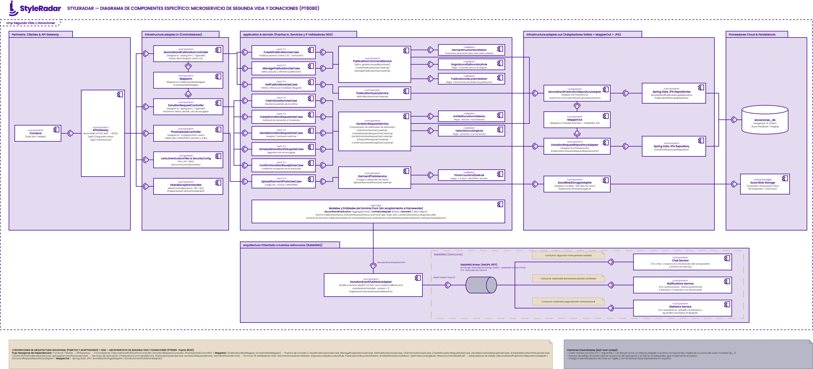
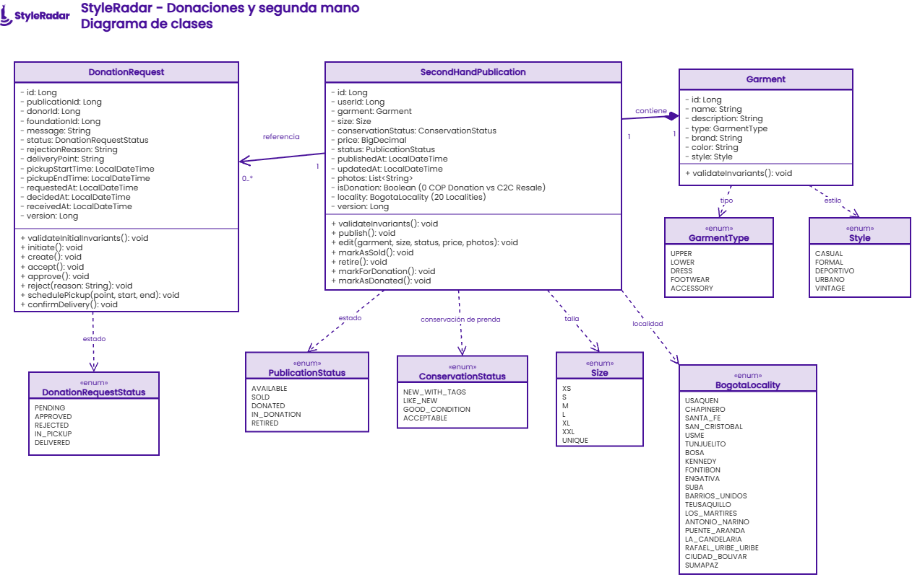
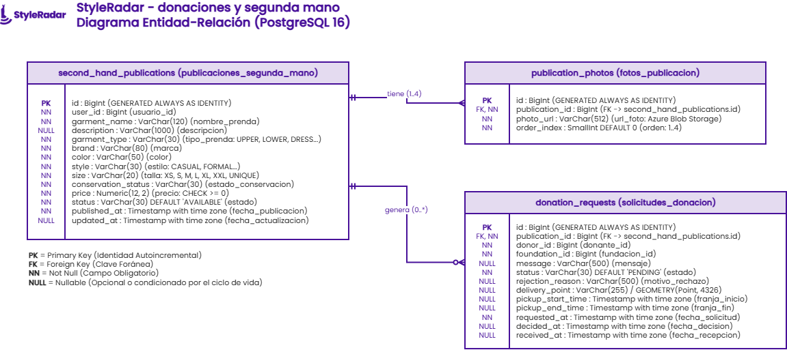

<!-- ==============================================================================
  STYLE RADAR · PLANTILLA MAESTRA DE README PARA MICROSERVICIOS
  Asignatura: DOSW (Diseño y Operación de Soluciones Web) · 2026
  Estándar obligatorio unificado para los 13 microservicios del proyecto StyleRadar.
  Microservicio: PT8080-Donations-Service (ms-segunda-vida-donaciones)
  Squad Asignado: Portal8080 (PT8080)
============================================================================== -->

<div align="center">

  <a href="https://github.com/StyleRadar1">
    
  </a>

  <h1>STYLE<font color="#5600EF">RADAR</font> &nbsp;·&nbsp; <code>ms-segunda-vida-donaciones</code></h1>

  <p align="center">
    
    
    
    
  </p>

  <p align="center">
    <strong><font color="#5600EF">Descubre tu estilo. En tu ciudad.</font></strong><br />
    <em>Plataforma de moda local con inventario multi-sede geolocalizado en tiempo real, economía circular textil, vitrina benéfica y donaciones a fundaciones para Bogotá D.C.</em>
  </p>
  <p align="center">
    <a href="#4-endpoints-y-enlace-a-swagger"></a>
    <a href="#4-endpoints-y-enlace-a-swagger"></a>
    <a href="#4-endpoints-y-enlace-a-swagger"></a>
    <a href="https://github.com/StyleRadar1/PT8080-Donations-Service/actions"></a>
    <a href="https://github.com/StyleRadar1/PT8080-Donations-Service/actions"></a>
    <a href="#9-pruebas-y-cobertura"></a>
    <a href="#9-pruebas-y-cobertura"></a>
  </p>

  <p align="center">
    <a href="#6-tecnologías-y-dependencias">
      
    </a>
    <a href="#6-tecnologías-y-dependencias">
      
    </a>
    <a href="#6-tecnologías-y-dependencias">
      
    </a>
    <a href="#6-tecnologías-y-dependencias">
      
    </a>
    <a href="#6-tecnologías-y-dependencias">
      
    </a>
  </p>

</div>

---

##  ÍNDICE DE CONTENIDOS

1. [Nombre del servicio y su bounded context](#1-nombre-del-servicio-y-su-bounded-context)
2. [Equipo y responsables](#2-equipo-y-responsables)
3. [Arquitectura hexagonal con sus diagramas](#3-arquitectura-hexagonal-con-sus-diagramas)
   - [3.1 Diagrama de Componentes Hexagonal](#31-diagrama-de-componentes-hexagonal)
   - [3.2 Diagrama de Clases del Dominio y Puertos](#32-diagrama-de-clases-del-dominio-y-puertos)
   - [3.3 Diagrama Entidad-Relación de Base de Datos](#33-diagrama-entidad-relación-de-base-de-datos)
   - [3.4 Estructura Oficial de Paquetes](#34-estructura-oficial-de-paquetes)
4. [Endpoints y enlace a Swagger](#4-endpoints-y-enlace-a-swagger)
5. [Eventos que publica y consume (RabbitMQ)](#5-eventos-que-publica-y-consume)
6. [Tecnologías y dependencias](#6-tecnologías-y-dependencias)
7. [Cómo ejecutar local y con Docker](#7-cómo-ejecutar-local-y-con-docker)
8. [Variables de entorno](#8-variables-de-entorno)
9. [Pruebas y cobertura](#9-pruebas-y-cobertura)
10. [CI/CD con el badge del pipeline](#10-cicd-con-el-badge-del-pipeline)
11. [Ramas y cómo contribuir](#11-ramas-y-cómo-contribuir)
12. [Enlace a la épica en Jira y requerimientos](#12-enlace-a-la-épica-en-jira)

---

<a id="1-nombre-del-servicio-y-su-bounded-context"></a>

## 1. NOMBRE DEL SERVICIO Y SU BOUNDED CONTEXT

* **Identificador de Servicio:** `PT8080-Donations-Service` (`ms-segunda-vida-donaciones`)
* **Paquete Arquitectónico:** Paquete 5: Probador virtual + Donaciones + API Gateway
* **Puerto de Escucha Oficial:** `8520` (context-path: `/api/v1`)
* **Base de Datos Asignada:** `PostgreSQL 16` (`styleradar_donations_qa` en QA / `styleradar_donations_prod` en PROD), aisladas en Azure Flexible Server bajo el patrón *Database-per-Service*.
* **Almacenamiento de Fotografías:** `Azure Blob Storage` (Cuenta `srdonacionesjmunar`, contenedor público `donaciones-fotos` en `rg-styleradar`).
* **Broker de Mensajería:** `RabbitMQ 3.12` mediante Topic Exchanges `styleradar.exchange` y `styleradar.events` con *Publisher Confirms* y *Correlation ID*.
* **Bounded Context:** `Segunda Vida y Donaciones` (Economía Circular Textil C2C y Sostenibilidad Social en Bogotá D.C.)

### Responsabilidades del Dominio

Este microservicio encapsula exclusivamente la lógica de negocio de economía circular textil para **Bogotá D.C.** dividida en dos ejes:
1. **Compraventa C2C de prendas de segunda mano (`esDonacion = false`, precio > 0 COP):** Publicación con fotografías en Azure Blob Storage, filtros por las 20 localidades de Bogotá, integración con `ms-chat` para acordar venta, y transición a `SOLD` mediante evento RabbitMQ `segunda-mano.prenda.vendida` con `compradorId` obligatorio.
2. **Vitrina Benéfica y Donaciones (`esDonacion = true`, precio 0 COP):** Publicación en Vitrina Abierta con reclamo directo por fundaciones aliadas, control de concurrencia optimista (`@Version`), prevención de auto-donación, coordinación de franjas horarias de entrega en Bogotá y confirmación física con evento `styleradar.donaciones.estado.cambiado`.

| Qué HACE este Microservicio (Alcance) | Qué NO HACE este Microservicio (Límites) |
| :--- | :--- |
| • Gestiona el catálogo circular C2C: publicación con fotos en Azure Blob Storage, tipo, marca, color, estilo, talla, estado de conservación (`ConservationStatus`), precio en COP, edición, venta y retiro voluntario (`SR-RF-33` a `39`). | • NO autentica usuarios ni emite identidades productivas (delegado a `ms-auth` en `:8081`; valida tokens JWT Bearer de forma stateless). |
| • Gestiona la Vitrina Abierta y solicitudes de donación: reclamo concurrente por fundaciones (`@Version`), selección de fundación, aprobación/rechazo, franjas de entrega en Bogotá y confirmación física (`SR-RF-42`, `44` a `49`). | • NO procesa pasarelas de pago monetarias de tiendas comerciales (delegado a `ms-pagos` en `:8090`). |
| • Carga y sirve fotografías de prendas binarias directamente a **Azure Blob Storage** (`donaciones-fotos`) generando URLs públicas de CDN permanentes con fallback resiliente a almacenamiento local. | • NO envía correos ni notificaciones push directas al usuario final (delegado a `ms-notificaciones` en `:8300` vía eventos RabbitMQ). |
| • Aplica control de acceso basado en roles (`USER`, `STORE`, `FOUNDATION`, `ADMIN`) y validación estricta de propiedad (`ResourceOwnershipValidator`) contra ataques IDOR/BOLA (`SR-RNF-04`). | • NO gestiona salas de chat en tiempo real entre compradores y vendedores (delegado a `ms-chat` en `:8200`). |
| • Emite eventos AMQP trazables con `version = 1` y UUID de correlación hacia el bus `styleradar.exchange` y `styleradar.events` con confirmación del broker. | • NO accede directamente a bases de datos de otros microservicios bajo el principio *Database-per-Service*. |

---

<a id="2-equipo-y-responsables"></a>

## 2. EQUIPO Y RESPONSABLES

Desarrollado y mantenido por el **Squad Portal 8080 (`PT8080`)** para la asignatura DOSW 2026:

<div align="center">

| Rol | Nombre Completo |
| :---: | :---: |
| **Líder de Equipo (Scrum Master)** | Daniel Valero Quiroga |
| **Desarrollador Backend (`ms-segunda-vida-donaciones`)** | Juan David Munar |
| **Desarrollador Backend** | Jose Alejandro Martinez Arias |
| **Desarrollador Frontend** | Kevin Ángel |

</div>

---

<a id="3-arquitectura-hexagonal-con-sus-diagramas"></a>

## 3. ARQUITECTURA HEXAGONAL CON SUS DIAGRAMAS

El microservicio implementa **Arquitectura Hexagonal Estricta (Puertos y Adaptadores)** combinada con principios tácticos de **Domain-Driven Design (DDD)**. El núcleo de dominio es 100% puro en Java 21, desacoplado de frameworks web, motores de persistencia o brokers de mensajería. Todos los casos de uso cumplen la convención oficial: **Interfaz de Puerto de Entrada (`domain.port.in.*UseCase`) + Implementación de Aplicación (`application.usecase.*UseCaseImpl`)**.

---

<a id="31-diagrama-de-componentes-hexagonal"></a>

### 3.1 Diagrama de Componentes Hexagonal (`ms-segunda-vida-donaciones`)

Diseñado siguiendo el formato y paleta visual oficial de **StyleRadar** (`#48119A`, `#E4DBF0`), notación **Lollipop (`-(o-`)** para interfaces provistas/requeridas, y representación de bus asíncrono RabbitMQ en tubería 3D:

<div align="center">
  
  <p><sub><b>Figura 3.1:</b> Diagrama de Componentes Hexagonal de <code>ms-segunda-vida-donaciones</code> (PT8080 · Puerto 8520). Detalla adaptadores de entrada REST, puertos de entrada/salida, lógica de dominio con validadores de invariantes, adaptadores JPA, Azure Blob Storage Adapter, y bus asíncrono RabbitMQ con microservicios suscriptores (<code>ms-chat</code>, <code>ms-notificaciones</code>, <code>ms-auditoria-analitica</code>).</sub></p>
  <p>
    📁 <b>Archivo editable Draw.io:</b> <a href="docs/diagramas/drawio/diagrama_componentes_segunda_vida_donaciones.drawio"><code>docs/diagramas/drawio/diagrama_componentes_segunda_vida_donaciones.drawio</code></a>
  </p>
</div>

#### Capas y Flujos Arquitectónicos Representados:
1. **Clientes HTTP & API Gateway:** Peticiones authenticated con JWT Bearer redirigidas a través de `APIGateway` (`:8080`) hacia los controladores REST en `:8520`.
2. **Adaptadores de Entrada (Driving Adapters):**
   - `SecondHandPublicationController`: Catálogo unificado C2C y vitrina benéfica en Bogotá D.C.
   - `DonationRequestController`: Reclamo de vitrina, radicación y coordinación logística de donaciones.
   - `PhotoUploadController`: Endpoint de subida binaria `multipart/form-data` para fotografías de prendas.
   - `AuthController` & `HealthController`: Endpoints demo para Swagger UI y diagnóstico de salud.
   - `GlobalExceptionHandler` & `SecurityConfig`: Manejo centralizado de errores RFC 7807 y filtro JWT.
3. **Casos de Uso & Dominio (Application & Core):**
   - Puertos de Entrada: `CreatePublicationUseCase`, `GetPublicationsUseCase`, `ManagePublicationUseCase`, `CreateDonationRequestUseCase`, `ClaimDonationUseCase`, `DecideDonationRequestUseCase`, `ScheduleDonationPickupUseCase`, `ConfirmDonationReceiptUseCase`, `UploadGarmentPhotoUseCase`.
   - Validadores de Invariantes: `BogotaLocalityValidator` (20 localidades de Bogotá D.C.), `GarmentPriceValidator` (0 COP donación / >0 COP venta), `GarmentImagePolicyValidator` (formatos JPEG/PNG/WEBP, máx 5MB), `DonationInvariantsValidator` (anti-auto-donación).
4. **Adaptadores de Salida (Driven Adapters):**
   - `PublicationPersistenceAdapter` & `DonationRequestPersistenceAdapter`: Persistencia relacional con Spring Data JPA y `PublicationSpecifications`.
   - `AzureBlobStorageAdapter`: Subida binaria de imágenes al contenedor `donaciones-fotos` en Azure Blob Storage vía SDK oficial `com.azure:azure-storage-blob` con fallback local resiliente.
   - `DonationEventPublisherAdapter` / `RabbitMQEventPublisherAdapter`: Publicación AMQP con *Publisher Confirms*.
5. **Proveedores Cloud & Mensajería Asíncrona:**
   - Base de Datos: PostgreSQL 16 (`styleradar_donations_*` en Azure Flexible Server).
   - Cloud Storage: Azure Blob Storage (`srdonacionesjmunar` en `rg-styleradar`).
   - Broker AMQP: Tubería RabbitMQ con exchanges `styleradar.exchange` y `styleradar.events`, enrutando hacia `ms-chat`, `ms-notificaciones` y `ms-auditoria-analitica`.

---

<a id="32-diagrama-de-clases-del-dominio-y-puertos"></a>

### 3.2 Diagrama de Clases del Modelo de Dominio y Puertos

Diseñado 100% en inglés técnico alineado estrictamente con el código fuente en Java 21:

<div align="center">
  
  <p><sub><b>Figura 3.2:</b> Diagrama de Clases del dominio de <code>ms-segunda-vida-donaciones</code>. Modela entidades agregadas (<code>SecondHandPublication</code>, <code>DonationRequest</code>), value objects inmutables (<code>Garment</code>), puertos de entrada/salida, casos de uso y enums de dominio (<code>BogotaLocality</code>, <code>ConservationStatus</code>, <code>GarmentType</code>, <code>PublicationStatus</code>, <code>DonationRequestStatus</code>).</sub></p>
  <p>
    📁 <b>Archivo editable Draw.io:</b> <a href="docs/diagramas/drawio/diagrama_clases_sprint3.drawio"><code>docs/diagramas/drawio/diagrama_clases_sprint3.drawio</code></a>
  </p>
</div>

#### Componentes del Modelo de Dominio:
* **Entidad Raíz de Agregado `SecondHandPublication`:**
  - Atributos: `id: Long`, `userId: Long`, `garment: Garment`, `size: Size`, `conservationStatus: ConservationStatus`, `price: BigDecimal`, `isDonation: Boolean`, `locality: BogotaLocality`, `version: Long (@Version)`, `status: PublicationStatus`, `publishedAt: LocalDateTime`, `updatedAt: LocalDateTime`, `photos: List<String>`.
  - Invariantes y Métodos de Negocio: `validateInvariants()`, `markAsSold(buyerId)`, `markForDonation()`, `retire()`, `markAsDonated()`, `edit(...)`.
* **Value Object Inmutable `Garment`:**
  - Encapsula: `type: GarmentType`, `brand: String`, `color: String`, `style: Style`, `description: String`.
* **Entidad Raíz de Agregado `DonationRequest`:**
  - Atributos: `id: Long`, `publicationId: Long`, `donorId: Long`, `foundationId: Long`, `message: String`, `status: DonationRequestStatus`, `rejectionReason: String`, `deliveryPoint: String`, `slotStart: LocalDateTime`, `slotEnd: LocalDateTime`, `version: Long (@Version)`, `requestDate: LocalDateTime`, `decisionDate: LocalDateTime`, `receptionDate: LocalDateTime`.
  - Métodos de Negocio: `approve()`, `reject(reason)`, `schedulePickup(point, start, end)`, `confirmReceipt()`.
* **Enumeraciones de Dominio:**
  - `BogotaLocality`: Las 20 localidades oficiales del Distrito Capital (`USAQUEN`, `CHAPINERO`, `SANTA_FE`, `SAN_CRISTOBAL`, `USME`, `TUNJUELITO`, `BOSA`, `KENNEDY`, `FONTIBON`, `ENGATIVA`, `SUBA`, `BARRIOS_UNIDOS`, `TEUSAQUILLO`, `LOS_MARTIRES`, `ANTONIO_NARINO`, `PUENTE_ARANDA`, `LA_CANDELARIA`, `RAFAEL_URIBE_URIBE`, `CIUDAD_BOLIVAR`, `SUMAPAZ`).
  - `ConservationStatus`: `NEW_WITH_TAGS`, `LIKE_NEW`, `GOOD`, `ACCEPTABLE`.
  - `GarmentType`: `UPPER`, `LOWER`, `DRESS`, `FOOTWEAR`, `ACCESSORY`.
  - `PublicationStatus`: `AVAILABLE`, `SOLD`, `DONATED`, `IN_DONATION`, `RETIRED`.
  - `DonationRequestStatus`: `PENDING`, `APPROVED`, `REJECTED`, `IN_PICKUP`, `DELIVERED`.

---

<a id="33-diagrama-entidad-relación-de-base-de-datos"></a>

### 3.3 Diagrama Entidad-Relación de Base de Datos (PostgreSQL 16)

<div align="center">
  
  <p><sub><b>Figura 3.3:</b> Modelo físico relacional en PostgreSQL 16 desplegado en Azure Flexible Server con bloqueo optimista (<code>version</code>), discriminador de donación (<code>es_donacion</code>) y restricción territorial en Bogotá (<code>localidad</code>).</sub></p>
  <p>
    📁 <b>Archivo editable Draw.io:</b> <a href="docs/diagramas/drawio/diagrama_er_sprint3.drawio"><code>docs/diagramas/drawio/diagrama_er_sprint3.drawio</code></a>
  </p>
</div>

#### Tablas del Microservicio:
1. **`publicaciones_segunda_mano`:** Almacena prendas unificadas de C2C y donación.
   - Columnas: `id BIGINT PK`, `usuario_id BIGINT NOT NULL`, `nombre_prenda VARCHAR(120) NOT NULL`, `descripcion VARCHAR(500)`, `tipo_prenda VARCHAR(30) NOT NULL`, `marca VARCHAR(60)`, `color VARCHAR(30) NOT NULL`, `estilo VARCHAR(30)`, `talla VARCHAR(20) NOT NULL`, `estado_conservacion VARCHAR(30) NOT NULL`, `precio NUMERIC(12,2) NOT NULL`, `es_donacion BOOLEAN NOT NULL`, `localidad VARCHAR(50) NOT NULL`, `estado VARCHAR(30) NOT NULL`, `version BIGINT NOT NULL DEFAULT 0`, `fecha_publicacion TIMESTAMP NOT NULL`, `fecha_actualizacion TIMESTAMP NOT NULL`.
2. **`fotos_publicacion`:** Galería fotográfica de 1 a 4 fotos alojadas en Azure Blob Storage.
   - Columnas: `id BIGINT PK`, `publicacion_id BIGINT NOT NULL FK`, `url_foto VARCHAR(512) NOT NULL`, `orden INT NOT NULL`. Relación `ON DELETE CASCADE`.
3. **`solicitudes_donacion`:** Registro trazable del ciclo logístico benéfico hacia fundaciones aliadas.
   - Columnas: `id BIGINT PK`, `publicacion_id BIGINT NOT NULL FK`, `donante_id BIGINT NOT NULL`, `fundacion_id BIGINT NOT NULL`, `mensaje VARCHAR(500)`, `estado VARCHAR(30) NOT NULL`, `motivo_rechazo VARCHAR(500)`, `punto_entrega VARCHAR(255)`, `franja_inicio TIMESTAMP`, `franja_fin TIMESTAMP`, `version BIGINT NOT NULL DEFAULT 0`, `fecha_solicitud TIMESTAMP NOT NULL`, `fecha_decision TIMESTAMP`, `fecha_recepcion TIMESTAMP`.

---

<a id="34-estructura-oficial-de-paquetes"></a>

### 3.4 Estructura Oficial de Paquetes en `src/main/java/`

```text
src/main/java/edu/dosw/styleradar/donaciones/
├── DonationsServiceApplication.java             <-- Punto de entrada Spring Boot 3.3.4
├── domain/                                      <-- NÚCLEO DE DOMINIO PURO (Java estándar, 0 dependencias)
│   ├── model/                                   <-- SecondHandPublication, Garment, DonationRequest, SearchCriteria, Enums
│   ├── event/                                   <-- Eventos de dominio puros (PublicationCreatedEvent, etc.)
│   ├── exception/                               <-- DomainException, DomainConflictException, ResourceNotFoundException
│   └── port/
│       ├── in/                                  <-- 9 Interfaces *UseCase y Commands inmutables
│       └── out/                                 <-- PublicationRepositoryPort, DonationRequestRepositoryPort, PhotoStoragePort, EventPublisherPort
├── application/                                 <-- CAPA DE APLICACIÓN (Orquestación de Casos de Uso)
│   ├── usecase/                                 <-- 9 Clases *UseCaseImpl (@Service / @Transactional)
│   └── dto/                                     <-- Request DTOs, Response DTOs y Mappers de aplicación
└── infrastructure/                              <-- CAPA DE INFRAESTRUCTURA (Tecnologías y Frameworks)
    ├── adapter/
    │   ├── in/
    │   │   ├── rest/                            <-- SecondHandPublicationController, DonationRequestController, PhotoUploadController, AuthController, HealthController
    │   │   └── messaging/                       <-- NotificationConsumerSimulator (Consumidor de prueba E2E)
    │   └── out/
    │       ├── persistence/                     <-- PublicationPersistenceAdapter, DonationRequestPersistenceAdapter, JPA Repositories
    │       ├── storage/                         <-- AzureBlobStorageAdapter (Azure Blob Storage SDK con fallback local)
    │       └── messaging/                       <-- DonationEventPublisherAdapter, RabbitMQEventPublisherAdapter
    ├── security/                                <-- SecurityConfig, JwtAuthenticationFilter, JwtTokenProvider, ResourceOwnershipValidator
    └── config/                                  <-- OpenApiConfig, RabbitMQConfig, FlywayConfig
```

---

<a id="4-endpoints-y-enlace-a-swagger"></a>

## 4. ENDPOINTS Y ENLACE A SWAGGER

El microservicio se encuentra desplegado y activo en **Microsoft Azure** dentro del Resource Group dedicado **`rg-styleradar`** (`Canada Central` / `East US 2`).

### 4.1 Matriz Oficial de Enlaces por Entorno (PROD, QA, LOCAL)

| Entorno | Estado | Propósito | URL Base del Servicio | Swagger OpenAPI UI | Health Check (`/health`) |
| :--- | :---: | :--- | :--- | :--- | :--- |
| **Producción (`PROD`)** | 🟢 **Active** | Entorno productivo en Azure Cloud con perfil endurecido | `https://styleradar-donaciones-prod-jmunar.azurewebsites.net` | [Swagger UI PROD](https://styleradar-donaciones-prod-jmunar.azurewebsites.net/api/v1/swagger-ui/index.html) | [`/api/v1/health`](https://styleradar-donaciones-prod-jmunar.azurewebsites.net/api/v1/health) |
| **Calidad (`QA`)** | 🟢 **Active** | Entorno de pruebas integradas y staging en Azure Cloud | `https://styleradar-donaciones-qa-jmunar.azurewebsites.net` | [Swagger UI QA](https://styleradar-donaciones-qa-jmunar.azurewebsites.net/api/v1/swagger-ui/index.html) | [`/api/v1/health`](https://styleradar-donaciones-qa-jmunar.azurewebsites.net/api/v1/health) |
| **Desarrollo Local (`DEV`)** | 🟢 **Active** | Entorno local de desarrollo (H2 o Docker Compose) | `http://localhost:8520` | [Swagger UI Local](http://localhost:8520/api/v1/swagger-ui.html) | [`/api/v1/health`](http://localhost:8520/api/v1/health) |

* **Especificación OpenAPI (JSON Contrato):** [`/api/v1/v3/api-docs`](https://styleradar-donaciones-qa-jmunar.azurewebsites.net/api/v1/v3/api-docs)

### 4.2 Tabla Canónica de Endpoints REST Expuestos

Todos los endpoints responden bajo el estándar **RFC 7807 (`application/problem+json`)** para códigos de error con esquemas y ejemplos detallados en Swagger UI:

| Tag Swagger | Método | Endpoint Canónico | RF Asociado | Descripción | Rol Requerido | Códigos HTTP |
| :--- | :---: | :--- | :---: | :--- | :--- | :---: |
| **Diagnóstico** | `GET` | `/api/v1/health` | Diagnóstico | Estado UP, versión, puerto y hash de commit | Público | `200` |
| **Autenticación Demo** | `POST` | `/api/v1/auth/login` | Seguridad | Iniciar sesión por email y password en Swagger | dev/test/qa | `200`, `400`, `500` |
| **Autenticación Demo** | `GET` | `/api/v1/auth/quick-token` | Seguridad | Generar token JWT rápido por rol (`USER`, `FOUNDATION`, `ADMIN`) | dev/test/qa | `200`, `400`, `500` |
| **Autenticación Demo** | `GET` | `/api/v1/auth/demo-users` | Seguridad | Catálogo de identidades demo precargadas | dev/test/qa | `200`, `500` |
| **Carga de Fotos** | `POST` | `/api/v1/segunda-mano/fotos/upload` | Azure Storage | Subir imagen (JPEG/PNG/WEBP, máx 5MB) a Azure Blob Storage | `USER`, `STORE`, `FOUNDATION`, `ADMIN` | `201`, `400`, `401`, `403`, `500` |
| **Economía Circular** | `POST` | `/api/v1/segunda-mano` | `SR-RF-33..35` | Publicar prenda para reventa C2C (>0 COP) o donación (0 COP) | `USER`, `STORE`, `FOUNDATION`, `ADMIN` | `201`, `400`, `401`, `403`, `500` |
| **Economía Circular** | `GET` | `/api/v1/segunda-mano` | `SR-RF-36` | Buscar y filtrar prendas por localidad de Bogotá, precio, estado | Público | `200`, `400`, `500` |
| **Economía Circular** | `GET` | `/api/v1/segunda-mano/{id}` | `SR-RF-36` | Consultar detalle de publicación por ID | Público | `200`, `404`, `500` |
| **Economía Circular** | `GET` | `/api/v1/segunda-mano/user/{userId}` | `SR-RF-33` | Listar publicaciones del usuario autenticado | Propietario, `ADMIN` | `200`, `401`, `403`, `500` |
| **Economía Circular** | `PUT` | `/api/v1/segunda-mano/{id}` | `SR-RF-37` | Editar prenda (precio, fotos, talla) en estado `AVAILABLE` | Propietario, `ADMIN` | `200`, `400`, `401`, `403`, `404`, `409`, `500` |
| **Economía Circular** | `PATCH` | `/api/v1/segunda-mano/{id}/sell` | `SR-RF-38` | Marcar como vendida (`SOLD`), exigiendo `compradorId` para `ms-chat` | Propietario, `ADMIN` | `200`, `400`, `401`, `403`, `404`, `409`, `500` |
| **Economía Circular** | `PATCH` | `/api/v1/segunda-mano/{id}/retire` | `SR-RF-39` | Retirar publicación activa de la vitrina | Propietario, `ADMIN` | `204`, `401`, `403`, `404`, `409`, `500` |
| **Economía Circular** | `PATCH` | `/api/v1/segunda-mano/{id}/donate` | `SR-RF-42` | Marcar prenda para canal benéfico (`IN_DONATION`) | Propietario, `ADMIN` | `200`, `401`, `403`, `404`, `409`, `500` |
| **Vitrina Benéfica** | `POST` | `/api/v1/donaciones/claim` | `SR-RF-44` | Reclamar donación desde Vitrina Abierta con bloqueo optimista | `FOUNDATION`, `ADMIN` | `201`, `400`, `401`, `403`, `404`, `409`, `500` |
| **Vitrina Benéfica** | `POST` | `/api/v1/donaciones` | `SR-RF-45` | Radicar solicitud directa de donación dirigida a una fundación | `USER`, `STORE`, `FOUNDATION`, `ADMIN` | `201`, `400`, `401`, `403`, `404`, `409`, `500` |
| **Vitrina Benéfica** | `GET` | `/api/v1/donaciones/{id}` | `SR-RF-46` | Consultar estado y cita logística de una solicitud | Donante, Fundación, `ADMIN` | `200`, `404`, `500` |
| **Vitrina Benéfica** | `GET` | `/api/v1/donaciones/donor/{donorId}` | `SR-RF-46` | Historial de solicitudes originadas por el donante | Donante propietario, `ADMIN` | `200`, `401`, `403`, `500` |
| **Vitrina Benéfica** | `GET` | `/api/v1/donaciones/foundation/{foundationId}` | `SR-RF-46` | Bandeja de solicitudes recibidas por la fundación | Fundación receptora, `ADMIN` | `200`, `401`, `403`, `500` |
| **Vitrina Benéfica** | `PATCH` | `/api/v1/donaciones/{id}/decide` | `SR-RF-47` | Aceptar (`APPROVED`) o rechazar (`REJECTED`) solicitud | Fundación receptora, `ADMIN` | `200`, `400`, `401`, `403`, `404`, `409`, `500` |
| **Vitrina Benéfica** | `PATCH` | `/api/v1/donaciones/{id}/pickup` | `SR-RF-48` | Agendar franja horaria y punto de entrega en Bogotá | Donante, Fundación, `ADMIN` | `200`, `400`, `401`, `403`, `404`, `409`, `500` |
| **Vitrina Benéfica** | `PATCH` | `/api/v1/donaciones/{id}/confirm` | `SR-RF-49` | Confirmar recepción física de la prenda (`DELIVERED`) | Fundación receptora, `ADMIN` | `200`, `401`, `403`, `404`, `409`, `500` |

---

<a id="5-eventos-que-publica-y-consume"></a>

## 5. EVENTOS QUE PUBLICA Y CONSUME (RABBITMQ)

La integración asíncrona se realiza a través de **RabbitMQ 3.12** utilizando Topic Exchanges compartidos en StyleRadar:

* **Exchange General:** `styleradar.exchange` (`topic`, durable)
* **Exchange de Eventos de Chat:** `styleradar.events` (`topic`, durable)
* **Dead Letter Exchange (DLX):** `styleradar.dlx` con cola `styleradar.donaciones.dlq`
* **Garantías de Entrega:** *Publisher Confirms* (`correlated`), *Publisher Returns* y trazabilidad con `version = 1` y `correlationId` UUID.

### Matriz de Eventos AMQP Integrados

| Tipo | Exchange | Routing Key | Emisor ➔ Receptor | Payload y Propósito de Integración |
| :---: | :--- | :--- | :--- | :--- |
| **PUBLICA** | `styleradar.events` | `segunda-mano.prenda.vendida` | `ms-segunda-vida-donaciones` ➔ `ms-chat` | `{ "version": 1, "correlationId": "...", "publicacionId": 10, "vendedorId": 101, "compradorId": 102, "precio": 75000.00, "timestamp": "..." }`<br>Permite a `ms-chat` conservar abierta la conversación del comprador y cerrar las demás conversaciones asociadas a la prenda. |
| **PUBLICA** | `styleradar.exchange` | `styleradar.donaciones.estado.cambiado` | `ms-segunda-vida-donaciones` ➔ `ms-notificaciones` | `{ "version": 1, "correlationId": "...", "solicitudId": 1, "donanteId": 101, "fundacionId": 501, "nuevoEstado": "APPROVED", ... }`<br>Dispara alertas push/email al donante y a la fundación ante cambios de estado en el ciclo benéfico. |
| **CONSUME** | `styleradar.exchange` | `styleradar.donaciones.estado.cambiado` | `styleradar.exchange` ➔ `NotificationConsumerSimulator` | Consumidor de prueba E2E aislable mediante `RABBITMQ_SIMULATOR_ENABLED=true` para verificar la emisión local sin depender de servicios externos. |

---

<a id="6-tecnologías-y-dependencias"></a>

## 6. TECNOLOGÍAS Y DEPENDENCIAS

El stack tecnológico de `PT8080-Donations-Service` cumple con el estándar unificado de DOSW 2026:

| Capa / Componente | Tecnología | Versión | Justificación Técnica |
| :--- | :--- | :--- | :--- |
| **Lenguaje Core** | Java LTS (Eclipse Temurin) | `21` | Virtual Threads, Records inmutables y Pattern Matching. |
| **Framework Base** | Spring Boot | `3.3.4` | Soporte nativo para WebMVC, Data JPA, Security, AMQP y Actuator. |
| **Cloud Storage** | Azure Blob Storage SDK | `12.28.0` | `com.azure:azure-storage-blob` para almacenamiento de fotos en nube con fallback local. |
| **Seguridad y Tokens** | Spring Security + JJWT | `6.3.x` / `0.13.0` | Validación stateless de JWT con firma HMAC-SHA256 (`HS256`) y claim `exp`. |
| **Base de Datos** | PostgreSQL | `16` | Integridad ACID, bloqueo optimista (`@Version`) y aislamiento *Database-per-Service*. |
| **Control de Esquema** | Flyway Core | `10.10.0` | Migraciones reproducibles (`V1__init_schema.sql`, `V2__align_domain_and_tables.sql`). |
| **Broker de Mensajería** | RabbitMQ (Spring AMQP) | `3.12` | Topic Exchanges durables con confirmaciones de publicación (*Publisher Confirms*). |
| **Mapeo y Boilerplate** | MapStruct + Lombok | `1.5.5` / `1.18.38` | Reducción de código repetitivo compatible con JDK 21. |
| **Documentación API** | SpringDoc OpenAPI | `2.5.0` | Especificación OpenAPI 3.0 con Swagger UI, esquemas RFC 7807 y ejemplos interactivos. |
| **Testing Automatizado** | JUnit 5 + Mockito + H2 | `5.10.3` | **197 pruebas automatizadas** (unitarias, integración, storage y seguridad RBAC). |
| **Métricas de Cobertura** | JaCoCo Maven Plugin | `0.8.12` | Verificación estricta de cobertura mínima (≥ 85%) alcanzando el 99.37%. |

---

<a id="7-cómo-ejecutar-local-y-con-docker"></a>

## 7. CÓMO EJECUTAR LOCAL Y CON DOCKER

### Prerrequisitos de Entorno

* **Java Development Kit (JDK):** Versión 21 LTS instalada (`java -version`).
* **Apache Maven:** Versión 3.9+ instalada (`mvn -version`).
* **Docker Engine & Docker Compose (Opcional):** Versión 24+ en ejecución (`docker --version`).

### Opción 1: Ejecución Instantánea Local con Perfil H2 (Sin dependencias externas)

No requiere levantar Docker ni bases de datos locales:

```powershell
mvn spring-boot:run "-Dspring-boot.run.profiles=local"
```

* **Swagger UI:** [http://localhost:8520/api/v1/swagger-ui.html](http://localhost:8520/api/v1/swagger-ui.html)
* **Health Check:** [http://localhost:8520/api/v1/health](http://localhost:8520/api/v1/health)

### Opción 2: Ejecución Contenerizada con Docker Compose (PostgreSQL 16 + RabbitMQ)

```bash
# 1. Clonar el repositorio
git clone https://github.com/StyleRadar1/PT8080-Donations-Service.git
cd PT8080-Donations-Service

# 2. Levantar la suite completa
docker compose up -d --build

# 3. Verificar estado saludable
docker compose ps
```

---

<a id="8-variables-de-entorno"></a>

## 8. VARIABLES DE ENTORNO

Todas las configuraciones se gestionan de forma desacoplada conforme a los principios de **Twelve-Factor App**:

| Variable | Descripción | Valor por Defecto (`dev`/`local`) | Requerido en Prod |
| :--- | :--- | :--- | :---: |
| `SERVER_PORT` / `PORT` | Puerto HTTP de escucha | `8520` | Sí |
| `SPRING_PROFILES_ACTIVE` | Perfil activo (`local`, `dev`, `qa`, `prod`, `test`) | `dev` | Sí |
| `DB_HOST` | Hostname de PostgreSQL | `localhost` | Sí |
| `DB_PORT` | Puerto de PostgreSQL | `5434` (`5432` en Azure) | Sí |
| `DB_NAME` | Nombre de la base de datos | `styleradar_donations` | Sí |
| `DB_USER` | Usuario de base de datos | `styleradar_user` | Sí |
| `DB_PASSWORD` | Contraseña de base de datos | `<configured_in_env>` | Sí |
| `DB_SSLMODE` | Modo SSL JDBC para Azure | `disable` (`require` en Cloud) | Sí |
| `AZURE_STORAGE_CONNECTION_STRING` | Connection String de Azure Blob Storage | *(vacío activa fallback local)* | Opcional |
| `AZURE_STORAGE_CONTAINER_NAME` | Contenedor público de blobs | `donaciones-fotos` | Sí |
| `AZURE_STORAGE_BLOB_ENDPOINT` | URL base del storage account | `https://srdonacionesjmunar.blob.core.windows.net` | Sí |
| `RABBITMQ_HOST` | Hostname del broker RabbitMQ | `localhost` | Sí |
| `RABBITMQ_PORT` | Puerto AMQP (`5672` local / `5671` TLS nube) | `5672` | Sí |
| `RABBITMQ_USERNAME` | Usuario de conexión RabbitMQ | `guest` | Sí |
| `RABBITMQ_PASSWORD` | Contraseña de conexión RabbitMQ | `guest` | Sí |
| `RABBITMQ_EXCHANGE` | Exchange compartido de eventos | `styleradar.exchange` | Sí |
| `RABBITMQ_CHAT_EXCHANGE` | Exchange para eventos hacia chat | `styleradar.events` | Sí |
| `SECURITY_JWT_SECRET` | Clave HMAC-SHA256 (mínimo 256 bits) | Clave local de desarrollo | Sí |

---

<a id="9-pruebas-y-cobertura"></a>

## 9. PRUEBAS Y COBERTURA (≥ 85%)

El proyecto exige una cobertura de código mínima del **85%** verificada automáticamente mediante **JaCoCo** durante la fase `verify` de Maven.

### Resumen de Métricas de Pruebas y Cobertura (Sprint 3)

| Métrica | Valor Alcanzado | Umbral Exigido | Estado |
| :--- | :---: | :---: | :---: |
| **Pruebas Automatizadas Ejecutadas** | **197 tests** | Suite completa | ✅ **100% Passing (0 fallos, 0 errores)** |
| **Cobertura de Instrucciones (JaCoCo)** | **99.37%** | `≥ 85.00%` | ✅ **Aprobado (+14.37%)** |
| **Cobertura de Líneas (JaCoCo)** | **99.28%** | `≥ 85.00%` | ✅ **Aprobado (+14.28%)** |
| **Cobertura de Ramas / Branches (JaCoCo)** | **90.30%** | `≥ 85.00%` | ✅ **Aprobado (+5.30%)** |
| **Auditoría SonarQube** | **Quality Gate Passed (Rating A)** | 0 Bugs, 0 Vuln, 0 Smells | ✅ **Calificación A** |

### Pirámide de Pruebas Implementada

| Nivel de Prueba | Clases de Prueba Representativas | Alcance Verificado |
| :--- | :--- | :--- |
| **Dominio Puro (Unitarias)** | `SecondHandPublicationTest`, `DonationRequestTest`, `BogotaLocalityTest` | Entidades, máquinas de estados, invariantes de Bogotá y precio. |
| **Casos de Uso (Unitarias Mockito)** | `SecondHandUseCasesTest`, `DonationUseCasesTest`, `UploadGarmentPhotoUseCaseImplTest` | Los 9 casos de uso (`*UseCaseImpl`), orquestación, concurrencia y subida de imágenes. |
| **Controladores REST (`MockMvc`)** | `SecondHandPublicationControllerTest`, `DonationRequestControllerTest`, `PhotoUploadControllerTest`, `AuthControllerTest`, `HealthControllerTest` | Contratos HTTP, códigos 200/201/204 y RFC 7807 (`ProblemDetail`) para 400/401/403/404/409/500. |
| **Persistencia, Storage y Mensajería** | `SecondHandPublicationPersistenceAdapterTest`, `DonationRequestPersistenceAdapterTest`, `AzureBlobStorageAdapterTest`, `DonationEventPublisherAdapterTest` | Mapeo JPA, SDK Azure Blob Storage con fallback local, y confirmación en RabbitMQ. |
| **Seguridad e Integración RBAC** | `SecurityRbacIntegrationTest`, `JwtTokenProviderTest`, `ResourceOwnershipValidatorTest`, `DemoUserServiceTest` | Roles (`USER`, `STORE`, `FOUNDATION`, `ADMIN`), mitigación anti-IDOR y expiración JWT. |

---

<a id="10-cicd-con-el-badge-del-pipeline"></a>

## 10. CI/CD CON EL BADGE DEL PIPELINE

El ciclo de integración y despliegue continuo está automatizado en **GitHub Actions** mediante dos flujos separados (`.github/workflows/ci-qa.yml` para QA y `.github/workflows/cd-prod.yml` para Producción):

### Matriz de Pipelines por Rama Protegida

| Pipeline | Rama / Entorno | Trigger | Quality Gate Requerido | Estado |
| :--- | :---: | :---: | :--- | :---: |
| **CI - Develop** | `develop`<br>*(Staging QA)* | Push / PR | 197 Tests + JaCoCo ≥ 85% + Docker Build | [](https://github.com/StyleRadar1/PT8080-Donations-Service/actions) |
| **CI - Master** | `master` / `main`<br>*(Producción)* | Push / PR | 197 Tests + JaCoCo ≥ 85% + Docker Build | [](https://github.com/StyleRadar1/PT8080-Donations-Service/actions) |
| **CD - Despliegue QA** | Azure QA (`rg-styleradar`) | Push / Merge a `develop` | Deploy Web App + Smoke Test `/health` | [](https://styleradar-donaciones-qa-jmunar.azurewebsites.net/api/v1/swagger-ui/index.html) |
| **CD - Despliegue PROD** | Azure PROD (`rg-styleradar`) | Push / Merge a `master` (CMV) | Aprobación CMV + Smoke Test `/health` | [](https://styleradar-donaciones-prod-jmunar.azurewebsites.net/api/v1/swagger-ui/index.html) |


---

<a id="11-ramas-y-cómo-contribuir"></a>

## 11. RAMAS Y CÓMO CONTRIBUIR

El equipo adopta el modelo **GitFlow adaptado para microservicios**. Las ramas `master` y `develop` están protegidas y reciben cambios exclusivamente mediante Pull Requests:

```text
master / main                           <-- Producción (Azure PROD · Requiere CMV)
└── develop                             <-- Integración continua (Azure QA)
    ├── feature/nombre-ejemplo          <-- Agregar nuevas funcionalidades
    └── fix/nombre-ejemplo              <-- Arreglar bugs solamente
```

### Convención de Commits (*Conventional Commits*)

```text
<tipo>(<alcance>): <descripción imperativa en español> [#PT8080-XX]
```

### Checklist Obligatorio para Pull Requests

- [x] La rama parte de la versión más reciente de `develop`.
- [x] El código compila limpiamente sin advertencias críticas con `mvn clean compile`.
- [x] Todas las pruebas automatizadas pasan en verde (`mvn clean verify` con 197 tests).
- [x] La cobertura en JaCoCo supera el 85% obligatorio (alcanzado 99.37%).
- [x] Diagramas de arquitectura actualizados en `docs/diagramas/drawio` y `docs/diagramas/png`.
- [x] No se introducen credenciales ni secretos en el código (uso de variables de entorno).
- [x] El PR cuenta con la revisión y aprobación del líder técnico del squad.

---

<a id="12-enlace-a-la-épica-en-jira"></a>

## 12. ENLACE A LA ÉPICA EN JIRA

* **Repositorio Oficial en GitHub:** [https://github.com/StyleRadar1/PT8080-Donations-Service](https://github.com/StyleRadar1/PT8080-Donations-Service)
* **Épica Oficial del Microservicio (Jira):** [https://mail-team-nyjtgqcj.atlassian.net/browse/PT8080-2](https://mail-team-nyjtgqcj.atlassian.net/browse/PT8080-2)
* **Tablero Scrum del Squad Portal 8080 (Jira):** [https://mail-team-nyjtgqcj.atlassian.net/jira/software/projects/PT8080/boards/74](https://mail-team-nyjtgqcj.atlassian.net/jira/software/projects/PT8080/boards/74)
* **Contenedor OCI Oficial (Docker Hub):** [https://hub.docker.com/r/judamuch09/pt8080-donations-service-ms-segunda-vida-donaciones](https://hub.docker.com/r/judamuch09/pt8080-donations-service-ms-segunda-vida-donaciones)

### Matriz de los 14 Requerimientos Funcionales Implementados

| Código RF | Nombre del Requerimiento | Implementación en `ms-segunda-vida-donaciones` | Estado |
| :---: | :--- | :--- | :---: |
| `SR-RF-33` | Publicar prenda de segunda mano | `POST /api/v1/segunda-mano` (`CreatePublicationUseCaseImpl`): fotos en Azure Blob Storage y 20 localidades de Bogotá. | ✅ Completado |
| `SR-RF-34` | Clasificar estado de conservación | Escala enum `ConservationStatus` validada en creación y edición. | ✅ Completado |
| `SR-RF-35` | Establecer precio de prenda usada | Atributo `price` (`BigDecimal >= 0` en COP, 0 forzoso para donaciones). | ✅ Completado |
| `SR-RF-36` | Buscar prendas publicadas | `GET /api/v1/segunda-mano` (`GetPublicationsUseCaseImpl` + `PublicationSpecifications`). | ✅ Completado |
| `SR-RF-37` | Editar publicación de segunda mano | `PUT /api/v1/segunda-mano/{id}` (`ManagePublicationUseCaseImpl.edit`) restringido a `AVAILABLE`. | ✅ Completado |
| `SR-RF-38` | Marcar prenda como vendida | `PATCH /api/v1/segunda-mano/{id}/sell` (`ManagePublicationUseCaseImpl.markAsSold`), con `compradorId` obligatorio hacia `ms-chat`. | ✅ Completado |
| `SR-RF-39` | Retirar publicación de segunda mano | `PATCH /api/v1/segunda-mano/{id}/retire` (`ManagePublicationUseCaseImpl.retire`). | ✅ Completado |
| `SR-RF-42` | Marcar prenda para donación | `PATCH /api/v1/segunda-mano/{id}/donate` (`ManagePublicationUseCaseImpl.markForDonation`). | ✅ Completado |
| `SR-RF-44` | Vitrina Abierta y Selección de Fundación | `POST /api/v1/donaciones/claim` con control de concurrencia optimista (`@Version`). | ✅ Completado |
| `SR-RF-45` | Enviar solicitud de donación | `POST /api/v1/donaciones` (`CreateDonationRequestUseCaseImpl`) con evento en RabbitMQ. | ✅ Completado |
| `SR-RF-46` | Consultar solicitudes de donación | `GET /api/v1/donaciones/{id}`, `/donor/{donorId}` y `/foundation/{foundationId}`. | ✅ Completado |
| `SR-RF-47` | Aceptar o rechazar donación | `PATCH /api/v1/donaciones/{id}/decide` (`DecideDonationRequestUseCaseImpl`) con notas obligatorias. | ✅ Completado |
| `SR-RF-48` | Coordinar recogida de donación | `PATCH /api/v1/donaciones/{id}/pickup` (`ScheduleDonationPickupUseCaseImpl`). | ✅ Completado |
| `SR-RF-49` | Confirmar recepción de donación | `PATCH /api/v1/donaciones/{id}/confirm` (`ConfirmDonationReceiptUseCaseImpl`). | ✅ Completado |
