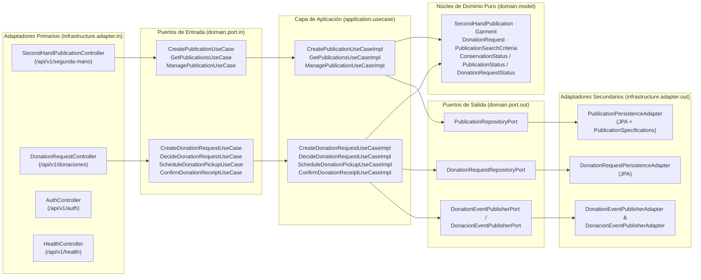

<!-- ==============================================================================
  STYLE RADAR 
  Asignatura: DOSW · 2026
  Estándar obligatorio unificado para los 13 microservicios del proyecto StyleRadar.
============================================================================== -->

<div align="center">

  <a href="https://github.com/StyleRadar1">
    
  </a>

  <h1>STYLE<font color="#5600EF">RADAR</font> &nbsp;·&nbsp; <code>ms-segunda-vida-donaciones</code></h1>

  <p align="center">
    
    
    
  </p>

  <p align="center">
    <strong><font color="#5600EF">Descubre tu estilo. En tu ciudad.</font></strong><br />
    <em>Plataforma de moda local con inventario multi-sede geolocalizado en tiempo real, economía circular y probador virtual para Bogotá.</em>
  </p>

  <p align="center">
    <a href="https://styleradar-donaciones-prod-jmunar.azurewebsites.net/api/v1/swagger-ui/index.html">
      
    </a>
    <a href="https://styleradar-donaciones-qa-jmunar.azurewebsites.net/api/v1/swagger-ui/index.html">
      
    </a>
    <a href="docs/seguridad/EVIDENCIA_SONARQUBE_QUALITY_GATE.md">
      
    </a>
    <a href="#9-pruebas-y-cobertura">
      
    </a>
    <a href="#6-tecnologías-y-dependencias">
      
    </a>
    <a href="#6-tecnologías-y-dependencias">
      
    </a>
    <a href="#7-cómo-ejecutar-local-y-con-docker">
      
    </a>
  </p>

</div>

---

##  ÍNDICE DE CONTENIDOS

1. [Nombre del servicio y su bounded context](#1-nombre-del-servicio-y-su-bounded-context)
2. [Equipo y responsables](#2-equipo-y-responsables)
3. [Arquitectura hexagonal con su diagrama](#3-arquitectura-hexagonal-con-su-diagrama)
4. [Endpoints y enlace a Swagger](#4-endpoints-y-enlace-a-swagger)
5. [Eventos que publica y consume](#5-eventos-que-publica-y-consume)
6. [Tecnologías y dependencias](#6-tecnologías-y-dependencias)
7. [Cómo ejecutar local y con Docker](#7-cómo-ejecutar-local-y-con-docker)
8. [Variables de entorno](#8-variables-de-entorno)
9. [Pruebas y cobertura](#9-pruebas-y-cobertura)
10. [CI/CD con el badge del pipeline](#10-cicd-con-el-badge-del-pipeline)
11. [Ramas y cómo contribuir](#11-ramas-y-cómo-contribuir)
12. [Enlace a la épica en Jira](#12-enlace-a-la-épica-en-jira)

---

<a id="1-nombre-del-servicio-y-su-bounded-context"></a>

##  1. NOMBRE DEL SERVICIO Y SU BOUNDED CONTEXT

* **Identificador de Servicio:** `ms-segunda-vida-donaciones`
* **Paquete Arquitectónico:** `Paquete 5: Probador virtual + Donaciones + API Gateway`
* **Puerto de Escucha Oficial:** `8520` (context-path: `/api/v1`)
* **Base de Datos Asignada:** `PostgreSQL 16` (`styleradar_donations_qa` en QA / `styleradar_donations_prod` en PROD), aisladas en Azure bajo el patrón *Database-per-Service*.
* **Bounded Context:** `Segunda Vida y Donaciones` (Economía Circular Textil y Sostenibilidad Social)

### Responsabilidades del Dominio

Este microservicio encapsula exclusivamente la lógica de negocio correspondiente a la economía circular de la plataforma StyleRadar, dividida en dos ejes: **compraventa C2C de ropa de segunda mano (`SR-RF-33` a `SR-RF-39`)** y **donaciones altruistas a fundaciones benéficas aliadas (`SR-RF-42`, `SR-RF-44` a `SR-RF-49`)**.

| Qué HACE este Microservicio (Alcance) | Qué NO HACE este Microservicio (Límites) |
| :--- | :--- |
| • Gestiona el ciclo de vida C2C de ropa de segunda mano: publicación con hasta 4 fotos, descripción, tipo, marca, color, estilo, talla, escala de estado (`NEW_WITH_TAGS`, `LIKE_NEW`, `GOOD_CONDITION`, `ACCEPTABLE_USED`), precio en COP, edición, venta y retiro voluntario. | • NO emite identidades productivas de usuarios (delegado a `ms-auth` en `:8081`; valida tokens JWT de forma stateless). |
| • Gestiona el flujo completo de donaciones a fundaciones aliadas: marcado de prenda para donar, selección de fundación, envío de solicitud, decisión justificada (aprobación/rechazo), coordinación de entrega/recogida (`DeliverySchedule`) y confirmación final de recepción. | • NO procesa pasarela de pagos monetarios de tiendas comerciales (delegado a `ms-pagos-suscripciones` en `:8090`). |
| • Aplica control de acceso basado en roles (`USER`, `FOUNDATION`, `ADMIN`) y validación estricta de propiedad de recursos (`ResourceOwnershipValidator`) contra ataques IDOR/BOLA. | • NO despacha correos electrónicos ni notificaciones push directas (delegado a `ms-notificaciones` en `:8088` vía eventos RabbitMQ). |
| • Publica eventos asíncronos de integración en RabbitMQ (`donacion.solicitud.creada`, `donacion.estado.actualizado`) con confirmación del broker (*Publisher Confirms & Returns*) y trazabilidad (`X-Correlation-Id`). | • NO genera superposición de prendas por Inteligencia Artificial (delegado a `ms-probador-virtual` en `:8092`). |
| • Garantiza persistencia ACID e índices de consulta rápida (`< 2s`) en bases de datos PostgreSQL 16 independientes para QA y PROD. | • NO accede directamente a bases de datos de otros microservicios. |

### Arquetipos de Moda y Personajes de StyleRadar

<div align="center">

| Antonia (Sastre) | Mateo (Calle) | Aura (Futuro) | Nora (Rebelde) | Tomás (Esencial) |
| :---: | :---: | :---: | :---: | :---: |
| <br>**Sastre**<br><sub>Tiendas & Descubrimiento</sub> | <br>**Calle**<br><sub>Playlists & Cultura Urbana</sub> | <br>**Futuro**<br><sub>Probador Virtual AI</sub> | <br><strong><font color="#5600EF">Nora (Rebelde)</font></strong><br><sub>Segunda Vida & Vintage</sub> | <br><strong><font color="#16A34A">Tomás (Esencial)</font></strong><br><sub>Fundaciones & Donaciones</sub> |

</div>

> [!NOTE]
> Este microservicio atiende a **Nora (Rebelde)** mediante la comercialización circular de ropa vintage y segunda mano (`SecondHandPublication`), y a **Tomás (Esencial)** a través de la canalización de prendas altruistas a fundaciones de impacto social (`DonationRequest`).

---

<a id="2-equipo-y-responsables"></a>

##  2. EQUIPO Y RESPONSABLES

Desarrollado y mantenido por el **Squad Portal 8080 (`PT8080`)** para la asignatura DOSW 2026:

<div align="center">

| Rol | Nombre Completo | Responsabilidad en el Paquete 5 |
| :--- | :--- | :--- |
| **Líder de Equipo (Scrum Master)** | Daniel Valero | Gestión de arquitectura, revisión de PRs y coordinación del Squad Portal 8080. |
| **Backend, DevOps & Seguridad (Owner `ms-segunda-vida-donaciones`)** | Juan Munar | Diseño hexagonal, implementación de los 14 RFs, SonarQube/OWASP y despliegue en Azure (QA/PROD). |
| **Backend & Arquitectura** | José Martínez | Integración de microservicios del Paquete 5 y mensajería asíncrona. |
| **Frontend** | Kevin Ángel | Integración del módulo de Segunda Vida y Donaciones en el cliente web StyleRadar. |

</div>

---

<a id="3-arquitectura-hexagonal-con-su-diagrama"></a>

##  3. ARQUITECTURA HEXAGONAL CON SU DIAGRAMA

El microservicio implementa **Arquitectura Hexagonal Estricta (Puertos y Adaptadores)** combinada con principios tácticos de **Domain-Driven Design (DDD)**. El núcleo de dominio es 100% puro y libre de dependencias de frameworks externos. Todos los casos de uso cumplen la regla obligatoria del curso: **Interfaz de Puerto de Entrada (`domain.port.in.*UseCase`) + Implementación de Aplicación (`application.usecase.*UseCaseImpl`)**.

> 📐 **Documento Completo de Arquitectura:** Consulta el detalle exhaustivo de componentes, clases y modelo relacional en [`docs/arquitectura/DOCUMENTO_ARQUITECTURA.md`](docs/arquitectura/DOCUMENTO_ARQUITECTURA.md).

---

### 3.1 Diagrama de Componentes Específico (Arquitectura Hexagonal Real Codificada)

<div align="center">
  
  <br>
  <sub>Figura 3.1: Arquitectura Hexagonal concéntrica con división en adaptadores primarios (Driving / Entrada) y adaptadores secundarios (Driven / Salida).</sub>
</div>

<br>



---

### 3.2 Diagrama de Clases del Dominio y Puertos

<div align="center">
  
  <br>
  <sub>Figura 3.2: Diagrama de Clases de ms-segunda-vida-donaciones detallando entidades de dominio, objetos de valor, casos de uso y puertos.</sub>
</div>

#### Componentes Reales Codificados en el Dominio:
* **Agregados y Objetos de Valor (`domain.model`):**
  * **`SecondHandPublication`:** Modela una prenda publicada en el mercado circular C2C (`id`, `userId`, `garment`, `conservationStatus`, `price`, `photoUrls`, `status`, `createdAt`, `updatedAt`). Comportamientos de negocio ricos: `create(...)`, `edit(...)`, `markAsSold()`, `retire()`, `markForDonation()`, `markAsDonated()`.
  * **`Garment` (Value Object):** Encapsula las propiedades textiles (`name`, `description`, `type`, `brand`, `color`, `style`, `size`).
  * **`DonationRequest`:** Agregado raíz del flujo de donación benéfica (`id`, `publicationId`, `donorId`, `foundationId`, `message`, `status`, `rejectionReason`, `deliveryPoint`, `pickupWindowStart`, `pickupWindowEnd`, `createdAt`, `decidedAt`, `receivedAt`). Comportamientos de negocio ricos: `create(...)`, `approve()`, `reject(reason)`, `schedulePickup(...)`, `confirmReceipt()`.
  * **Enumeraciones de Dominio:** `ConservationStatus` (`BRAND_NEW_WITH_TAGS`, `LIKE_NEW`, `GOOD_CONDITION`, `ACCEPTABLE`), `GarmentType` (`UPPER`, `LOWER`, `DRESS`, `FOOTWEAR`, `ACCESSORY`), `PublicationStatus` (`AVAILABLE`, `SOLD`, `DONATED`, `IN_DONATION`, `RETIRED`), `DonationRequestStatus` (`PENDING`, `APPROVED`, `REJECTED`, `IN_PICKUP`, `DELIVERED`), `Size` (`XS`, `S`, `M`, `L`, `XL`, `XXL`, `ONE_SIZE`), `Style` (`CASUAL`, `FORMAL`, `SPORT`, `URBAN`, `VINTAGE`).
* **Puertos de Entrada (`domain.port.in`) e Implementaciones (`application.usecase`):**
  * `CreatePublicationUseCase` ➔ `CreatePublicationUseCaseImpl`
  * `GetPublicationsUseCase` ➔ `GetPublicationsUseCaseImpl`
  * `ManagePublicationUseCase` ➔ `ManagePublicationUseCaseImpl`
  * `CreateDonationRequestUseCase` ➔ `CreateDonationRequestUseCaseImpl`
  * `DecideDonationRequestUseCase` ➔ `DecideDonationRequestUseCaseImpl`
  * `ScheduleDonationPickupUseCase` ➔ `ScheduleDonationPickupUseCaseImpl`
  * `ConfirmDonationReceiptUseCase` ➔ `ConfirmDonationReceiptUseCaseImpl`
* **Puertos de Salida (`domain.port.out`) y Adaptadores (`infrastructure.adapter.out`):**
  * `PublicationRepositoryPort` ➔ `PublicationPersistenceAdapter`
  * `DonationRequestRepositoryPort` ➔ `DonationRequestPersistenceAdapter`
  * `DonationEventPublisherPort` / `DonacionEventPublisherPort` ➔ `DonationEventPublisherAdapter`, `DonacionEventPublisherAdapter`, `RabbitMQEventPublisherAdapter`

---

### 3.3 Diagrama Entidad-Relación (E-R) de Base de Datos (Desplegado en QA y PROD)

El microservicio utiliza **PostgreSQL 16** bajo el patrón *Database-per-Service*, con migraciones automáticas gestionadas por **Flyway** (`V1__init_schema.sql` y `V2__align_domain_and_tables.sql`) desplegadas en instancias independientes de Azure PostgreSQL Flexible Server para QA y PROD:

<div align="center">
  
  <br>
  <sub>Figura 3.3: Diagrama de Base de Datos de ms-segunda-vida-donaciones en PostgreSQL 16.</sub>
</div>

#### Tablas Físicas Desplegadas (`V2__align_domain_and_tables.sql`):
1. **`publicaciones_segunda_mano`:** Centraliza las publicaciones de prendas de segunda mano (`id BIGINT PK`, `usuario_id BIGINT`, `nombre_prenda`, `descripcion`, `tipo_prenda`, `marca`, `color`, `estilo`, `talla`, `estado_conservacion`, `precio NUMERIC(12,2)`, `estado`, `fecha_publicacion`, `fecha_actualizacion`).
2. **`fotos_publicacion`:** Galería de hasta 4 fotografías por publicación (`id BIGINT PK`, `publicacion_id BIGINT FK`, `url_foto VARCHAR(512)`, `orden INTEGER`).
3. **`solicitudes_donacion`:** Solicitudes de donación a fundaciones aliadas (`id BIGINT PK`, `publicacion_id BIGINT FK`, `donante_id BIGINT`, `fundacion_id BIGINT`, `mensaje`, `estado`, `motivo_rechazo`, `punto_entrega`, `franja_inicio`, `franja_fin`, `fecha_solicitud`, `fecha_decision`, `fecha_recepcion`).

---

### 3.4 Estructura Real de Paquetes en `src/main/java/`

```text
src/main/java/edu/dosw/styleradar/donaciones/
├── DonationsServiceApplication.java             <-- Punto de entrada Spring Boot 3.3.4
├── domain/                                      <-- NÚCLEO DE DOMINIO PURO (0 dependencias externas)
│   ├── model/                                   <-- SecondHandPublication, Garment, DonationRequest, PublicationSearchCriteria y Enums
│   ├── event/                                   <-- Eventos de dominio (PublicationCreatedEvent, DonationRequestCreatedEvent, etc.)
│   ├── exception/                               <-- DomainException, DomainConflictException, InvalidStateTransitionException, ResourceNotFoundException
│   └── port/
│       ├── in/                                  <-- 7 Interfaces *UseCase y Commands inmutables (Puertos de Entrada)
│       └── out/                                 <-- PublicationRepositoryPort, DonationRequestRepositoryPort, DonationEventPublisherPort
├── application/                                 <-- CAPA DE APLICACIÓN (Orquestación de Casos de Uso)
│   ├── usecase/                                 <-- 7 Clases *UseCaseImpl (@Service / @Transactional)
│   └── dto/                                     <-- DTOs de entrada/salida (request, response, auth)
└── infrastructure/                              <-- CAPA DE INFRAESTRUCTURA (Adaptadores & Configuración)
    ├── adapter/
    │   ├── in/
    │   │   ├── rest/                            <-- SecondHandPublicationController, DonationRequestController, AuthController, HealthController, GlobalExceptionHandler
    │   │   └── messaging/                       <-- NotificationConsumerSimulator (Consumidor de verificación)
    │   └── out/
    │       ├── persistence/                     <-- PublicationPersistenceAdapter, DonationRequestPersistenceAdapter, Entidades JPA, PublicationSpecifications y Mappers
    │       └── messaging/                       <-- DonationEventPublisherAdapter, DonacionEventPublisherAdapter, DonationRequestCreatedIntegrationEvent
    ├── security/                                <-- SecurityConfig, JwtAuthenticationFilter, JwtTokenProvider, ResourceOwnershipValidator, DemoUserService
    └── config/                                  <-- OpenApiConfig, RabbitMQConfig
```

---

<a id="4-endpoints-y-enlace-a-swagger"></a>

##  4. ENDPOINTS Y ENLACE A SWAGGER

El microservicio se encuentra desplegado y operativo 24/7 en **Microsoft Azure** dentro del Grupo de Recursos dedicado **`rg-styleradar`** (`Canada Central`).

### 4.1 Tabla de Despliegue en la Nube (Pág. 8 del Enunciado)

| Servicio | URL QA | URL PROD | BD QA (Aislada) | BD PROD (Aislada) |
| :--- | :--- | :--- | :--- | :--- |
| **`ms-segunda-vida-donaciones`** | [`https://styleradar-donaciones-qa-jmunar.azurewebsites.net`](https://styleradar-donaciones-qa-jmunar.azurewebsites.net) | [`https://styleradar-donaciones-prod-jmunar.azurewebsites.net`](https://styleradar-donaciones-prod-jmunar.azurewebsites.net) | `styleradar-db-qa-jmunar.postgres.database.azure.com` (`styleradar_donations_qa`) | `styleradar-db-prod-jmunar.postgres.database.azure.com` (`styleradar_donations_prod`) |

> ⚠️ **Regla de Oro de Bases de Datos (Pág. 8):** Las bases de datos de QA (`styleradar-db-qa-jmunar`) y PRODUCCIÓN (`styleradar-db-prod-jmunar`) son servidores Azure PostgreSQL Flexible Server completamente independientes y jamás se comparten.

### 4.2 Tabla de Swagger Público · Registro del Curso (Pág. 10 del Enunciado)

| Equipo | Servicio | URL de Swagger en QA | URL de Swagger en PROD |
| :--- | :--- | :--- | :--- |
| **`Portal8080`** | **`ms-segunda-vida-donaciones`** | [`https://styleradar-donaciones-qa-jmunar.azurewebsites.net/api/v1/swagger-ui/index.html`](https://styleradar-donaciones-qa-jmunar.azurewebsites.net/api/v1/swagger-ui/index.html) | [`https://styleradar-donaciones-prod-jmunar.azurewebsites.net/api/v1/swagger-ui/index.html`](https://styleradar-donaciones-prod-jmunar.azurewebsites.net/api/v1/swagger-ui/index.html) |

### 4.3 Matriz Oficial de Enlaces Operativos por Entorno (PROD, QA, LOCAL)

| Entorno | Estado | URL Base | Swagger OpenAPI UI | Health Check (`/health`) | OpenAPI JSON (`/v3/api-docs`) |
| :--- | :---: | :--- | :--- | :--- | :--- |
| **Producción (`PROD`)** | 🟢 **Activo** | `https://styleradar-donaciones-prod-jmunar.azurewebsites.net` | [Swagger UI PROD](https://styleradar-donaciones-prod-jmunar.azurewebsites.net/api/v1/swagger-ui/index.html) | [`/api/v1/health`](https://styleradar-donaciones-prod-jmunar.azurewebsites.net/api/v1/health) | [`/api/v1/v3/api-docs`](https://styleradar-donaciones-prod-jmunar.azurewebsites.net/api/v1/v3/api-docs) |
| **Calidad (`QA`)** | 🟢 **Activo** | `https://styleradar-donaciones-qa-jmunar.azurewebsites.net` | [Swagger UI QA](https://styleradar-donaciones-qa-jmunar.azurewebsites.net/api/v1/swagger-ui/index.html) | [`/api/v1/health`](https://styleradar-donaciones-qa-jmunar.azurewebsites.net/api/v1/health) | [`/api/v1/v3/api-docs`](https://styleradar-donaciones-qa-jmunar.azurewebsites.net/api/v1/v3/api-docs) |
| **Local (`DEV`)** | 🟢 Activo | `http://localhost:8520` | [Swagger UI Local](http://localhost:8520/api/v1/swagger-ui/index.html) | [`/api/v1/health`](http://localhost:8520/api/v1/health) | [`/api/v1/v3/api-docs`](http://localhost:8520/api/v1/v3/api-docs) |

<div align="center">
  
  <br>
  <sub>Documentación interactiva Swagger OpenAPI UI exponiendo los controladores de Segunda Mano, Donaciones, Autenticación Demo y Health.</sub>
</div>

<br>

<div align="center">
  
  <br>
  <sub>Ejecución interactiva del endpoint de diagnóstico /api/v1/health respondiendo con código HTTP 200 OK y estado UP.</sub>
</div>

### 4.4 Tabla Completa de los 19 Endpoints REST Expuestos

| Método | Endpoint | RF Asociado | Descripción | Rol / Acceso Requerido | Códigos HTTP |
| :---: | :--- | :---: | :--- | :--- | :---: |
| `GET` | `/api/v1/health` | Diagnóstico | Monitoreo de salud, versión y estado operativo del microservicio | Público | `200` |
| `POST` | `/api/v1/auth/login` | Seguridad JWT | Autenticar usuario demo y obtener token Bearer JWT (`HS256`). Restringido a dev/test/qa. | Público (Solo dev/test/qa; Deshabilitado en prod) | `200`, `401`, `404` |
| `GET` | `/api/v1/auth/quick-token` | Seguridad JWT | Generar token JWT rápido por perfil demo para Swagger. Restringido a dev/test/qa. | Público (Solo dev/test/qa; Deshabilitado en prod) | `200`, `400`, `404` |
| `GET` | `/api/v1/auth/demo-users` | Seguridad JWT | Listar usuarios de prueba precargados para Swagger. Restringido a dev/test/qa. | Público (Solo dev/test/qa; Deshabilitado en prod) | `200`, `404` |
| `POST` | `/api/v1/segunda-mano` | `SR-RF-33`, `34`, `35` | Publicar prenda de segunda mano con hasta 4 fotos, estado de conservación y precio en COP | `USER`, `ADMIN` (Valida `sellerId`) | `201`, `400`, `401`, `403` |
| `GET` | `/api/v1/segunda-mano` | `SR-RF-36` | Buscar prendas disponibles con filtros combinables (`clothingType`, `size`, `condition`, `minPrice`, `maxPrice`, `color`, `style`) | Público | `200` |
| `GET` | `/api/v1/segunda-mano/{id}` | `SR-RF-36` | Consultar el detalle completo de una publicación de segunda mano por UUID | Público | `200`, `404` |
| `GET` | `/api/v1/segunda-mano/user/{userId}` | `SR-RF-33` | Listar todas las publicaciones de segunda mano de un usuario vendedor | Público | `200` |
| `PUT` | `/api/v1/segunda-mano/{id}` | `SR-RF-37` | Editar datos de una publicación mientras se encuentre en estado `AVAILABLE` | Propietario (`USER`) o `ADMIN` | `200`, `400`, `403`, `404`, `409` |
| `PATCH` | `/api/v1/segunda-mano/{id}/sell` | `SR-RF-38` | Marcar prenda de segunda mano como vendida (`SOLD`) y retirarla del catálogo | Propietario (`USER`) o `ADMIN` | `200`, `403`, `404`, `409` |
| `PATCH` | `/api/v1/segunda-mano/{id}/retire` | `SR-RF-39` | Retirar voluntariamente una publicación activa (`RETIRED`) | Propietario (`USER`) o `ADMIN` | `200`, `403`, `404`, `409` |
| `PATCH` | `/api/v1/segunda-mano/{id}/donate` | `SR-RF-42` | Marcar una prenda publicada para donación (`MARKED_FOR_DONATION`) y opcionalmente radicar solicitud | Propietario (`USER`) o `ADMIN` | `200`, `400`, `403`, `404`, `409` |
| `POST` | `/api/v1/donaciones` | `SR-RF-44`, `45` | Crear y enviar una solicitud formal de donación a una fundación aliada (dispara evento RabbitMQ) | `USER`, `ADMIN` (Valida `donorId`) | `201`, `400`, `401`, `403` |
| `GET` | `/api/v1/donaciones/{id}` | `SR-RF-46` | Consultar el detalle y estado de una solicitud de donación por UUID | Donante, Fundación destino o `ADMIN` | `200`, `401`, `403`, `404` |
| `GET` | `/api/v1/donaciones/donor/{donorId}` | `SR-RF-46` | Listar todas las solicitudes de donación realizadas por un donante | Donante propietario o `ADMIN` | `200`, `401`, `403` |
| `GET` | `/api/v1/donaciones/foundation/{foundationId}` | `SR-RF-46` | Consultar solicitudes recibidas por una fundación con filtro opcional por `status` | `FOUNDATION` propietaria o `ADMIN` | `200`, `401`, `403` |
| `PATCH` | `/api/v1/donaciones/{id}/decide` | `SR-RF-47` | Aceptar (`APPROVED`) o rechazar (`REJECTED`) una solicitud de donación con notas obligatorias | `FOUNDATION` destinataria o `ADMIN` | `200`, `400`, `403`, `404`, `409` |
| `PATCH` | `/api/v1/donaciones/{id}/pickup` | `SR-RF-48` | Coordinar entrega o recogida de donación (modo, fecha, franja horaria, dirección y aceptación) | Donante, `FOUNDATION` o `ADMIN` | `200`, `400`, `403`, `404`, `409` |
| `PATCH` | `/api/v1/donaciones/{id}/confirm` | `SR-RF-49` | Confirmar recepción final de la donación (`COMPLETED`) por parte de la fundación aliada | `FOUNDATION` destinataria o `ADMIN` | `200`, `400`, `403`, `404`, `409` |

<details>
<summary><b>Click para ver Ejemplos Interactivos de Request y Response JSON (Payloads Reales)</b></summary>

<br>

#### 1. Ejemplo Health Check (`GET /api/v1/health`)

```bash
curl -X GET "https://styleradar-donaciones-qa-jmunar.azurewebsites.net/api/v1/health" -H "Accept: application/json"
```

```json
{
  "service": "ms-segunda-vida-donaciones",
  "status": "UP",
  "version": "0.0.1-SNAPSHOT",
  "port": 8520,
  "timestamp": "2026-11-09T22:30:00.000000"
}
```

#### 2. Ejemplo Obtener Token Rápido en Swagger (`GET /api/v1/auth/quick-token?profile=NORA_VENDEDORA`)

```bash
curl -X GET "https://styleradar-donaciones-qa-jmunar.azurewebsites.net/api/v1/auth/quick-token?profile=NORA_VENDEDORA"
```

#### 3. Ejemplo Publicar Prenda de Segunda Mano (`POST /api/v1/segunda-mano`)

```bash
curl -X POST "https://styleradar-donaciones-qa-jmunar.azurewebsites.net/api/v1/segunda-mano" \
  -H "Content-Type: application/json" \
  -H "Authorization: Bearer <JWT_TOKEN_NORA>" \
  -d '{
    "userId": 101,
    "name": "Chaqueta Denim Vintage 90s",
    "description": "Chaqueta en denim azul clásico, sin desgaste en costuras.",
    "type": "UPPER",
    "brand": "Levi Strauss",
    "color": "Azul",
    "style": "VINTAGE",
    "size": "M",
    "conservationStatus": "LIKE_NEW",
    "price": 95000.00,
    "photoUrls": [
      "https://images.unsplash.com/photo-1551537482-f2075a1d41f2?w=800",
      "https://images.unsplash.com/photo-1576995853123-5a10305d93c0?w=800"
    ]
  }'
```

#### 4. Ejemplo Crear Solicitud de Donación (`POST /api/v1/donaciones`)

```bash
curl -X POST "https://styleradar-donaciones-qa-jmunar.azurewebsites.net/api/v1/donaciones" \
  -H "Content-Type: application/json" \
  -H "Authorization: Bearer <JWT_TOKEN_NORA>" \
  -d '{
    "publicationId": 1,
    "donorId": 101,
    "foundationId": 501,
    "message": "Prenda limpia y empacada lista para entrega en sede Chapinero."
  }'
```

</details>

---

<a id="5-eventos-que-publica-y-consume"></a>

##  5. EVENTOS QUE PUBLICA Y CONSUME

La comunicación asíncrona e integración orientada a eventos se implementa con **RabbitMQ (Spring AMQP)** mediante el Topic Exchange durable **`donaciones.exchange`** (configurable en `app.rabbitmq.exchange.donations`), con confirmaciones de publicación (`publisher-confirm-type: correlated`), retornos habilitados (`publisher-returns: true`) e inyección automática del encabezado de trazabilidad `X-Correlation-Id`.

### Matriz de Eventos AMQP (`RabbitMQConfig` & `DonationEventPublisherAdapter`)

| Tipo | Evento / Clase Java | Routing Key | Exchange / Cola (Queue) | Emisor ➔ Receptor | Cuándo se Dispara / Acción |
| :---: | :--- | :--- | :--- | :--- | :--- |
| **PUBLICA** | `SolicitudDonacionCreadaEvent` | `donacion.solicitud.creada` | Exchange: `donaciones.exchange`<br>Queue: `q.notificaciones.donacion-solicitud-creada` | `ms-segunda-vida-donaciones` ➔ `ms-notificaciones` | Disparado automáticamente al crear una solicitud de donación (`SR-RF-45`) o al marcar una prenda para donación con fundación destino (`SR-RF-42`). |
| **PUBLICA** | `EstadoDonacionActualizadoEvent` | `donacion.estado.actualizado` | Exchange: `donaciones.exchange` | `ms-segunda-vida-donaciones` ➔ `ms-notificaciones` | Disparado cuando la fundación aprueba o rechaza una solicitud (`SR-RF-47`) o cuando confirma la recepción final de la donación (`SR-RF-49`). |
| **CONSUME** | `SolicitudDonacionCreadaEvent` | `donacion.solicitud.creada` | Queue aislada: `q.donaciones.simulador-notificaciones` | `donaciones.exchange` ➔ `NotificationConsumerSimulator` | Consumidor de verificación e integración end-to-end (activable con `RABBITMQ_SIMULATOR_ENABLED=true`) que registra la recepción del evento sin drenar la cola real de `ms-notificaciones`. |

<details>
<summary><b>Click para ver Esquema JSON de los Eventos Publicados en RabbitMQ</b></summary>

<br>

#### 1. Payload `SolicitudDonacionCreadaEvent` (`donacion.solicitud.creada`)
```json
{
  "eventId": "f47ac10b-58cc-4372-a567-0e02b2c3d479",
  "eventType": "SolicitudDonacionCreadaEvent",
  "timestamp": "2026-11-09T20:15:30Z",
  "producer": "ms-segunda-vida-donaciones",
  "correlationId": "a1b2c3d4-e5f6-7890-abcd-ef1234567890",
  "donationRequestId": "dddddddd-1111-1111-1111-111111111111",
  "donorId": "11111111-1111-1111-1111-111111111111",
  "foundationId": "aaaaaaaa-aaaa-aaaa-aaaa-aaaaaaaaaaaa",
  "foundationName": "Fundación Abrigo Bogotá",
  "clothingDescription": "Lote de 4 sacos de lana tejidos y 2 chaquetas impermeables talla M.",
  "quantity": 6,
  "status": "PENDING",
  "version": 1
}
```

#### 2. Payload `EstadoDonacionActualizadoEvent` (`donacion.estado.actualizado`)
```json
{
  "eventId": "9c8b7a6f-5432-4100-9abc-def012345678",
  "eventType": "EstadoDonacionActualizadoEvent",
  "timestamp": "2026-11-09T20:20:00Z",
  "producer": "ms-segunda-vida-donaciones",
  "correlationId": "b2c3d4e5-f6a7-8901-bcde-f12345678901",
  "donationRequestId": "dddddddd-1111-1111-1111-111111111111",
  "donorId": "11111111-1111-1111-1111-111111111111",
  "foundationId": "aaaaaaaa-aaaa-aaaa-aaaa-aaaaaaaaaaaa",
  "foundationName": "Fundación Abrigo Bogotá",
  "previousStatus": "PENDING",
  "newStatus": "APPROVED",
  "notes": "Aceptamos la donación. Podemos recibir las prendas en nuestra sede de Chapinero.",
  "version": 1
}
```

</details>

---

<a id="6-tecnologías-y-dependencias"></a>

##  6. TECNOLOGÍAS Y DEPENDENCIAS

El stack del microservicio cumple con el estándar unificado de arquitectura de StyleRadar:

| Capa / Componente | Tecnología | Versión Exacta | Justificación Técnica |
| :--- | :--- | :--- | :--- |
| **Lenguaje Core** | Java LTS (Eclipse Temurin) | `21` | Virtual Threads, Pattern Matching y Records inmutables para alta eficiencia. |
| **Framework Empresarial** | Spring Boot | `3.3.4` | Soporte nativo para WebMVC, Data JPA, Security, AMQP RabbitMQ y Actuator. |
| **Seguridad y Autenticación** | Spring Security + JJWT (`jjwt-api`) | `6.3.x` / `0.13.0` | Validación stateless de tokens JWT firmados con HMAC-SHA256 (`HS256`) y control RBAC. |
| **Base de Datos Relacional** | PostgreSQL (Azure Flexible Server & Docker) | `16` | Integridad transaccional ACID, índices compuestos y aislamiento *Database-per-Service*. |
| **Migraciones de Esquema** | Flyway Core + PostgreSQL | `10.10.0` | Control versionado y reproducible del esquema SQL (`V1__init_schema.sql`, `V2__seed_initial_data.sql`). |
| **Broker de Mensajería** | RabbitMQ (Spring Boot Starter AMQP) | `3.12` / `3.1.7` | Desacoplamiento asíncrono con Topic Exchanges durables y *Publisher Confirms*. |
| **Mapeo y Boilerplate** | MapStruct + Project Lombok | `1.5.5.Final` / `1.18.38` | Reducción declarativa de código repetitivo compatible con JDK 21+. |
| **Documentación de API** | SpringDoc OpenAPI Starter WebMVC UI | `2.5.0` | Generación dinámica de Swagger UI interactivo con esquema de seguridad Bearer JWT. |
| **Testing Automatizado** | JUnit 5 + Mockito + Spring Security Test + H2 | `5.10.3` / `5.11.0` | 168 pruebas automatizadas (unitarias, de integración y seguridad RBAC/JWT). |
| **Calidad y Cobertura** | JaCoCo + SonarQube Scanner Maven | `0.8.12` / `3.11.0.3922` | Verificación automática de cobertura (`99.37%` ≥ `85%`) y Quality Gate en calificación `A`. |

---

<a id="7-cómo-ejecutar-local-y-con-docker"></a>

##  7. CÓMO EJECUTAR LOCAL Y CON DOCKER

### Prerrequisitos de Entorno

* **Java Development Kit (JDK):** Versión 21 LTS instalada (`java -version`).
* **Apache Maven:** Versión 3.9+ instalada (`mvn -version`).
* **Docker Engine & Docker Compose:** Versión 24+ en ejecución (`docker --version`).

### Opción 1: Ejecución Completa Contenerizada con Docker Compose (Recomendada)

```bash
# 1. Clonar el repositorio y ubicarse en la raíz
git clone https://github.com/StyleRadar1/PT8080-Donations-Service.git
cd PT8080-Donations-Service

# 2. Levantar PostgreSQL 16 (puerto 5434), RabbitMQ 3.12 (puertos 5674/15674) y el microservicio (puerto 8520)
docker compose up -d --build

# 3. Verificar estado saludable de los contenedores
docker compose ps
```

### Opción 2: Ejecución Local con Maven (Con BD y RabbitMQ en Docker)

```bash
# 1. Levantar únicamente las dependencias de infraestructura (PostgreSQL y RabbitMQ)
docker compose up -d postgres-donaciones rabbitmq-donaciones

# 2. Compilar y ejecutar el microservicio con perfil dev
mvn clean spring-boot:run
```

### Comprobación de Salud (Health Check)

```bash
curl -s http://localhost:8520/api/v1/health
# Respuesta esperada: {"service":"ms-segunda-vida-donaciones","status":"UP","port":8520,"timestamp":"..."}
```

<div align="center">
  
  <br>
  <sub>Contenedores de ms-segunda-vida-donaciones, PostgreSQL (puerto 5434) y RabbitMQ (puertos 5674/15674) en ejecución saludable.</sub>
</div>

<br>

<div align="center">
  
  <br>
  <sub>Compilación limpia exitosa con JDK 21 LTS y Spring Boot 3.3.4 (BUILD SUCCESS).</sub>
</div>

---

<a id="8-variables-de-entorno"></a>

##  8. VARIABLES DE ENTORNO

Todas las configuraciones están externalizadas en `application.yml`, `application-qa.yml` y `application-prod.yml` siguiendo la metodología **Twelve-Factor App**:

| Variable | Descripción | Valor por Defecto (`dev`) | Requerido en QA / PROD |
| :--- | :--- | :--- | :---: |
| `PORT` / `SERVER_PORT` | Puerto HTTP de escucha del microservicio | `8520` | Sí |
| `SPRING_PROFILES_ACTIVE` | Perfil de ejecución activo (`dev`, `qa`, `prod`, `test`) | `dev` | Sí (`qa` / `prod`) |
| `SPRING_DATASOURCE_URL` | Cadena JDBC completa hacia Azure PostgreSQL (con `sslmode=require`) | Construida desde `DB_*` | Sí |
| `DB_HOST` | Hostname del servidor PostgreSQL (`styleradar-db-qa-jmunar...` / `styleradar-db-prod-jmunar...`) | `localhost` | Sí |
| `DB_PORT` | Puerto de conexión a PostgreSQL | `5434` (`5432` en Azure) | Sí |
| `DB_NAME` | Nombre de la base de datos (`styleradar_donations_qa` / `styleradar_donations_prod`) | `styleradar_donations` | Sí |
| `DB_USER` | Usuario de conexión a PostgreSQL | `styleradar_user` | Sí |
| `DB_PASSWORD` | Contraseña de la base de datos PostgreSQL | `<configured_in_env>` | Sí |
| `DB_SSLMODE` | Modo SSL para la conexión JDBC en la nube | `disable` (`require` en Cloud) | Sí (`require`) |
| `SECURITY_JWT_SECRET` | Clave secreta HMAC-SHA256 (mínimo 32 bytes / 256 bits; validación fail-fast al arranque) | Clave local de desarrollo | Sí (≥ 256 bits) |
| `SECURITY_JWT_EXPIRATION_MS` | Tiempo de expiración del token JWT en milisegundos | `86400000` (24h) | Opcional |
| `RABBITMQ_HOST` | Hostname del broker RabbitMQ / CloudAMQP | `localhost` | Sí |
| `RABBITMQ_PORT` | Puerto AMQP (`5672` sin TLS / `5671` con TLS) | `5674` | Sí |
| `RABBITMQ_USERNAME` | Usuario de conexión al broker RabbitMQ | `guest` | Sí |
| `RABBITMQ_PASSWORD` | Contraseña de conexión al broker RabbitMQ | `guest` | Sí |
| `RABBITMQ_VHOST` | Virtual Host de RabbitMQ | `/` | Sí |
| `RABBITMQ_SSL_ENABLED` | Habilita cifrado TLS en tránsito hacia RabbitMQ | `false` (`true` en Cloud) | Sí |
| `RABBITMQ_SIMULATOR_ENABLED` | Activa el consumidor de prueba `NotificationConsumerSimulator` | `false` | Opcional |

---

<a id="9-pruebas-y-cobertura"></a>

##  9. PRUEBAS Y COBERTURA (≥ 85%)

El microservicio cuenta con una suite exhaustiva de **168 pruebas automatizadas** (0 fallos, 0 errores) que validan el modelo de dominio, los casos de uso, los controladores REST, los adaptadores de persistencia JPA, la publicación y consumo en RabbitMQ, la validación de tokens JWT (vigentes, expirados y sin claim `exp`) y la seguridad RBAC anti-IDOR, alcanzando una cobertura de código en **JaCoCo del 99.37%** (superando ampliamente el mínimo exigido del **85%**).

### Resumen de Métricas de Pruebas y Cobertura (Sprint 2)

| Métrica | Valor Alcanzado | Umbral Exigido | Estado |
| :--- | :---: | :---: | :---: |
| **Total de Pruebas Ejecutadas (`mvn clean verify`)** | **168 tests** | Suite unitaria + integración | ✅ **100% Passing** |
| **Cobertura de Líneas (JaCoCo)** | **99.28%** (`1.105 / 1.113` líneas) | `≥ 85.00%` | ✅ **Aprobado (+14.28%)** |
| **Cobertura de Instrucciones (JaCoCo)** | **99.37%** (`4.084 / 4.110` instr.) | `≥ 85.00%` | ✅ **Aprobado (+14.37%)** |
| **Cobertura de Ramas / Branches (JaCoCo)** | **90.30%** (`214 / 237` ramas) | `≥ 85.00%` | ✅ **Aprobado (+5.30%)** |
| **Cobertura Compuesta SonarQube v26.9.0** | **96.2%** | `≥ 85.00%` | ✅ **Quality Gate Passed** |

### Pirámide de Pruebas Implementada (`src/test/java`)

| Nivel de Prueba | Clases de Prueba | Alcance Verificado |
| :--- | :--- | :--- |
| **Dominio Puro (Unitarias)** | `SecondHandPublicationTest`, `DonationRequestTest` | Creación, validaciones de dominio, fechas UTC y máquinas de estado finitas. |
| **Aplicación / Casos de Uso (Unitarias con Mockito)** | `SecondHandUseCasesTest`, `DonationUseCasesTest` | Los 10 `*UseCaseImpl`, reglas de negocio, manejo de errores y disparo de eventos. |
| **Controladores Web y Excepciones (`MockMvc`)** | `SecondHandPublicationControllerTest`, `DonationRequestControllerTest`, `AuthControllerTest`, `HealthControllerTest`, `GlobalExceptionHandlerTest` | Contratos HTTP, serialización JSON, validaciones `@Valid` y respuestas RFC 7807 (`ProblemDetail`). |
| **Persistencia, Mensajería y Mappers** | `SecondHandPublicationPersistenceAdapterTest`, `DonationRequestPersistenceAdapterTest`, `PublicationSpecificationsTest`, `DonationEventPublisherAdapterTest`, `NotificationConsumerSimulatorTest`, `PersistenceMapperTest`, `WebDtoMapperTest` | Consultas JPA dinámicas, callbacks de RabbitMQ (*Publisher Confirms & Returns*), encabezados `X-Correlation-Id` y mapeo bidireccional. |
| **Seguridad RBAC, Propiedad y JWT (Integración)** | `SecurityRbacIntegrationTest`, `JwtTokenProviderTest`, `JwtAuthenticationFilterTest`, `ResourceOwnershipValidatorTest`, `SecurityErrorHandlerTest`, `DemoUserServiceTest` | Control de acceso por roles (`USER`, `FOUNDATION`, `ADMIN`), bloqueo de suplantación IDOR/BOLA (HTTP 403) y rechazo de tokens inválidos, expirados o sin claim `exp` (HTTP 401). |

### Comandos de Ejecución

```bash
# Ejecutar las 170 pruebas y validar el umbral de cobertura JaCoCo (≥ 85%)
mvn clean verify

# Abrir el reporte visual HTML de JaCoCo
# Ruta generada: target/site/jacoco/index.html
```

<div align="center">
  
  <br>
  <sub>Reporte consolidado de cobertura de JaCoCo evidenciando el cumplimiento del umbral mínimo obligatorio (≥ 85%).</sub>
</div>

---

<a id="10-cicd-con-el-badge-del-pipeline"></a>

##  10. CI/CD CON EL BADGE DEL PIPELINE

El ciclo de vida de integración y despliegue continuo está automatizado en **GitHub Actions** (`.github/workflows/ci.yml`), integrando compilación con JDK 21, ejecución de las 168 pruebas, verificación estricta de cobertura JaCoCo (`≥ 85%`), empaquetado del artefacto JAR, construcción de imagen Docker OCI y despliegue automatizado hacia **Azure App Service**:

* **`develop` ➔ Ambiente QA (`deploy-qa`):** Despliegue automático en cada push/merge a `develop` hacia `https://styleradar-donaciones-qa-jmunar.azurewebsites.net` con validación obligatoria de credenciales y *Smoke Test* (`/api/v1/health` status `UP` y versión `0.0.1-SNAPSHOT`). Si faltan credenciales o el health check no responde adecuadamente, el pipeline falla de inmediato (`exit 1`).
* **`master` / `main` ➔ Ambiente PROD (`deploy-prod`):** Despliegue hacia `https://styleradar-donaciones-prod-jmunar.azurewebsites.net` protegido mediante entorno `production` (requiere CMV y aprobación del profesor), validación de credenciales y *Smoke Test* de salud y versión.

> [!NOTE]
> **Aclaración sobre el Pipeline de CI/CD y SonarQube:**
> El workflow de GitHub Actions (`ci.yml`) ejecuta de forma automatizada la compuerta de calidad de **cobertura con JaCoCo** (`mvn verify`), asegurando el umbral mínimo obligatorio (≥ 85%).
> Por su parte, la auditoría estática de **SonarQube v26.9.0** se ejecuta de manera independiente y local (`mvn sonar:sonar`), certificando el Quality Gate en **Calificación A (0 issues)**, debidamente documentada con evidencias oficiales en [`docs/seguridad/EVIDENCIA_SONARQUBE_QUALITY_GATE.md`](docs/seguridad/EVIDENCIA_SONARQUBE_QUALITY_GATE.md).

### Matriz de Pipelines y Quality Gates

| Pipeline / Compuerta | Entorno Destino | Trigger | Criterio de Aprobación | Estado |
| :--- | :--- | :--- | :--- | :---: |
| **CI - Build, Test & JaCoCo** | Transversal | Push / PR a `develop`, `master`, `feature/**` | 168 tests en verde + Cobertura JaCoCo ≥ 85% (`99.37%`) | [](https://github.com/StyleRadar1/PT8080-Donations-Service/actions) |
| **CD - Despliegue Automático QA** | Azure QA (`rg-styleradar`) | Push / Merge a `develop` | CI en verde + Credenciales Azure + Smoke Test HTTP 200 en `/api/v1/health` (Status UP y versión esperada) | [](https://styleradar-donaciones-qa-jmunar.azurewebsites.net/api/v1/swagger-ui/index.html) |
| **CD - Despliegue a Producción** | Azure PROD (`rg-styleradar`) | Push / Merge a `master` (con CMV) | Aprobación CMV + Credenciales Azure + Smoke Test HTTP 200 en `/api/v1/health` (Status UP y versión esperada) | [](https://styleradar-donaciones-prod-jmunar.azurewebsites.net/api/v1/swagger-ui/index.html) |
| **Auditoría SonarQube (Local/Audit)** | Transversal | Análisis Estático SonarQube v26.9.0 | **0 Bugs, 0 Vulnerabilidades, 0 Code Smells, 0 Hotspots (Rating A)** | [](docs/seguridad/EVIDENCIA_SONARQUBE_QUALITY_GATE.md) |


### Calidad de Código (SonarQube) y Seguridad (OWASP Top 10:2025)

| Dimensión SonarQube (Pág. 15) | Calificación | Hallazgos Iniciales | Estado Final | Evidencia Documentada |
| :--- | :---: | :---: | :---: | :--- |
| **Confiabilidad (Reliability)** | **A** | 11 (`java:S6548` / `java:S6909`) | **0 Bugs** | Estandarización a `LocalDateTime.now(ZoneOffset.UTC)`. |
| **Seguridad (Security)** | **A** | 0 Vulnerabilidades / 1 Hotspot CSRF | **0 Vulnerabilidades** | API JWT Stateless documentada y validada. |
| **Mantenibilidad (Maintainability)** | **A** | 40 Code Smells | **0 Code Smells** | Complejidad cognitiva `≤ 3`, constantes extraídas, API `java.time.Instant`. |
| **Cobertura y Duplicación** | **A** | — | **96.2% Cobertura / 0.0% Duplicación** | Supera el umbral del 85% con 0 líneas duplicadas. |

#### Documentación Técnica en `docs/` (Arquitectura, Seguridad, OWASP y Despliegue)

* 🏛️ **[Documento de Arquitectura Hexagonal, Clases y Base de Datos (Pág. 13)](docs/arquitectura/DOCUMENTO_ARQUITECTURA.md)**
* 📊 **[Evidencia Técnica del Quality Gate SonarQube v26.9.0 (Pág. 15)](docs/seguridad/EVIDENCIA_SONARQUBE_QUALITY_GATE.md)** y **[Guía de Análisis SonarQube](docs/seguridad/ANALISIS_SONARQUBE.md)**
* 🔐 **[Documento de Análisis de Seguridad: Autenticación, Autorización e Integridad (Pág. 16)](docs/seguridad/ANALISIS_SEGURIDAD.md)**
* 🛡️ **[Matriz Completa de Evaluación OWASP Top 10:2025 (`A01` a `A10`) (Pág. 17)](docs/seguridad/OWASP_TOP_10_2025.md)**
* ☁️ **[Guía Técnica de Despliegue en Azure (QA & PROD) y CI/CD (Págs. 8, 10 y 18)](docs/despliegue/CONFIGURACION_NUBE_QA_PROD.md)**

<details>
<summary><b>Click para ver el Paso a Paso para Ejecutar SonarQube Localmente (localhost:9000)</b></summary>

<br>

1. **Iniciar el Servidor SonarQube (v26.9.0 o Docker):**
   ```powershell
   $env:SONAR_JAVA_PATH = "C:\Program Files\Java\jdk-21.0.12\bin\java.exe"
   & "C:\sonarqube\bin\windows-x86-64\StartSonar.bat"
   ```
2. **Ejecutar el Escaneo Maven desde la Raíz del Proyecto:**
   ```powershell
   mvn clean verify sonar:sonar "-Dsonar.token=<TU_TOKEN_SQU>"
   ```
3. **Visualizar el Dashboard:** `http://localhost:9000/dashboard?id=styleradar_ms-segunda-vida-donaciones`

</details>

---

<a id="11-ramas-y-cómo-contribuir"></a>

##  11. RAMAS Y CÓMO CONTRIBUIR

El equipo sigue el modelo **GitFlow** con protección de ramas y revisión obligatoria por Pull Request:

```text
master / main                           <-- Producción (Azure PROD · Requiere CMV y aprobación del Profesor)
└── develop                             <-- Integración y despliegue automático a Azure QA
    ├── feature/domain-model-flyway     <-- Fase 1: Dominio, Puertos y Migraciones Flyway (Fusionada)
    ├── feature/core-business-rabbitmq  <-- Fase 2: Casos de Uso, Controladores REST y RabbitMQ (Fusionada)
    ├── feature/security-jwt-rbac       <-- Fase 3: Seguridad JWT, RBAC y Anti-IDOR (Fusionada)
    ├── feature/quality-sonar-owasp     <-- Fase 4: SonarQube 0 Issues, Cobertura 99.37% y OWASP 2025 (Fusionada)
    └── feature/deployment-qa-prod      <-- Fase 5: CI/CD, Despliegue en Azure (QA/PROD) y Documentación Final
```

### Reglas de Contribución y Gobernanza

1. **Prohibido hacer push directo** a `master` o `develop`.
2. Todo cambio ingresa desde una rama `feature/*` o `fix/*` mediante **Pull Request** revisado y aprobado por el líder técnico del squad (Daniel Valero) y con el pipeline de GitHub Actions en verde.
3. Los mensajes de commit siguen **Conventional Commits (`feat:`, `fix:`, `refactor:`, `test:`, `docs:`, `ci:`, `chore:`)**.
4. El paso de `develop` a `master` se realiza únicamente con **CMV** y autorización del profesor.

---

<a id="12-enlace-a-la-épica-en-jira"></a>

##  12. ENLACE A LA ÉPICA EN JIRA

El seguimiento de historias de usuario, subtareas técnicas y las 9 evidencias de cierre se centraliza en el tablero oficial de Jira del **Squad Portal 8080 (`PT8080`)**:

* **Épica Oficial del Microservicio (Jira):** [https://mail-team-nyjtgqcj.atlassian.net/browse/PT8080-2](https://mail-team-nyjtgqcj.atlassian.net/browse/PT8080-2)
* **Tablero Scrum del Squad Portal 8080 (Jira):** [https://mail-team-nyjtgqcj.atlassian.net/jira/software/projects/PT8080/boards/74](https://mail-team-nyjtgqcj.atlassian.net/jira/software/projects/PT8080/boards/74)
* **Contenedor OCI Oficial (Docker Hub):** [https://hub.docker.com/r/judamuch09/pt8080-donations-service-ms-segunda-vida-donaciones](https://hub.docker.com/r/judamuch09/pt8080-donations-service-ms-segunda-vida-donaciones)

<div align="center">
  
  <br>
  <sub>Seguimiento de la Épica PT8080-2 y requerimientos funcionales asignados en el tablero Scrum de Jira.</sub>
</div>

### Matriz de los 14 Requerimientos Funcionales Implementados (`StyleRadar v4`)

| Código RF | Nombre del Requerimiento | Actor Principal | Implementación en `ms-segunda-vida-donaciones` | Estado |
| :---: | :--- | :--- | :--- | :---: |
| `SR-RF-33` | Publicar prenda de segunda mano | Usuario vendedor (`Nora`) | `POST /api/v1/segunda-mano` (`CreatePublicationUseCaseImpl`): hasta 4 fotos, descripción, tipo, marca, color, estilo y talla. | ✅ Completado |
| `SR-RF-34` | Clasificar estado de conservación de prenda usada | Usuario vendedor (`Nora`) | Escala enum `ConservationStatus` (`BRAND_NEW_WITH_TAGS`, `LIKE_NEW`, `GOOD_CONDITION`, `ACCEPTABLE`) validada en creación y edición. | ✅ Completado |
| `SR-RF-35` | Establecer precio de prenda usada | Usuario vendedor (`Nora`) | Atributo `price` (`BigDecimal >= 0` en COP) validado en `SecondHandPublication`. | ✅ Completado |
| `SR-RF-36` | Buscar prendas publicadas por otros usuarios | Usuario comprador | `GET /api/v1/segunda-mano` (`GetPublicationsUseCaseImpl` + `PublicationSpecifications`) con filtros combinables. | ✅ Completado |
| `SR-RF-37` | Editar publicación de segunda mano | Propietario de publicación | `PUT /api/v1/segunda-mano/{id}` (`ManagePublicationUseCaseImpl.edit`) restringido a estado `AVAILABLE` y dueño del recurso. | ✅ Completado |
| `SR-RF-38` | Marcar prenda de segunda mano como vendida | Propietario de publicación | `PATCH /api/v1/segunda-mano/{id}/sell` (`ManagePublicationUseCaseImpl.markAsSold`): transición a `SOLD` y retiro de búsqueda pública. | ✅ Completado |
| `SR-RF-39` | Retirar publicación de segunda mano | Propietario de publicación | `PATCH /api/v1/segunda-mano/{id}/retire` (`ManagePublicationUseCaseImpl.retire`): transición a `RETIRED`. | ✅ Completado |
| `SR-RF-42` | Marcar prenda para donación | Usuario donante (`Nora`) | `PATCH /api/v1/segunda-mano/{id}/donate` (`ManagePublicationUseCaseImpl.markForDonation`): transición a `IN_DONATION`. | ✅ Completado |
| `SR-RF-44` | Seleccionar fundación para donación | Usuario donante | Selección de `foundationId` validada al radicar la solicitud de donación en `CreateDonationRequestUseCaseImpl`. | ✅ Completado |
| `SR-RF-45` | Enviar solicitud de donación | Usuario donante | `POST /api/v1/donaciones` (`CreateDonationRequestUseCaseImpl`): persiste en estado `PENDING` y publica `DonationRequestCreatedIntegrationEvent` en RabbitMQ. | ✅ Completado |
| `SR-RF-46` | Consultar solicitudes de donación | Donante / Fundación (`Tomás`) | `GET /api/v1/donaciones/{id}`, `/donor/{donorId}` y `/foundation/{foundationId}` (`CreateDonationRequestUseCaseImpl`). | ✅ Completado |
| `SR-RF-47` | Aceptar o rechazar solicitud de donación | Representante de fundación (`Tomás`) | `PATCH /api/v1/donaciones/{id}/decide` (`DecideDonationRequestUseCaseImpl`): transición a `APPROVED` o `REJECTED` con motivo obligatorio y evento en RabbitMQ. | ✅ Completado |
| `SR-RF-48` | Coordinar recogida de donación | Donante / Fundación | `PATCH /api/v1/donaciones/{id}/pickup` (`ScheduleDonationPickupUseCaseImpl`): registra punto de entrega y franja horaria, transicionando a `IN_PICKUP`. | ✅ Completado |
| `SR-RF-49` | Confirmar recepción de donación | Representante de fundación (`Tomás`) | `PATCH /api/v1/donaciones/{id}/confirm` (`ConfirmDonationReceiptUseCaseImpl`): transición final a `DELIVERED` y prenda a `DONATED` con evento en RabbitMQ. | ✅ Completado |

### Requerimientos No Funcionales Gobernados (`StyleRadar v4`)

| Código RNF | Categoría | Criterio de Aceptación | Implementación Verificada |
| :---: | :--- | :--- | :--- |
| `SR-RNF-01` | **Rendimiento** | Búsqueda y filtrado en `< 2 segundos` con hasta 500 usuarios concurrentes. | Índices en PostgreSQL (`idx_pub_estado`, `idx_pub_tipo`, `idx_sol_fundacion`, `idx_sol_estado`) y consultas parametrizadas con `JpaSpecificationExecutor`. |
| `SR-RNF-04` | **Seguridad** | Contraseñas seguras, HTTPS obligatorio, JWT con expiración y autorización por rol. | HTTPS en Azure App Service, `JwtTokenProvider` con HMAC-SHA256 (`≥ 256 bits`) y validación obligatoria de claim `exp`, RBAC + `ResourceOwnershipValidator` (anti-IDOR). |
| `SR-RNF-09` | **Mantenibilidad** | Arquitectura hexagonal por microservicio, cobertura `≥ 80%` (meta curso `≥ 85%`) y documentación OpenAPI. | Arquitectura hexagonal estricta (`*UseCase` + `*UseCaseImpl`), **99.37% de cobertura JaCoCo**, **0 issues en SonarQube (Calificación A)** y Swagger UI público en QA y PROD. |
