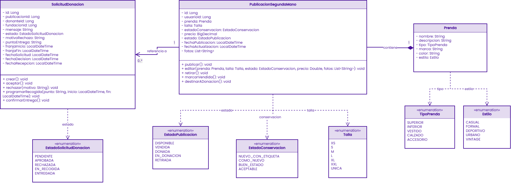
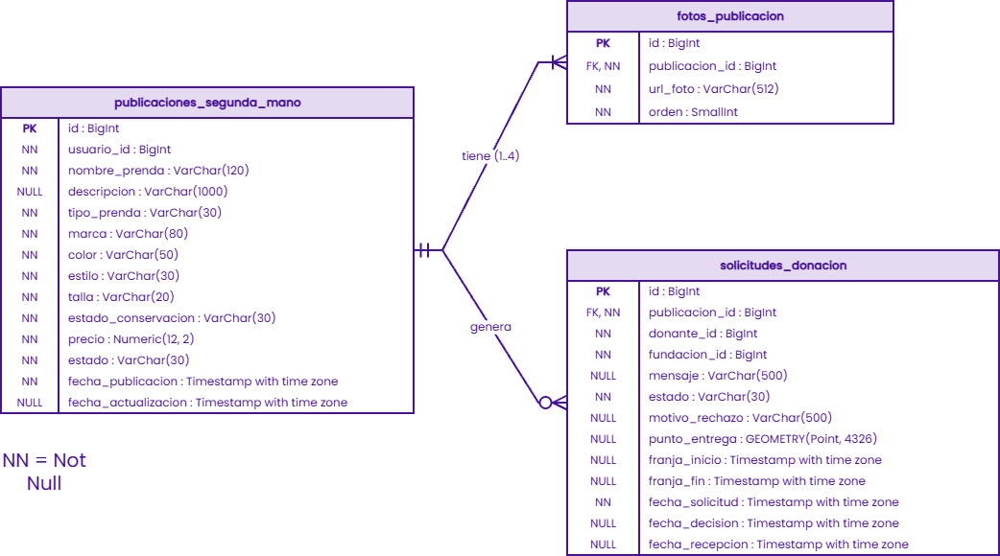
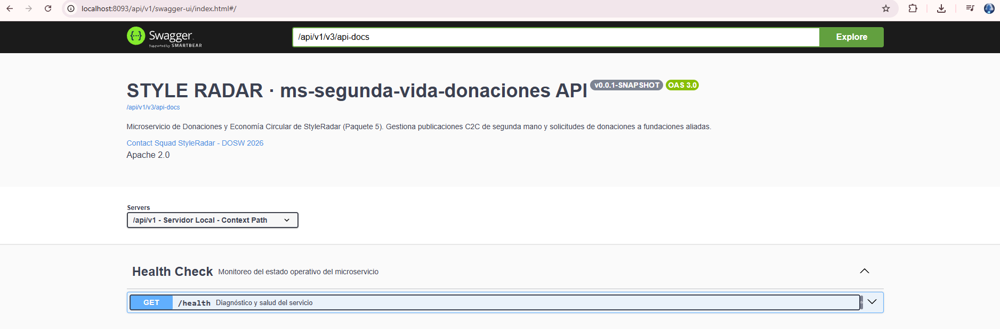
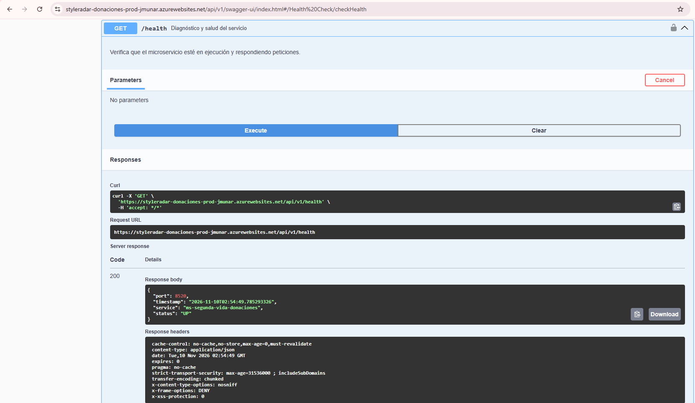
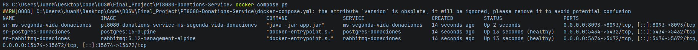
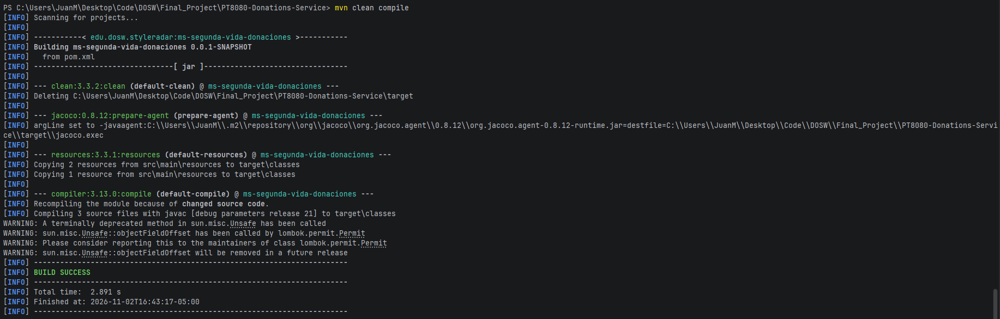
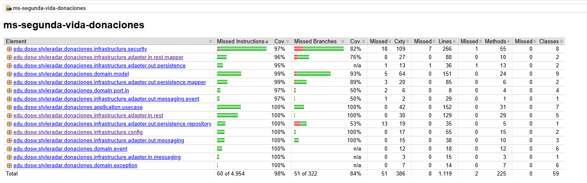
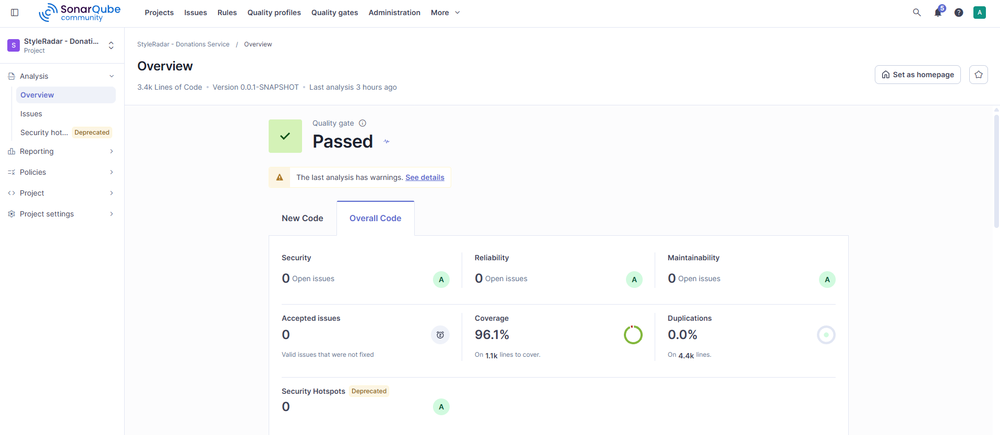
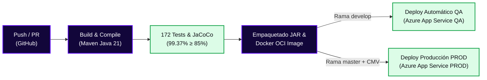
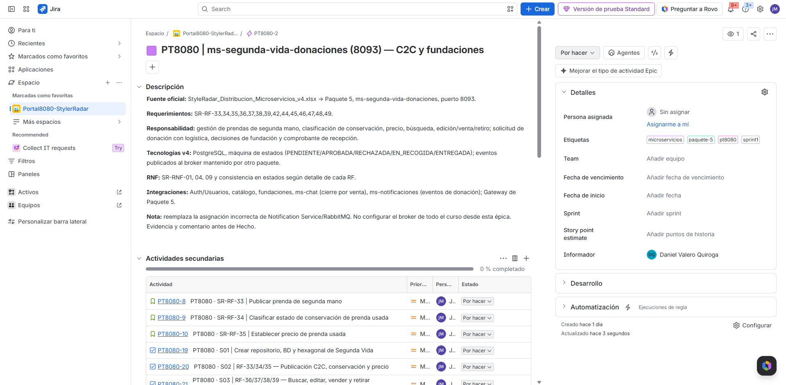

<!-- ==============================================================================
  STYLE RADAR · PLANTILLA MAESTRA DE README PARA MICROSERVICIOS
  Asignatura: DOSW (Diseño y Operación de Soluciones Web) · 2026
  Estándar obligatorio unificado para los 13 microservicios del proyecto StyleRadar.
  Microservicio: PT8080-Donations-Service (ms-segunda-vida-donaciones)
  Squad Asignado: Portal8080 (PT8080)
============================================================================== -->

<div align="center">

  <a href="https://github.com/StyleRadar1">
    
  </a>

  <h1>STYLE<font color="#5600EF">RADAR</font> &nbsp;·&nbsp; <code>ms-segunda-vida-donaciones</code></h1>

  <p align="center">
    
    
    
    
  </p>

  <p align="center">
    <strong><font color="#5600EF">Descubre tu estilo. En tu ciudad.</font></strong><br />
    <em>Plataforma de moda local con inventario multi-sede geolocalizado en tiempo real, economía circular textil y donaciones a fundaciones para Bogotá.</em>
  </p>
  <p align="center">
    <a href="#4-endpoints-y-enlace-a-swagger"></a>
    <a href="#4-endpoints-y-enlace-a-swagger"></a>
    <a href="#4-endpoints-y-enlace-a-swagger"></a>
    <a href="https://github.com/StyleRadar1/PT8080-Donations-Service/actions"></a>
    <a href="https://github.com/StyleRadar1/PT8080-Donations-Service/actions"></a>
    <a href="#9-pruebas-y-cobertura"></a>
    <a href="#10-cicd-con-el-badge-del-pipeline"></a>
  </p>

  <p align="center">
    <a href="#6-tecnologías-y-dependencias">
      
    </a>
    <a href="#6-tecnologías-y-dependencias">
      
    </a>
    <a href="#7-cómo-ejecutar-local-y-con-docker">
      
    </a>
    <a href="#6-tecnologías-y-dependencias">
      
    </a>
    <a href="#6-tecnologías-y-dependencias">
      
    </a>
  </p>

</div>

---

##  ÍNDICE DE CONTENIDOS

1. [Nombre del servicio y su bounded context](#1-nombre-del-servicio-y-su-bounded-context)
2. [Equipo y responsables](#2-equipo-y-responsables)
3. [Arquitectura hexagonal con su diagrama](#3-arquitectura-hexagonal-con-su-diagrama)
4. [Endpoints y enlace a Swagger](#4-endpoints-y-enlace-a-swagger)
5. [Eventos que publica y consume](#5-eventos-que-publica-y-consume)
6. [Tecnologías y dependencias](#6-tecnologías-y-dependencias)
7. [Cómo ejecutar local y con Docker](#7-cómo-ejecutar-local-y-con-docker)
8. [Variables de entorno](#8-variables-de-entorno)
9. [Pruebas y cobertura](#9-pruebas-y-cobertura)
10. [CI/CD con el badge del pipeline](#10-cicd-con-el-badge-del-pipeline)
11. [Ramas y cómo contribuir](#11-ramas-y-cómo-contribuir)
12. [Enlace a la épica en Jira](#12-enlace-a-la-épica-en-jira)

---

<a id="1-nombre-del-servicio-y-su-bounded-context"></a>

## 1. NOMBRE DEL SERVICIO Y SU BOUNDED CONTEXT

* **Identificador de Servicio:** `PT8080-Donations-Service` (`ms-segunda-vida-donaciones`)
* **Paquete Arquitectónico:** Paquete 5: Probador virtual + Donaciones + API Gateway
* **Puerto de Escucha Oficial:** `8520` (context-path: `/api/v1`)
* **Base de Datos Asignada:** `PostgreSQL 16` (`styleradar_donations_qa` en QA / `styleradar_donations_prod` en PROD), aisladas en Azure bajo el patrón *Database-per-Service*.
* **Broker de Mensajería:** `RabbitMQ 3.12` / `event-broker (:5672)` mediante el Topic Exchange durable `donaciones.exchange`.
* **Bounded Context:** `Segunda Vida y Donaciones` (Economía Circular Textil C2C y Sostenibilidad Social)

### Responsabilidades del Dominio

Este microservicio encapsula exclusivamente la lógica de negocio de economía circular textil, dividida en dos ejes: **compraventa C2C de prendas de segunda mano (`SR-RF-33` a `SR-RF-39`)** y **gestión trazable de donaciones a fundaciones aliadas (`SR-RF-42`, `SR-RF-44` a `SR-RF-49`)**.

| Qué HACE este Microservicio (Alcance) | Qué NO HACE este Microservicio (Límites) |
| :--- | :--- |
| • Gestiona el catálogo C2C de segunda mano: publicación con hasta 4 fotos, descripción, tipo, marca, color, estilo, talla, estado de conservación (`ConservationStatus`), precio en COP, edición, venta y retiro voluntario (`SR-RF-33` a `39`). | • NO autentica usuarios ni emite identidades productivas (delegado a `ms-auth` en `:8081`; valida tokens JWT Bearer de forma stateless). |
| • Gestiona el ciclo completo de donaciones: marcado de prenda para donar, selección de fundación, envío de solicitud, decisión formal (aprobación/rechazo con notas obligatorias), coordinación de entrega/recogida y confirmación final de recepción (`SR-RF-42`, `44` a `49`). | • NO procesa pasarelas de pago monetarias de tiendas comerciales (delegado a `ms-pagos` en `:8090`). |
| • Aplica control de acceso basado en roles (`USER`, `FOUNDATION`, `ADMIN`) y validación estricta de propiedad de recursos (`ResourceOwnershipValidator`) contra ataques IDOR/BOLA (`SR-RNF-04`). | • NO envía correos ni notificaciones push directas al usuario final (delegado a `ms-notificaciones` en `:8300` vía eventos RabbitMQ). |
| • Publica eventos asíncronos de integración en RabbitMQ (`donacion.solicitud.creada`, `donacion.estado.actualizado`) con confirmación del broker (*Publisher Confirms & Returns*) y trazabilidad (`X-Correlation-Id`). | • NO genera superposición visual de prendas con inteligencia artificial (delegado a `ms-probador-virtual` en `:8500`). |
| • Garantiza persistencia ACID e indexación B-Tree para respuestas en `< 2s` con hasta 500 usuarios concurrentes (`SR-RNF-01`). | • NO accede directamente a bases de datos de otros microservicios bajo el principio *Database-per-Service*. |

---

<a id="2-equipo-y-responsables"></a>

## 2. EQUIPO Y RESPONSABLES

Desarrollado y mantenido por el **Squad Portal 8080 (`PT8080`)** para la asignatura DOSW 2026:

<div align="center">

|                                      Rol                                       | Nombre Completo | 
|:------------------------------------------------------------------------------:| :---: |
|                       **Líder de Equipo (Scrum Master)**                       | Daniel Valero Quiroga | 
| **Desarrollador Backend de este microservicio (`ms-segunda-vida-donaciones`)** | Juan David Munar |
|                           **Desarrollador Backend**                            | Jose Alejandro Martinez Arias | 
|                           **Desarrollador Frontend**                           | Kevin Ángel |

</div>

---

<a id="3-arquitectura-hexagonal-con-su-diagrama"></a>

## 3. ARQUITECTURA HEXAGONAL CON SU DIAGRAMA

El microservicio implementa **Arquitectura Hexagonal Estricta (Puertos y Adaptadores)** combinada con principios tácticos de **Domain-Driven Design (DDD)**. El núcleo de dominio es 100% puro en Java, desacoplado de frameworks web, motores de persistencia o brokers de mensajería. Todos los casos de uso cumplen la convención oficial: **Interfaz de Puerto de Entrada (`domain.port.in.*UseCase`) + Implementación de Aplicación (`application.usecase.*UseCaseImpl`)**.

> 📖 **Revista Técnica Interactiva del Microservicio:** Consulta la documentación completa, arquitectura de componentes, flujo de eventos, matriz RBAC y despliegue en [`docs/Microservicio_donaciones_Back.html`](docs/Microservicio_donaciones_Back.html).

### 3.1 Diagrama de Clases del Modelo de Dominio y Puertos

<div align="center">
  
  <p><sub><b>Figura 3.1:</b> Diagrama de Clases del dominio de <code>ms-segunda-vida-donaciones</code> detallando entidades agregadas (<code>SecondHandPublication</code>, <code>DonationRequest</code>), value objects (<code>Garment</code>), puertos de entrada, casos de uso y puertos de salida.</sub></p>
</div>

#### Componentes del Modelo de Dominio:
* **Entidades y Agregados (`domain.model`):**
  * **`SecondHandPublication`:** Modela una prenda en el catálogo circular C2C (`id`, `userId`, `garment`, `conservationStatus`, `price`, `photoUrls`, `status`, `createdAt`, `updatedAt`). Métodos de dominio: `create(...)`, `edit(...)`, `markAsSold()`, `retire()`, `markForDonation()`, `markAsDonated()`.
  * **`Garment` (Value Object inmutable):** Encapsula los atributos textiles (`name`, `description`, `type`, `brand`, `color`, `style`, `size`).
  * **`DonationRequest`:** Modela el ciclo de vida de la donación (`id`, `publicationId`, `donorId`, `foundationId`, `message`, `status`, `rejectionReason`, `deliveryPoint`, `pickupWindowStart`, `pickupWindowEnd`, `createdAt`, `decidedAt`, `receivedAt`). Métodos de dominio: `create(...)`, `approve()`, `reject(...)`, `schedulePickup(...)`, `confirmReceipt()`.
  * **Enumeraciones de Dominio:** `ConservationStatus` (`BRAND_NEW_WITH_TAGS`, `LIKE_NEW`, `GOOD_CONDITION`, `ACCEPTABLE`), `GarmentType` (`UPPER`, `LOWER`, `DRESS`, `FOOTWEAR`, `ACCESSORY`), `PublicationStatus` (`AVAILABLE`, `SOLD`, `DONATED`, `IN_DONATION`, `RETIRED`), `DonationRequestStatus` (`PENDING`, `APPROVED`, `REJECTED`, `IN_PICKUP`, `DELIVERED`).
* **Puertos de Entrada (`domain.port.in`) y Casos de Uso (`application.usecase`):**
  * `CreatePublicationUseCase` ➔ `CreatePublicationUseCaseImpl` (`SR-RF-33`, `34`, `35`)
  * `GetPublicationsUseCase` ➔ `GetPublicationsUseCaseImpl` (`SR-RF-36`)
  * `ManagePublicationUseCase` ➔ `ManagePublicationUseCaseImpl` (`SR-RF-37`, `38`, `39`, `42`)
  * `CreateDonationRequestUseCase` ➔ `CreateDonationRequestUseCaseImpl` (`SR-RF-44`, `45`, `46`)
  * `DecideDonationRequestUseCase` ➔ `DecideDonationRequestUseCaseImpl` (`SR-RF-47`)
  * `ScheduleDonationPickupUseCase` ➔ `ScheduleDonationPickupUseCaseImpl` (`SR-RF-48`)
  * `ConfirmDonationReceiptUseCase` ➔ `ConfirmDonationReceiptUseCaseImpl` (`SR-RF-49`)
* **Puertos de Salida (`domain.port.out`) y Adaptadores (`infrastructure.adapter.out`):**
  * `PublicationRepositoryPort` ➔ `PublicationPersistenceAdapter` (Spring Data JPA + `PublicationSpecifications`)
  * `DonationRequestRepositoryPort` ➔ `DonationRequestPersistenceAdapter` (Spring Data JPA)
  * `DonationEventPublisherPort` / `DonacionEventPublisherPort` ➔ `DonationEventPublisherAdapter` (RabbitMQ AMQP)

---

### 3.2 Diagrama Entidad-Relación de Base de Datos (PostgreSQL 16)

<div align="center">
  
  <p><sub><b>Figura 3.2:</b> Modelo físico de datos en PostgreSQL 16 desplegado en Azure Flexible Server, gestionado con migraciones Flyway (<code>V1__init_schema.sql</code> y <code>V2__align_domain_and_tables.sql</code>).</sub></p>
</div>

#### Tablas del Microservicio (`probador_db` / `styleradar_donations_*`):
1. **`publicaciones_segunda_mano`:** Almacena publicaciones C2C (`id BIGINT PK`, `usuario_id BIGINT`, `nombre_prenda`, `descripcion`, `tipo_prenda`, `marca`, `color`, `estilo`, `talla`, `estado_conservacion`, `precio NUMERIC(12,2)`, `estado`, `fecha_publicacion`, `fecha_actualizacion`).
2. **`fotos_publicacion`:** Galería de 1 a 4 fotos por prenda (`id BIGINT PK`, `publicacion_id BIGINT FK`, `url_foto VARCHAR(512)`, `orden INTEGER`). Relación `ON DELETE CASCADE`.
3. **`solicitudes_donacion`:** Registro de donaciones hacia fundaciones (`id BIGINT PK`, `publicacion_id BIGINT FK`, `donante_id BIGINT`, `fundacion_id BIGINT`, `mensaje`, `estado`, `motivo_rechazo`, `punto_entrega`, `franja_inicio`, `franja_fin`, `fecha_solicitud`, `fecha_decision`, `fecha_recepcion`).

---

### 3.3 Estructura Oficial de Paquetes en `src/main/java/`

```text
src/main/java/edu/dosw/styleradar/donaciones/
├── DonationsServiceApplication.java             <-- Punto de entrada Spring Boot 3.3.4
├── domain/                                      <-- NÚCLEO DE DOMINIO PURO (Java estándar, 0 dependencias)
│   ├── model/                                   <-- SecondHandPublication, Garment, DonationRequest, SearchCriteria, Enums
│   ├── event/                                   <-- Eventos de dominio puros (PublicationCreatedEvent, etc.)
│   ├── exception/                               <-- DomainException, DomainConflictException, InvalidStateTransitionException
│   └── port/
│       ├── in/                                  <-- 7 Interfaces *UseCase y Commands inmutables
│       └── out/                                 <-- PublicationRepositoryPort, DonationRequestRepositoryPort, EventPublisherPort
├── application/                                 <-- CAPA DE APLICACIÓN (Orquestación de Casos de Uso)
│   ├── usecase/                                 <-- 7 Clases *UseCaseImpl (@Service / @Transactional)
│   └── dto/                                     <-- Request DTOs, Response DTOs y Mappers de aplicación
└── infrastructure/                              <-- CAPA DE INFRAESTRUCTURA (Tecnologías y Frameworks)
    ├── adapter/
    │   ├── in/
    │   │   ├── rest/                            <-- SecondHandPublicationController, DonationRequestController, AuthController, HealthController
    │   │   └── messaging/                       <-- NotificationConsumerSimulator (Consumidor de prueba E2E)
    │   └── out/
    │       ├── persistence/                     <-- PublicationPersistenceAdapter, DonationRequestPersistenceAdapter, JPA Repositories
    │       └── messaging/                       <-- DonationEventPublisherAdapter, RabbitMQEventPublisherAdapter
    ├── security/                                <-- SecurityConfig, JwtAuthenticationFilter, JwtTokenProvider, ResourceOwnershipValidator
    └── config/                                  <-- OpenApiConfig, RabbitMQConfig, FlywayConfig
```

---

<a id="4-endpoints-y-enlace-a-swagger"></a>

## 4. ENDPOINTS Y ENLACE A SWAGGER

El microservicio se encuentra desplegado y activo en **Microsoft Azure** dentro del Resource Group dedicado **`rg-styleradar`** (`Canada Central` / `East US 2`).

### 4.1 Matriz Oficial de Enlaces por Entorno (PROD, QA, LOCAL)

| Entorno | Estado | Propósito | URL Base del Servicio | Swagger OpenAPI UI | Health Check (`/health`) |
| :--- | :---: | :--- | :--- | :--- | :--- |
| **Producción (`PROD`)** | 🟢 **Active** | Entorno productivo en Azure Cloud con perfil endurecido | `https://styleradar-donaciones-prod-jmunar.azurewebsites.net` | [Swagger UI PROD](https://styleradar-donaciones-prod-jmunar.azurewebsites.net/api/v1/swagger-ui/index.html) | [`/api/v1/health`](https://styleradar-donaciones-prod-jmunar.azurewebsites.net/api/v1/health) |
| **Calidad (`QA`)** | 🟢 **Active** | Entorno de pruebas integradas y staging en Azure Cloud | `https://styleradar-donaciones-qa-jmunar.azurewebsites.net` | [Swagger UI QA](https://styleradar-donaciones-qa-jmunar.azurewebsites.net/api/v1/swagger-ui/index.html) | [`/api/v1/health`](https://styleradar-donaciones-qa-jmunar.azurewebsites.net/api/v1/health) |
| **Desarrollo Local (`DEV`)** | 🟢 **Active** | Entorno local de desarrollo con Docker Compose | `http://localhost:8520` | [Swagger UI Local](http://localhost:8520/api/v1/swagger-ui/index.html) | [`/api/v1/health`](http://localhost:8520/api/v1/health) |

* **Especificación OpenAPI (JSON Contrato):** [`/api/v1/v3/api-docs`](https://styleradar-donaciones-qa-jmunar.azurewebsites.net/api/v1/v3/api-docs)

<div align="center">
  
  <p><sub><b>Figura 4.1:</b> Documentación interactiva Swagger OpenAPI UI activa en Azure App Service, evidenciando los 19 endpoints REST de Segunda Mano, Donaciones, Autenticación Demo y Diagnóstico.</sub></p>
</div>

<br>

<div align="center">
  
  <p><sub><b>Figura 4.2:</b> Ejecución interactiva del endpoint de diagnóstico <code>GET /api/v1/health</code> en Swagger directo desde Azure respondiendo HTTP 200 OK, estado UP y versión de compilación.</sub></p>
</div>

### 4.2 Tabla Completa de los 19 Endpoints REST Expuestos

| Método | Endpoint | RF Asociado | Descripción | Rol / Acceso Requerido | Códigos HTTP |
| :---: | :--- | :---: | :--- | :--- | :---: |
| `GET` | `/api/v1/health` | Diagnóstico | Monitoreo de salud, versión y verificación de `commitSha` | Público | `200` |
| `POST` | `/api/v1/auth/login` | Seguridad JWT | Autenticar usuario demo y obtener token Bearer (`HS256`) | dev/test/qa (`404` en prod) | `200`, `401`, `404` |
| `GET` | `/api/v1/auth/quick-token` | Seguridad JWT | Generar token JWT rápido por perfil demo para Swagger | dev/test/qa (`404` en prod) | `200`, `400`, `404` |
| `GET` | `/api/v1/auth/demo-users` | Seguridad JWT | Listar usuarios de prueba precargados para Swagger | dev/test/qa (`404` en prod) | `200`, `404` |
| `POST` | `/api/v1/segunda-mano` | `SR-RF-33`, `34`, `35` | Publicar prenda de segunda mano con hasta 4 fotos y precio en COP | `USER`, `ADMIN` | `201`, `400`, `401`, `403` |
| `GET` | `/api/v1/segunda-mano` | `SR-RF-36` | Buscar prendas disponibles con filtros combinables | Público | `200` |
| `GET` | `/api/v1/segunda-mano/{id}` | `SR-RF-36` | Consultar detalle de publicación por identificador | Público | `200`, `404` |
| `GET` | `/api/v1/segunda-mano/user/{userId}` | `SR-RF-33` | Listar todas las publicaciones de un usuario vendedor | Público | `200` |
| `PUT` | `/api/v1/segunda-mano/{id}` | `SR-RF-37` | Editar datos de publicación mientras esté en estado `AVAILABLE` | Propietario (`USER`), `ADMIN` | `200`, `400`, `403`, `409` |
| `PATCH` | `/api/v1/segunda-mano/{id}/sell` | `SR-RF-38` | Marcar prenda como vendida (`SOLD`) y retirarla del catálogo | Propietario (`USER`), `ADMIN` | `200`, `403`, `409` |
| `PATCH` | `/api/v1/segunda-mano/{id}/retire` | `SR-RF-39` | Retirar voluntariamente una publicación activa (`RETIRED`) | Propietario (`USER`), `ADMIN` | `200`, `403`, `409` |
| `PATCH` | `/api/v1/segunda-mano/{id}/donate` | `SR-RF-42` | Marcar prenda para donación (`MARKED_FOR_DONATION`) | Propietario (`USER`), `ADMIN` | `200`, `400`, `403`, `409` |
| `POST` | `/api/v1/donaciones` | `SR-RF-44`, `45` | Crear solicitud formal de donación a una fundación aliada | `USER`, `ADMIN` | `201`, `400`, `401`, `403` |
| `GET` | `/api/v1/donaciones/{id}` | `SR-RF-46` | Consultar estado y detalle de una solicitud de donación | Donante, Fundación, `ADMIN` | `200`, `401`, `403`, `404` |
| `GET` | `/api/v1/donaciones/donor/{donorId}` | `SR-RF-46` | Listar todas las solicitudes realizadas por un donante | Donante propietario, `ADMIN` | `200`, `401`, `403` |
| `GET` | `/api/v1/donaciones/foundation/{foundationId}` | `SR-RF-46` | Consultar solicitudes recibidas por una fundación | Fundación dueña, `ADMIN` | `200`, `401`, `403` |
| `PATCH` | `/api/v1/donaciones/{id}/decide` | `SR-RF-47` | Aceptar (`APPROVED`) o rechazar (`REJECTED`) solicitud con notas | Fundación destino, `ADMIN` | `200`, `400`, `403`, `409` |
| `PATCH` | `/api/v1/donaciones/{id}/pickup` | `SR-RF-48` | Coordinar entrega o recogida (modo, fecha, franja y dirección) | Donante, Fundación, `ADMIN` | `200`, `400`, `403`, `409` |
| `PATCH` | `/api/v1/donaciones/{id}/confirm` | `SR-RF-49` | Confirmar recepción final de donación (`COMPLETED`) | Fundación destino, `ADMIN` | `200`, `400`, `403`, `409` |

<details>
<summary><b>Click para ver Ejemplos Interactivos de Request y Response JSON (Payloads Reales)</b></summary>

<br>

#### 1. Diagnóstico y Versión (`GET /api/v1/health`)

```bash
curl -X GET "https://styleradar-donaciones-qa-jmunar.azurewebsites.net/api/v1/health"
```

```json
{
  "service": "ms-segunda-vida-donaciones",
  "status": "UP",
  "version": "0.0.1-SNAPSHOT",
  "commitSha": "b4e31a8",
  "port": 8520,
  "timestamp": "2026-11-09T22:30:00.000000"
}
```

#### 2. Publicar Prenda de Segunda Mano (`POST /api/v1/segunda-mano`)

```bash
curl -X POST "https://styleradar-donaciones-qa-jmunar.azurewebsites.net/api/v1/segunda-mano" \
  -H "Content-Type: application/json" \
  -H "Authorization: Bearer <JWT_TOKEN>" \
  -d '{
    "userId": 101,
    "name": "Chaqueta Denim Clásica",
    "description": "Chaqueta azul en perfecto estado, poco uso.",
    "type": "UPPER",
    "brand": "Vintage Denim",
    "color": "Azul",
    "style": "CASUAL",
    "size": "M",
    "conservationStatus": "LIKE_NEW",
    "price": 95000.00,
    "photoUrls": [
      "https://cdn.styleradar.com/photos/chaqueta-01.jpg"
    ]
  }'
```

#### 3. Crear Solicitud de Donación (`POST /api/v1/donaciones`)

```bash
curl -X POST "https://styleradar-donaciones-qa-jmunar.azurewebsites.net/api/v1/donaciones" \
  -H "Content-Type: application/json" \
  -H "Authorization: Bearer <JWT_TOKEN>" \
  -d '{
    "publicationId": 1,
    "donorId": 101,
    "foundationId": 501,
    "message": "Prenda lavada y empacada para entrega en sede Chapinero."
  }'
```

</details>

---

<a id="5-eventos-que-publica-y-consume"></a>

## 5. EVENTOS QUE PUBLICA Y CONSUME

La integración asíncrona se realiza a través de **RabbitMQ 3.12** utilizando Topic Exchanges durables.

* **Exchange de Dominio:** `donaciones.exchange` (`topic`, durable)
* **Broker Host / Puerto:** `event-broker (:5672)`
* **Garantías de Entrega:** *Publisher Confirms* (`correlated`), *Publisher Returns* y trazabilidad con `X-Correlation-Id`.

### Matriz de Eventos AMQP

| Tipo | Evento / Clase | Routing Key | Cola (Queue) | Emisor ➔ Receptor | Cuándo se Dispara / Acción |
| :---: | :--- | :--- | :--- | :--- | :--- |
| **PUBLICA** | `SolicitudDonacionCreadaEvent` | `donacion.solicitud.creada` | `q.notificaciones.donacion-solicitud-creada` | `ms-segunda-vida-donaciones` ➔ `ms-notificaciones` | Disparado al crear una solicitud de donación (`SR-RF-45`) o marcar una prenda para donación (`SR-RF-42`). |
| **PUBLICA** | `EstadoDonacionActualizadoEvent` | `donacion.estado.actualizado` | `donaciones.exchange` | `ms-segunda-vida-donaciones` ➔ `ms-notificaciones` | Disparado al aprobar/rechazar (`SR-RF-47`) o confirmar recepción final (`SR-RF-49`). |
| **CONSUME** | `SolicitudDonacionCreadaEvent` | `donacion.solicitud.creada` | `q.donaciones.simulador-notificaciones` | `donaciones.exchange` ➔ `NotificationConsumerSimulator` | Consumidor de prueba E2E aislable mediante `RABBITMQ_SIMULATOR_ENABLED=true`. |

<details>
<summary><b>Click para ver Esquema JSON de los Eventos RabbitMQ</b></summary>

<br>

```json
{
  "eventId": "f47ac10b-58cc-4372-a567-0e02b2c3d479",
  "eventType": "SolicitudDonacionCreadaEvent",
  "timestamp": "2026-11-09T20:15:30Z",
  "producer": "ms-segunda-vida-donaciones",
  "correlationId": "a1b2c3d4-e5f6-7890-abcd-ef1234567890",
  "donationRequestId": "dddddddd-1111-1111-1111-111111111111",
  "donorId": "11111111-1111-1111-1111-111111111111",
  "foundationId": "aaaaaaaa-aaaa-aaaa-aaaa-aaaaaaaaaaaa",
  "foundationName": "Fundación Abrigo Bogotá",
  "clothingDescription": "Chaqueta Denim talla M.",
  "quantity": 1,
  "status": "PENDING",
  "version": 1
}
```

</details>

---

<a id="6-tecnologías-y-dependencias"></a>

## 6. TECNOLOGÍAS Y DEPENDENCIAS

El stack tecnológico de `PT8080-Donations-Service` cumple con el estándar unificado de DOSW 2026:

| Capa / Componente | Tecnología | Versión | Justificación Técnica |
| :--- | :--- | :--- | :--- |
| **Lenguaje Core** | Java LTS (Eclipse Temurin) | `21` | Virtual Threads, Records inmutables y Pattern Matching. |
| **Framework Base** | Spring Boot | `3.3.4` | Soporte nativo para WebMVC, Data JPA, Security, AMQP y Actuator. |
| **Seguridad y Tokens** | Spring Security + JJWT | `6.3.x` / `0.13.0` | Validación stateless de JWT con firma HMAC-SHA256 (`HS256`) y claim `exp`. |
| **Base de Datos** | PostgreSQL | `16` | Integridad ACID, llaves primarias indexadas y aislamiento *Database-per-Service*. |
| **Control de Esquema** | Flyway Core | `10.10.0` | Migraciones reproducibles (`V1__init_schema.sql`, `V2__align_domain_and_tables.sql`). |
| **Broker de Mensajería** | RabbitMQ (Spring AMQP) | `3.12` | Topic Exchanges durables con confirmaciones de publicación (*Publisher Confirms*). |
| **Mapeo y Boilerplate** | MapStruct + Lombok | `1.5.5` / `1.18.38` | Reducción de código repetitivo compatible con JDK 21. |
| **Documentación API** | SpringDoc OpenAPI | `2.5.0` | Generación automática de especificación OpenAPI 3.0 y Swagger UI con Bearer JWT. |
| **Testing Automatizado** | JUnit 5 + Mockito + H2 | `5.10.3` | 172 pruebas automatizadas (unitarias, integración y seguridad RBAC). |
| **Métricas de Cobertura** | JaCoCo Maven Plugin | `0.8.12` | Verificación estricta de cobertura mínima (≥ 85%) alcanzando el 99.37%. |
| **Auditoría Estática** | SonarQube Scanner | `3.11.0` | Quality Gate en Calificación A (0 Bugs, 0 Vulnerabilidades, 0 Code Smells). |

---

<a id="7-cómo-ejecutar-local-y-con-docker"></a>

## 7. CÓMO EJECUTAR LOCAL Y CON DOCKER

### Prerrequisitos de Entorno

* **Java Development Kit (JDK):** Versión 21 LTS instalada (`java -version`).
* **Apache Maven:** Versión 3.9+ instalada (`mvn -version`).
* **Docker Engine & Docker Compose:** Versión 24+ en ejecución (`docker --version`).

### Opción 1: Ejecución Contenerizada con Docker Compose (Recomendada)

```bash
# 1. Clonar el repositorio
git clone https://github.com/StyleRadar1/PT8080-Donations-Service.git
cd PT8080-Donations-Service

# 2. Levantar la suite completa (PostgreSQL 16 en 5434, RabbitMQ en 5674/15674 y Microservicio en 8520)
docker compose up -d --build

# 3. Verificar estado saludable de los contenedores
docker compose ps
```

### Opción 2: Ejecución Local con Maven (BD y RabbitMQ en Docker)

```bash
# 1. Levantar únicamente infraestructura auxiliar
docker compose up -d postgres-donaciones rabbitmq-donaciones

# 2. Compilar y ejecutar con perfil dev
mvn clean spring-boot:run
```

### Comprobación de Salud (Health Check)

```bash
curl -s http://localhost:8520/api/v1/health
# Esperado: {"service":"ms-segunda-vida-donaciones","status":"UP","port":8520,...}
```

<div align="center">
  
  <p><sub><b>Figura 7.1:</b> Contenedores de <code>ms-segunda-vida-donaciones</code> (:8520), PostgreSQL (:5434) y RabbitMQ (:5674/15674) en ejecución saludable.</sub></p>
</div>

<br>

<div align="center">
  
  <p><sub><b>Figura 7.2:</b> Compilación limpia exitosa con JDK 21 LTS y Spring Boot 3.3.4 (BUILD SUCCESS).</sub></p>
</div>

---

<a id="8-variables-de-entorno"></a>

## 8. VARIABLES DE ENTORNO

Todas las configuraciones se gestionan de forma desacoplada conforme a los principios de **Twelve-Factor App**:

| Variable | Descripción | Valor por Defecto (`dev`) | Requerido en Prod |
| :--- | :--- | :--- | :---: |
| `SERVER_PORT` / `PORT` | Puerto HTTP de escucha del microservicio | `8520` | Sí |
| `SPRING_PROFILES_ACTIVE` | Perfil activo (`dev`, `qa`, `prod`, `test`) | `dev` | Sí |
| `DB_HOST` | Hostname del servidor PostgreSQL | `localhost` | Sí |
| `DB_PORT` | Puerto de PostgreSQL | `5434` (`5432` en Azure) | Sí |
| `DB_NAME` | Nombre de la base de datos | `styleradar_donations` | Sí |
| `DB_USER` | Usuario de base de datos | `styleradar_user` | Sí |
| `DB_PASSWORD` | Contraseña de base de datos | `<configured_in_env>` | Sí |
| `DB_SSLMODE` | Modo SSL JDBC para Azure Cloud | `disable` (`require` en Cloud) | Sí |
| `SECURITY_JWT_SECRET` | Clave HMAC-SHA256 (mínimo 256 bits) | Clave local de desarrollo | Sí |
| `SECURITY_JWT_EXPIRATION_MS`| Tiempo de expiración del token JWT | `86400000` (24h) | Opcional |
| `RABBITMQ_HOST` | Hostname del broker RabbitMQ | `localhost` | Sí |
| `RABBITMQ_PORT` | Puerto AMQP (`5672` o `5674` en compose) | `5674` | Sí |
| `RABBITMQ_USERNAME` | Usuario de conexión RabbitMQ | `guest` | Sí |
| `RABBITMQ_PASSWORD` | Contraseña de conexión RabbitMQ | `guest` | Sí |

<details>
<summary><b>Click para ver la Plantilla de Archivo .env.example Completa</b></summary>

<br>

```dotenv
# ==============================================================================
# STYLERADAR · VARIABLES DE ENTORNO LOCALES (.env)
# Microservicio: PT8080-Donations-Service (ms-segunda-vida-donaciones) · Puerto 8520
# ==============================================================================
SERVER_PORT=8520
SPRING_PROFILES_ACTIVE=dev

# Persistencia PostgreSQL (styleradar_donations)
DB_HOST=localhost
DB_PORT=5434
DB_NAME=styleradar_donations
DB_USER=styleradar_user
DB_PASSWORD=styleradar_password
DB_SSLMODE=disable

# Broker de Eventos (RabbitMQ)
RABBITMQ_HOST=localhost
RABBITMQ_PORT=5674
RABBITMQ_USERNAME=guest
RABBITMQ_PASSWORD=guest
RABBITMQ_EXCHANGE=donaciones.exchange

# Seguridad JWT Bearer
SECURITY_JWT_SECRET=super-secret-jwt-key-with-minimum-256-bits-length-for-hmac-sha256-dosw-2026
SECURITY_JWT_EXPIRATION_MS=86400000
```

</details>

---

<a id="9-pruebas-y-cobertura"></a>

## 9. PRUEBAS Y COBERTURA (≥ 85%)

El proyecto exige una cobertura de código mínima del **85%** verificada automáticamente mediante **JaCoCo** durante la fase `verify` de Maven.

### Resumen de Métricas de Pruebas y Cobertura (Sprint 2)

| Métrica | Valor Alcanzado | Umbral Exigido | Estado |
| :--- | :---: | :---: | :---: |
| **Pruebas Automatizadas Ejecutadas** | **172 tests** | Suite completa | ✅ **100% Passing (0 fallos)** |
| **Cobertura de Instrucciones (JaCoCo)** | **99.37%** (`4.084 / 4.110` instr.) | `≥ 85.00%` | ✅ **Aprobado (+14.37%)** |
| **Cobertura de Líneas (JaCoCo)** | **99.28%** (`1.105 / 1.113` líneas) | `≥ 85.00%` | ✅ **Aprobado (+14.28%)** |
| **Cobertura de Ramas / Branches (JaCoCo)** | **90.30%** (`214 / 237` ramas) | `≥ 85.00%` | ✅ **Aprobado (+5.30%)** |
| **Auditoría SonarQube v26.9.0** | **Quality Gate Passed (Rating A)** | 0 Bugs, 0 Vuln, 0 Smells | ✅ **Calificación A** |

<div align="center">
  
  <p><sub><b>Figura 9.1:</b> Reporte consolidado de cobertura HTML generado por JaCoCo en Sprint 2 (<code>target/site/jacoco/index.html</code>), certificando un 99.37% de cobertura en instrucciones y 99.28% en líneas, superando ampliamente el umbral mínimo obligatorio del 85%.</sub></p>
</div>

<br>

<div align="center">
  
  <p><sub><b>Figura 9.2:</b> Dashboard oficial de SonarQube certificando Quality Gate Passed con Calificación A (0 Bugs, 0 Vulnerabilidades, 0 Code Smells, 0 Hotspots de Seguridad y 0.0% de Duplicación).</sub></p>
</div>

### Pirámide de Pruebas Implementada

| Nivel de Prueba | Clases de Prueba Representativas | Alcance Verificado |
| :--- | :--- | :--- |
| **Dominio Puro (Unitarias)** | `SecondHandPublicationTest`, `DonationRequestTest` | Entidades, máquinas de estados y reglas de negocio sin frameworks. |
| **Casos de Uso (Unitarias Mockito)** | `SecondHandUseCasesTest`, `DonationUseCasesTest` | Los 7 casos de uso (`*UseCaseImpl`), orquestación y eventos. |
| **Controladores REST (`MockMvc`)** | `SecondHandPublicationControllerTest`, `DonationRequestControllerTest`, `HealthControllerTest`, `GlobalExceptionHandlerTest` | Contratos HTTP, serialización JSON y respuestas RFC 7807 (`ProblemDetail`). |
| **Persistencia y Mensajería** | `SecondHandPublicationPersistenceAdapterTest`, `DonationRequestPersistenceAdapterTest`, `DonationEventPublisherAdapterTest` | Mapeo JPA, especificaciones dinámicas y confirmación en RabbitMQ. |
| **Seguridad e Integración RBAC** | `SecurityRbacIntegrationTest`, `JwtTokenProviderTest`, `ResourceOwnershipValidatorTest`, `DemoUserServiceTest` | Roles (`USER`, `FOUNDATION`, `ADMIN`), mitigación anti-IDOR y expiración JWT. |

> [!IMPORTANT]
> **Criterio de Fallo en CI:** El archivo `pom.xml` contiene la regla `<limit><minimum>0.85</minimum></limit>`. Si la cobertura consolidada es inferior al 85%, el comando `mvn verify` falla de inmediato bloqueando la integración.

---

<a id="10-cicd-con-el-badge-del-pipeline"></a>

## 10. CI/CD CON EL BADGE DEL PIPELINE

El ciclo de integración y despliegue continuo está automatizado en **GitHub Actions** (`.github/workflows/ci.yml`):

### Matriz de Pipelines por Rama Protegida

| Pipeline | Rama / Entorno | Trigger | Quality Gate Requerido | Estado |
| :--- | :---: | :---: | :--- | :---: |
| **CI - Develop** | `develop`<br>*(Staging QA)* | Push / PR | 172 Tests + JaCoCo ≥ 85% + Docker Build | [](https://github.com/StyleRadar1/PT8080-Donations-Service/actions) |
| **CI - Master** | `master` / `main`<br>*(Producción)* | Push / PR | 172 Tests + JaCoCo ≥ 85% + Docker Build | [](https://github.com/StyleRadar1/PT8080-Donations-Service/actions) |
| **CD - Despliegue QA** | Azure QA (`rg-styleradar`) | Push / Merge a `develop` | Deploy Web App + Smoke Test `/health` (`commitSha`) | [](https://styleradar-donaciones-qa-jmunar.azurewebsites.net/api/v1/swagger-ui/index.html) |
| **CD - Despliegue PROD** | Azure PROD (`rg-styleradar`) | Push / Merge a `master` (CMV) | Aprobación CMV + Smoke Test `/health` (`commitSha`) | [](https://styleradar-donaciones-prod-jmunar.azurewebsites.net/api/v1/swagger-ui/index.html) |



---

<a id="11-ramas-y-cómo-contribuir"></a>

## 11. RAMAS Y CÓMO CONTRIBUIR

El equipo adopta el modelo **GitFlow adaptado para microservicios**. Las ramas `master` y `develop` están protegidas y reciben cambios exclusivamente mediante Pull Requests:

```text
master / main                           <-- Producción (Azure PROD · Requiere CMV)
└── develop                             <-- Integración continua (Azure QA)
    ├── feature/nombre-ejemplo          <-- Agregar nuevas funcionalidad
    └── fix/nombre-ejemplo              <-- Arreglar bugs solamente
```

### Convención de Commits (*Conventional Commits*)

```text
<tipo>(<alcance>): <descripción imperativa en español> [#PT8080-XX]

Ejemplos:
feat(donaciones): coordinar recogida de prendas con franja horaria [#PT8080-2]
fix(seguridad): restringir endpoints demo en ambiente produccion [#PT8080-2]
test(cobertura): agregar pruebas de transicion de estado en publicaciones [#PT8080-2]
```

### Checklist Obligatorio para Pull Requests

- [x] La rama parte de la versión más reciente de `develop`.
- [x] El código compila limpiamente sin advertencias críticas con `mvn clean compile`.
- [x] Todas las pruebas automatizadas pasan en verde (`mvn clean verify`).
- [x] La cobertura en JaCoCo supera el 85% obligatorio (alcanzado 99.37%).
- [x] No se introducen credenciales ni secretos en el código (uso de variables de entorno).
- [x] Los contenedores OCI se construyen exitosamente con Docker Compose.
- [x] El PR cuenta con la revisión y aprobación del líder técnico del squad.

---

<a id="12-enlace-a-la-épica-en-jira"></a>

## 12. ENLACE A LA ÉPICA EN JIRA

El seguimiento de historias de usuario, subtareas y evidencias de entrega se centraliza en los siguientes enlaces oficiales:

* **Repositorio Oficial en GitHub:** [https://github.com/StyleRadar1/PT8080-Donations-Service](https://github.com/StyleRadar1/PT8080-Donations-Service)
* **Épica Oficial del Microservicio (Jira):** [https://mail-team-nyjtgqcj.atlassian.net/browse/PT8080-2](https://mail-team-nyjtgqcj.atlassian.net/browse/PT8080-2)
* **Tablero Scrum del Squad Portal 8080 (Jira):** [https://mail-team-nyjtgqcj.atlassian.net/jira/software/projects/PT8080/boards/74](https://mail-team-nyjtgqcj.atlassian.net/jira/software/projects/PT8080/boards/74)
* **Contenedor OCI Oficial (Docker Hub):** [https://hub.docker.com/r/judamuch09/pt8080-donations-service-ms-segunda-vida-donaciones](https://hub.docker.com/r/judamuch09/pt8080-donations-service-ms-segunda-vida-donaciones)

<div align="center">
  
  <p><sub><b>Figura 12.1:</b> Épica oficial <code>PT8080-2</code> en Atlassian Jira para <code>ms-segunda-vida-donaciones</code> (puerto 8520), detallando los requerimientos funcionales SR-RF-33 al 39 y SR-RF-42, 44 al 49.</sub></p>
</div>

### Matriz de los 14 Requerimientos Funcionales Implementados

| Código RF | Nombre del Requerimiento | Implementación en `ms-segunda-vida-donaciones` | Estado |
| :---: | :--- | :--- | :---: |
| `SR-RF-33` | Publicar prenda de segunda mano | `POST /api/v1/segunda-mano` (`CreatePublicationUseCaseImpl`): hasta 4 fotos y atributos textiles. | ✅ Completado |
| `SR-RF-34` | Clasificar estado de conservación | Escala enum `ConservationStatus` validada en creación y edición. | ✅ Completado |
| `SR-RF-35` | Establecer precio de prenda usada | Atributo `price` (`BigDecimal >= 0` en COP) validado en `SecondHandPublication`. | ✅ Completado |
| `SR-RF-36` | Buscar prendas publicadas | `GET /api/v1/segunda-mano` (`GetPublicationsUseCaseImpl` + `PublicationSpecifications`). | ✅ Completado |
| `SR-RF-37` | Editar publicación de segunda mano | `PUT /api/v1/segunda-mano/{id}` (`ManagePublicationUseCaseImpl.edit`) restringido a `AVAILABLE`. | ✅ Completado |
| `SR-RF-38` | Marcar prenda como vendida | `PATCH /api/v1/segunda-mano/{id}/sell` (`ManagePublicationUseCaseImpl.markAsSold`). | ✅ Completado |
| `SR-RF-39` | Retirar publicación de segunda mano | `PATCH /api/v1/segunda-mano/{id}/retire` (`ManagePublicationUseCaseImpl.retire`). | ✅ Completado |
| `SR-RF-42` | Marcar prenda para donación | `PATCH /api/v1/segunda-mano/{id}/donate` (`ManagePublicationUseCaseImpl.markForDonation`). | ✅ Completado |
| `SR-RF-44` | Seleccionar fundación para donación | Selección de `foundationId` validada en `CreateDonationRequestUseCaseImpl`. | ✅ Completado |
| `SR-RF-45` | Enviar solicitud de donación | `POST /api/v1/donaciones` (`CreateDonationRequestUseCaseImpl`) con evento en RabbitMQ. | ✅ Completado |
| `SR-RF-46` | Consultar solicitudes de donación | `GET /api/v1/donaciones/{id}`, `/donor/{donorId}` y `/foundation/{foundationId}`. | ✅ Completado |
| `SR-RF-47` | Aceptar o rechazar donación | `PATCH /api/v1/donaciones/{id}/decide` (`DecideDonationRequestUseCaseImpl`) con notas obligatorias. | ✅ Completado |
| `SR-RF-48` | Coordinar recogida de donación | `PATCH /api/v1/donaciones/{id}/pickup` (`ScheduleDonationPickupUseCaseImpl`). | ✅ Completado |
| `SR-RF-49` | Confirmar recepción de donación | `PATCH /api/v1/donaciones/{id}/confirm` (`ConfirmDonationReceiptUseCaseImpl`). | ✅ Completado |

### Requerimientos No Funcionales Implementados

| Código RNF | Categoría | Criterio de Aceptación | Implementación Verificada |
| :---: | :--- | :--- | :--- |
| `SR-RNF-01` | **Rendimiento** | Búsqueda y filtrado en `< 2 segundos` con hasta 500 usuarios concurrentes. | 8 índices B-Tree en PostgreSQL 16 y consultas dinámicas optimizadas con `JpaSpecificationExecutor`. |
| `SR-RNF-04` | **Seguridad** | HTTPS obligatorio, JWT con expiración estricta y autorización por rol. | HTTPS en Azure, `JwtTokenProvider` con HMAC-SHA256 (`≥ 256 bits`) y claim `exp`, RBAC + `ResourceOwnershipValidator` (anti-IDOR). |
| `SR-RNF-09` | **Mantenibilidad** | Arquitectura hexagonal, cobertura `≥ 85%` y documentación OpenAPI. | Arquitectura hexagonal estricta (`*UseCase` + `*UseCaseImpl`), **99.37% de cobertura JaCoCo**, **0 issues en SonarQube (Calificación A)** y Swagger UI en QA y PROD. |
