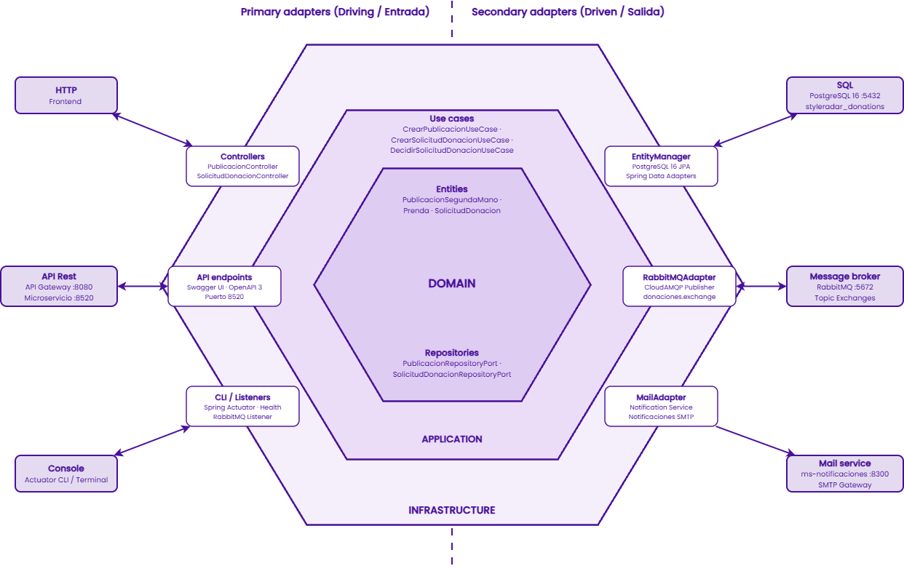
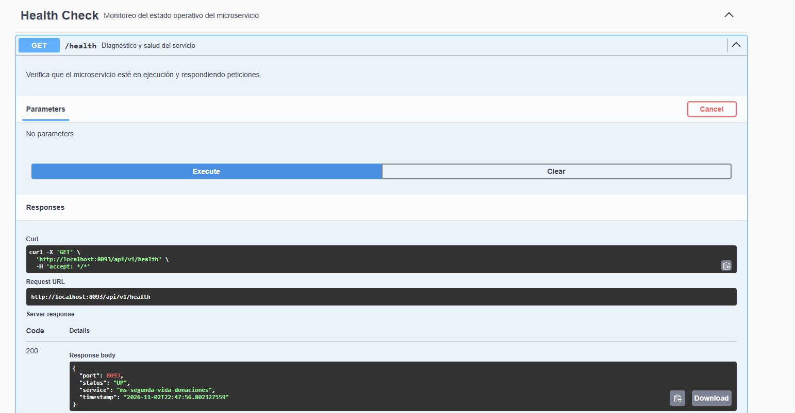
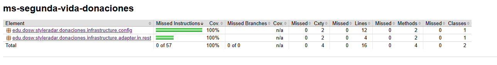
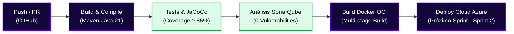

<!-- ==============================================================================
  STYLE RADAR 
  Asignatura: DOSW · 2026
  Estándar obligatorio unificado para los 13 microservicios del proyecto StyleRadar.
============================================================================== -->

<div align="center">

  <a href="https://github.com/StyleRadar">
    
  </a>

  <h1>STYLE<font color="#5600EF">RADAR</font> &nbsp;·&nbsp; <code>ms-segunda-vida-donaciones</code></h1>

  <p align="center">
    
    
    
  </p>

  <p align="center">
    <strong><font color="#5600EF">Descubre tu estilo. En tu ciudad.</font></strong><br />
    <em>Plataforma de moda local con inventario multi-sede geolocalizado en tiempo real y probador virtual para Bogotá.</em>
  </p>

  <p align="center">
    
    
    <a href="https://sonarcloud.io">
      
    </a>
    <a href="target/site/jacoco/index.html">
      
    </a>
    <a href="#6-tecnologías-y-dependencias">
      
    </a>
    <a href="#6-tecnologías-y-dependencias">
      
    </a>
    <a href="#7-cómo-ejecutar-local-y-con-docker">
      
    </a>
  </p>

</div>

---

##  ÍNDICE DE CONTENIDOS

1. [Nombre del servicio y su bounded context](#1-nombre-del-servicio-y-su-bounded-context)
2. [Equipo y responsables](#2-equipo-y-responsables)
3. [Arquitectura hexagonal con su diagrama](#3-arquitectura-hexagonal-con-su-diagrama)
4. [Endpoints y enlace a Swagger](#4-endpoints-y-enlace-a-swagger)
5. [Eventos que publica y consume](#5-eventos-que-publica-y-consume)
6. [Tecnologías y dependencias](#6-tecnologías-y-dependencias)
7. [Cómo ejecutar local y con Docker](#7-cómo-ejecutar-local-y-con-docker)
8. [Variables de entorno](#8-variables-de-entorno)
9. [Pruebas y cobertura](#9-pruebas-y-cobertura)
10. [CI/CD con el badge del pipeline](#10-cicd-con-el-badge-del-pipeline)
11. [Ramas y cómo contribuir](#11-ramas-y-cómo-contribuir)
12. [Enlace a la épica en Jira](#12-enlace-a-la-épica-en-jira)

---

<a id="1-nombre-del-servicio-y-su-bounded-context"></a>

##  1. NOMBRE DEL SERVICIO Y SU BOUNDED CONTEXT

* **Identificador de Servicio:** `ms-segunda-vida-donaciones`
* **Paquete Arquitectónico:** `Paquete 5: Probador virtual + Donaciones + API Gateway`
* **Puerto de Escucha Oficial:** `8520` (context-path: `/api/v1`)
* **Base de Datos Asignada:** `PostgreSQL 16` (`styleradar_donations`), aislada bajo el patrón *Database-per-Service*.
* **Bounded Context:** `Segunda Vida y Donaciones` (Economía Circular)

### Responsabilidades del Dominio

Este microservicio encapsula exclusivamente la lógica de negocio correspondiente a la economía circular de la plataforma StyleRadar, dividida en dos ejes: venta C2C de ropa de segunda mano y donaciones altruistas a fundaciones aliadas.

| Qué HACE este Microservicio (Alcance) | Qué NO HACE este Microservicio (Límites) |
| :--- | :--- |
| • Gestiona el ciclo de vida C2C de ropa de segunda mano (publicación, hasta 4 fotos, descripción, talla, marca, precio en COP, escala de estado y retiro/venta). | • NO autentica usuarios (delegado a `ms-auth` en `:8081`). |
| • Gestiona el flujo altruista de donaciones a fundaciones aliadas (SR-RF-42 a SR-RF-49). | • NO procesa pasarela de pagos monetarios de tiendas (delegado a `ms-pagos-suscripciones` en `:8090`). |
| • Coordinación de logística de recogida/acopio de donaciones (franjas horarias, puntos de acopio, estados PENDIENTE, APROBADA, RECHAZADA, EN_RECOGIDA, ENTREGADA). | • NO despacha emails ni notificaciones push directas (delegado a `ms-notificaciones` en `:8088`). |
| • Publicación y consumo de eventos asíncronos vía RabbitMQ Topic Exchanges. | • NO genera la superposición de prendas por Inteligencia Artificial (delegado a `ms-probador-virtual` en `:8092`). |
| • Garantiza persistencia ACID e idempotencia en su base de datos PostgreSQL 16. | • NO accede directamente a bases de datos de otros microservicios. |

### Arquetipos de Moda y Personajes de StyleRadar

<div align="center">

| Antonia (Sastre) | Mateo (Calle) | Aura (Futuro) | Nora (Rebelde) | Tomás (Esencial) |
| :---: | :---: | :---: | :---: | :---: |
| <br>**Sastre**<br><sub>Tiendas & Descubrimiento</sub> | <br>**Calle**<br><sub>Playlists & Cultura Urbana</sub> | <br>**Futuro**<br><sub>Probador Virtual AI</sub> | <br><strong><font color="#5600EF">Nora (Rebelde)</font></strong><br><sub>Segunda Vida & Vintage</sub> | <br><strong><font color="#16A34A">Tomás (Esencial)</font></strong><br><sub>Fundaciones & Donaciones</sub> |

</div>

> [!NOTE]
> Este microservicio atiende a **Nora (Rebelde)** mediante la comercialización circular de ropa vintage y segunda mano, y a **Tomás (Esencial)** a través de la canalización de prendas altruistas a fundaciones de impacto social.

---

<a id="2-equipo-y-responsables"></a>

##  2. EQUIPO Y RESPONSABLES

Desarrollado y mantenido por el **Squad Portal 8080 (PT8080)** para la asignatura DOSW 2026.

<div align="center">

| Rol | Nombre Completo |
| :--- | :--- |
| **Líder de Equipo** | Daniel Valero |
| **Backend & Arquitectura** | José Martínez |
| **Backend & DevOps** | Juan Munar |
| **Frontend** | Kevin Ángel |

</div>

---

<a id="3-arquitectura-hexagonal-con-su-diagrama"></a>

##  3. ARQUITECTURA HEXAGONAL CON SU DIAGRAMA

El microservicio implementa **Arquitectura Hexagonal (Puertos y Adaptadores - Alistair Cockburn)** combinada con principios tácticos de **Domain-Driven Design (DDD)**. El núcleo de negocio permanece 100% puro y completamente aislado de frameworks (`Spring`), mecanismos de persistencia (`JPA / PostgreSQL`) o brokers de mensajería (`RabbitMQ`). La comunicación entre el mundo exterior y la lógica de negocio se realiza estrictamente a través de interfaces bien tipadas (*Puertos*).

---

### 3.1 Diagrama de Arquitectura Hexagonal (Estructura de Puertos y Adaptadores)

El siguiente diagrama detalla la separación canónica en dos hemisferios (*Primary Adapters* y *Secondary Adapters*) junto con las tres capas concéntricas del microservicio `ms-segunda-vida-donaciones`:

<div align="center">
  
  <br>
  <sub>Figura 3.1: Arquitectura Hexagonal concéntrica con división en adaptadores primarios (Driving / Entrada) y adaptadores secundarios (Driven / Salida).</sub>
</div>

<br>

#### Documentación Técnica de Capas y Adaptadores:

1. **Hemisferio Izquierdo · Adaptadores Primarios (*Primary / Driving Adapters*):**
   * **`Controllers (Donación y Segunda Mano)`:** Controladores REST (`HealthController`, `ArticuloRestController`, `DonacionRestController`, `RecogidaRestController`) que reciben y validan peticiones HTTP provenientes del frontend web de StyleRadar (Angular) y clientes autorizados.
   * **`API endpoints (Swagger / OpenAPI 8520)`:** Documentación interactiva del contrato OpenAPI 3.0 expuesta en el puerto oficial `8520` a través de `/swagger-ui.html` y `/api-docs`.
   * **`EventConsumer (RabbitMQ Listener / Console)`:** Adaptadores de infraestructura que consumen eventos asíncronos distribuidos en el broker RabbitMQ (ej: eventos de cuentas de usuario o tiendas).

2. **Capa Intermedia · Casos de Uso (*Application Layer*):**
   * **`Use cases (Casos de Uso)`:** Interfaces y servicios de aplicación encargados de orquestar las operaciones del negocio (`PublicarArticuloUseCase`, `GestionarDonacionUseCase`, `ProgramarRecogidaUseCase`, `ConsultarCatalogoUseCase`), sin acoplamiento a frameworks.
   * **`APPLICATION`:** Mapeadores de entrada/salida (MapStruct) y servicios de coordinación transaccional.

3. **Núcleo Central · Dominio Puro (*Domain Core*):**
   * **`DOMAIN`:** Corazón del microservicio, implementado en Java 21 puro sin dependencias externas ni anotaciones de base de datos.
   * **`Entities`:** Entidades del modelo de negocio (`ArticuloSegundaMano`, `SolicitudDonacion`, `CitaRecogida`) y Value Objects inmutables (`CategoriaArticulo`, `EstadoConservacion`, `EstadoPublicacionArticulo`, `EstadoSolicitudDonacion`).
   * **`Repositories`:** Puertos de salida (*SPI - Output Ports*) que declaran los contratos de persistencia que el dominio exige (`ArticuloRepositoryPort`, `SolicitudDonacionRepositoryPort`, `CitaRecogidaRepositoryPort`).

4. **Hemisferio Derecho · Adaptadores Secundarios (*Secondary / Driven Adapters*):**
   * **`EntityManager (PostgreSQL 16 / Spring Data)`:** Adaptadores de persistencia JPA que implementan los puertos de repositorio del dominio conectándose a la base de datos relacional aislada `styleradar_donations`.
   * **`RabbitMQAdapter (CloudAMQP Publisher)`:** Adaptador emisor que publica eventos durables de integración hacia los Topic Exchanges (`styleradar.donations.exchange`, `styleradar.resale.exchange`).
   * **`MailAdapter (SMTP / Notificaciones)`:** Adaptador de mensajería para confirmación de recogidas, aceptación de donaciones y alertas automáticas a donantes y fundaciones aliadas.

---

### 3.2 Diagrama de Clases del Dominio y Puertos

El modelo de clases del microservicio refleja la separación estricta entre el Dominio puro, los Puertos de abstracción y los Adaptadores de infraestructura:

<div align="center">
  
  <br>
  <sub>Figura 3.2: Diagrama de Clases de ms-segunda-vida-donaciones detallando entidades, value objects, casos de uso y puertos SPI.</sub>
</div>

<br>

#### Documentación Técnica del Modelo de Clases:

* **Entidades de Negocio y Agregados:**
  * **`ArticuloSegundaMano`:** Modela una prenda o accesorio publicado para venta circular C2C o donación. Encapsula identificador único UUID, identificación del donante o vendedor, título, descripción, categoría, estado de conservación (`NUEVO_CON_ETIQUETA`, `EXCELENTE`, `BUENO`, `ACEPTABLE`), precio en COP, URLs de fotos y estado de publicación (`DISPONIBLE`, `RESERVADO`, `DONADO`, `RETIRADO`).
  * **`SolicitudDonacion`:** Agregado raíz que formaliza la entrega altruista de una o más prendas a una fundación aliada. Gestiona la máquina de estados del trámite (`PENDIENTE` &rarr; `APROBADA` / `RECHAZADA` &rarr; `EN_RECOGIDA` &rarr; `ENTREGADA`).
  * **`CitaRecogida`:** Modela la orden logística de recolección física de las prendas donadas, asociando dirección de recogida, transportador asignado, fecha programada, franja horaria (`MAÑANA`, `TARDE`) y estado logístico.

* **Puertos de Entrada (*Inbound / Driving Ports*):**
  * `PublicarArticuloUseCase`: Métodos para publicación, actualización y retiro voluntario de artículos C2C.
  * `GestionarDonacionUseCase`: Radicación formal de solicitudes, evaluación por parte de la fundación y gestión de motivos de rechazo.
  * `ProgramarRecogidaUseCase`: Agendamiento, confirmación de retiro y cierre de ciclo de transporte.
  * `ConsultarCatalogoUseCase`: Búsquedas filtradas del catálogo circular y detalle por identificador.

* **Puertos de Salida (*Outbound / Driven Ports - SPI*):**
  * `ArticuloRepositoryPort`, `SolicitudDonacionRepositoryPort`, `CitaRecogidaRepositoryPort`: Contratos agnósticos de acceso a datos implementados en la infraestructura JPA.
  * `EventPublisherPort`: Contrato para la emisión asíncrona de eventos de integración hacia RabbitMQ.
  * `NotificacionPort`: Contrato para la emisión de comunicados hacia usuarios y fundaciones aliadas.

---

### 3.3 Diagrama Entidad-Relación (E-R) de Base de Datos

El microservicio utiliza **PostgreSQL 16** bajo el patrón arquitectónico *Database-per-Service*. La persistencia relacional se estructura formalmente mediante el siguiente **Diagrama Entidad-Relación (E-R)** compuesto por tres tablas:

<div align="center">
  
  <br>
  <sub>Figura 3.3: Diagrama Entidad-Relación (E-R) del modelo de datos de ms-segunda-vida-donaciones en PostgreSQL 16.</sub>
</div>

<br>

#### Documentación Técnica de las 3 Tablas del Modelo E-R:

1. **`publicaciones_segunda_mano` (Entidad Principal / Fuerte):**
   * **Propósito:** Centraliza las publicaciones de prendas y artículos de moda ofertados por los usuarios para venta circular C2C o donación altruista.
   * **Atributos y Tipos de Datos:**
     * `id`: `<PK>` Identificador primario autoincremental de tipo `BigInt`.
     * `usuario_id`: `NN` Identificador numérico `BigInt` del usuario propietario (vendedor o donante).
     * `nombre_prenda`: `NN` Título o denominación del artículo (`VarChar(120)`).
     * `descripcion`: Campo opcional descriptivo de la prenda (`VarChar(1000)`).
     * `tipo_prenda`: `NN` Categoría de la prenda (`VarChar(30)`).
     * `marca`: `NN` Marca del fabricante (`VarChar(80)`).
     * `color`: `NN` Color predominante (`VarChar(50)`).
     * `estilo`: `NN` Estilo o arquetipo de moda (`VarChar(30)`).
     * `talla`: `NN` Talla comercial estandarizada (`VarChar(20)`).
     * `estado_conservacion`: `NN` Calificación de conservación según escala estándar (`VarChar(30)`).
     * `precio`: `NN` Valor monetario en pesos colombianos (`Numeric(12, 2)`).
     * `estado`: `NN` Estado de publicación en el ciclo de vida (`VarChar(30)`).
     * `fecha_publicacion`: `NN` Fecha y hora de alta en el catálogo (`Timestamp with time zone`).
     * `fecha_actualizacion`: Fecha y hora de última modificación (`Timestamp with time zone`).

2. **`fotos_publicacion` (Entidad Débil / Galería de Fotografías):**
   * **Propósito:** Almacena las URLs de las imágenes fotográficas asociadas a cada publicación para su visualización en catálogo y probador virtual.
   * **Atributos y Tipos de Datos:**
     * `id`: `<PK>` Identificador primario de la fotografía (`BigInt`).
     * `publicacion_id`: `<FK>` `NN` Clave foránea que referencia a `publicaciones_segunda_mano(id)`.
     * `url_foto`: `NN` Enlace seguro a la imagen en el storage (`VarChar(512)`).
     * `orden`: `NN` Secuencia numérica de la foto en la galería (`SmallInt`).
   * **Relación:** **`tiene (1..4)`** — Cada publicación de segunda mano tiene asociadas obligatoriamente entre 1 y 4 fotos (según requerimiento de negocio SR-RF-33).

3. **`solicitudes_donacion` (Entidad de Donación Benéfica):**
   * **Propósito:** Formaliza la solicitud de donación hacia fundaciones aliadas cuando una prenda es destinada a impacto social.
   * **Atributos y Tipos de Datos:**
     * `id`: `<PK>` Identificador único de la solicitud de donación (`BigInt`).
     * `publicacion_id`: `<FK>` `NN` Clave foránea que referencia a la prenda en `publicaciones_segunda_mano(id)`.
     * `donante_id`: `NN` Identificador del usuario donante (`BigInt`).
     * `fundacion_id`: `NN` Identificador de la fundación beneficiaria (`BigInt`).
     * `mensaje`: Mensaje explicativo o notas del donante (`VarChar(500)`).
     * `estado`: `NN` Estado de la solicitud (`VarChar(30)` - PENDIENTE, APROBADA, RECHAZADA, EN_RECOGIDA, ENTREGADA).
     * `motivo_rechazo`: Justificación en caso de no ser aceptada por la fundación (`VarChar(500)`).
     * `punto_entrega`: Ubicación acordada para la entrega o acopio (`VarChar(200)`).
     * `franja_inicio` y `franja_fin`: Ventana horaria programada para entrega o recogida (`Timestamp with time zone`).
     * `fecha_solicitud`: `NN` Timestamp de radicación formal (`Timestamp with time zone`).
     * `fecha_decision`: Momento en que la fundación aprueba o rechaza (`Timestamp with time zone`).
     * `fecha_recepcion`: Momento de recepción efectiva en el centro de acopio (`Timestamp with time zone`).
   * **Relación:** **`genera`** — Una publicación marcada para donación genera la solicitud hacia la fundación aliada receptora.

---

### 3.4 Estructura Oficial de Paquetes en `src/main/java/`

```text
src/main/java/edu/dosw/styleradar/donaciones/
├── domain/                                  <-- NÚCLEO DE DOMINIO (Cero dependencias externas)
│   ├── model/                               <-- Entidades (PrendaSegundaMano, SolicitudDonacion) y VOs
│   ├── event/                               <-- Definición de Eventos puros de Dominio
│   ├── exception/                           <-- Excepciones de reglas de negocio
│   └── port/
│       ├── in/                              <-- Input Ports (Interfaces para casos de uso)
│       └── out/                             <-- Output Ports (Interfaces para persistencia y broker)
├── application/                             <-- CAPA DE APLICACIÓN (Orquestación)
│   ├── usecase/                             <-- Implementación de casos de uso (*UseCaseImpl)
│   ├── service/impl/                        <-- Servicios de aplicación adicionales
│   ├── dto/
│   │   ├── request/                         <-- DTOs de entrada inmutables
│   │   ├── response/                        <-- DTOs de salida para clientes
│   │   └── event/                           <-- DTOs de mensajería para eventos
│   └── mapper/
│       ├── in/                              <-- Mappers Request -> Modelo
│       └── out/                             <-- Mappers Modelo -> Response
└── infrastructure/                          <-- CAPA DE INFRAESTRUCTURA (Adaptadores & Spring)
    ├── adapter/
    │   ├── in/
    │   │   ├── rest/                        <-- Controladores REST y subcarpeta doc/
    │   │   ├── amqp/                        <-- Consumidores de eventos RabbitMQ
    │   │   └── websocket/                   <-- Handlers STOMP (si aplica)
    │   └── out/
    │       ├── persistence/                 <-- Adaptador JPA, Entidades y Repositorios
    │       ├── messaging/                   <-- Adaptadores RabbitMQ Publisher
    │       ├── security/                    <-- Proveedor de tokens y seguridad
    │       └── external/                    <-- Clientes HTTP y APIs externas
    ├── config/                              <-- Beans de configuración Spring (OpenAPI, etc.)
    └── exception/                           <-- GlobalExceptionHandler (RFC 7807)
```

---

<a id="4-endpoints-y-enlace-a-swagger"></a>

##  4. ENDPOINTS Y ENLACE A SWAGGER

La documentación interactiva OpenAPI 3.0 y los contratos de ejecución se encuentran disponibles y clasificados por entorno:

### Matriz Oficial de Enlaces por Entorno (PROD, QA, LOCAL)

| Entorno | Estado | Propósito | URL Base del Servicio | Swagger OpenAPI UI | Health Check |
| :--- | :---: | :--- | :--- | :--- | :--- |
| **Producción (PROD)** | Próximo Sprint | Despliegue cloud en Azure App Service programado para el próximo Sprint | *(En planificación para Sprint 2)* | *(Próximo Sprint)* | *(Próximo Sprint)* |
| **Calidad / Pruebas (QA)** | Próximo Sprint | Entorno de staging cloud en Azure programado para el próximo Sprint | *(En planificación para Sprint 2)* | *(Próximo Sprint)* | *(Próximo Sprint)* |
| **Desarrollo Local (DEV)** | Active (Sprint 1) | Entorno operativo actual en máquina local y contenedor OCI | `http://localhost:8520` | [Swagger UI Local](http://localhost:8520/api/v1/swagger-ui.html) | [`/api/v1/health`](http://localhost:8520/api/v1/health) |

* **Especificación OpenAPI (Contrato JSON Schema):** `http://localhost:8520/api/v1/v3/api-docs`

<div align="center">
  
  <br>
  <sub>Documentación interactiva Swagger OpenAPI UI activa en http://localhost:8520/api/v1/swagger-ui.html exponiendo los endpoints del servicio.</sub>
</div>

<br>

<div align="center">
  
  <br>
  <sub>Ejecución interactiva del endpoint de diagnóstico /api/v1/health desde Swagger UI respondiendo con código HTTP 200 OK y estado UP.</sub>
</div>

### Tabla de Endpoints Expuestos

| Método | Endpoint | Descripción | Rol Requerido | Códigos HTTP |
| :---: | :--- | :--- | :--- | :---: |
| `GET` | `/api/v1/health` | Diagnóstico y monitoreo operativo del microservicio | Público | `200` |
| `GET` | `/api/v1/segunda-mano` | Buscar y listar publicaciones activas de prendas usadas | Autenticado | `200`, `400` |
| `GET` | `/api/v1/segunda-mano/{id}` | Consulta de detalle de una publicación de prenda usada | Autenticado | `200`, `404` |
| `POST` | `/api/v1/segunda-mano` | Crear publicación C2C de ropa de segunda mano | `VENDEDOR`, `CLIENTE` | `201`, `400` |
| `PUT` | `/api/v1/segunda-mano/{id}` | Editar información editable de prenda de segunda mano | Propietario | `200`, `404` |
| `PATCH` | `/api/v1/segunda-mano/{id}/vendida` | Marcar prenda de segunda mano como vendida | Propietario | `200`, `409` |
| `DELETE` | `/api/v1/segunda-mano/{id}` | Retirar voluntariamente una publicación | Propietario | `204`, `404` |
| `POST` | `/api/v1/donaciones/solicitudes` | Enviar solicitud formal de donación a fundación aliada | `DONANTE` | `201`, `400` |
| `GET` | `/api/v1/donaciones/solicitudes` | Consultar solicitudes de donación por estado o fundación | `FUNDACION`, `ADMIN` | `200`, `403` |
| `PATCH` | `/api/v1/donaciones/solicitudes/{id}/estado` | Aceptar o rechazar solicitud de donación | `FUNDACION` | `200`, `400`, `404` |
| `POST` | `/api/v1/donaciones/solicitudes/{id}/recogida` | Coordinar logística de recogida y franja horaria | `DONANTE`, `FUNDACION` | `200`, `400` |
| `PATCH` | `/api/v1/donaciones/solicitudes/{id}/recepcion` | Confirmar recepción de donación y emitir constancia | `FUNDACION` | `200`, `409` |

<details>
<summary><b>Click para ver Ejemplos Interactivos de Request y Response JSON (Payloads)</b></summary>

<br>

#### Ejemplo Request Health Check (`GET /api/v1/health`)

```bash
curl -X GET "http://localhost:8520/api/v1/health" -H "Accept: application/json"
```

#### Ejemplo Response Exitoso Health Check (`200 OK`)

```json
{
  "service": "ms-segunda-vida-donaciones",
  "status": "UP",
  "port": 8520,
  "timestamp": "2026-11-01T19:34:09.816875100"
}
```

#### Ejemplo Request Publicar Prenda Segunda Mano (`POST /api/v1/segunda-mano`)

```bash
curl -X POST "http://localhost:8520/api/v1/segunda-mano" \
  -H "Content-Type: application/json" \
  -H "Authorization: Bearer <JWT_TOKEN>" \
  -d '{
    "titulo": "Chaqueta Vintage Jean Oversized",
    "descripcion": "Chaqueta en denim azul claro original de los 90, excelente caída.",
    "marca": "Levi Strauss",
    "talla": "M",
    "estadoConservacion": "COMO_NUEVO",
    "precioCop": 120000.00,
    "fotosUrls": [
      "https://storage.styleradar.co/prendas/segundamano/foto1.jpg",
      "https://storage.styleradar.co/prendas/segundamano/foto2.jpg"
    ]
  }'
```

#### Ejemplo Response Publicación Creada (`201 Created`)

```json
{
  "id": "018e3a2b-2222-7000-8000-000000000010",
  "titulo": "Chaqueta Vintage Jean Oversized",
  "precioCop": 120000.00,
  "estadoConservacion": "COMO_NUEVO",
  "estadoPublicacion": "DISPONIBLE",
  "fechaPublicacion": "2026-11-01T15:00:00Z"
}
```

</details>

---

<a id="5-eventos-que-publica-y-consume"></a>

##  5. EVENTOS QUE PUBLICA Y CONSUME

La orquestación asíncrona de eventos se gestiona a través de **RabbitMQ 3.12** con Topic Exchanges durables.

* **Exchange de Donaciones:** `donaciones.exchange` (`topic`, durable; configurable con `app.rabbitmq.exchange.donations`)
* **Exchange Alternativo / Alias:** `styleradar.donations.exchange`
* **Exchange de Segunda Mano:** `styleradar.resale.exchange` (`topic`, durable)
* **Exchange General de Estilo:** `styleradar.events` (`topic`, durable)
* **Dead Letter Exchange (DLX):** `styleradar.dlx`

### Matriz de Eventos AMQP

| Tipo | Routing Key | Cola (Queue) | Microservicio Emisor / Receptor | Cuándo se Dispara / Acción |
| :---: | :--- | :--- | :--- | :--- |
| **PUBLICA** | `donacion.solicitud.creada` | N/A (Exchange: `styleradar.donations.exchange`) | `ms-segunda-vida-donaciones` &rarr; `ms-notificaciones` | Disparado al registrar formalmente solicitud de donación (`SolicitudDonacionCreadaEvent`). |
| **PUBLICA** | `donacion.estado.actualizado` | N/A (Exchange: `styleradar.donations.exchange`) | `ms-segunda-vida-donaciones` &rarr; `ms-notificaciones` | Notifica al donante cambios de estado (`EstadoDonacionActualizadoEvent` - Aceptada, Rechazada, Entregada). |
| **PUBLICA** | `segundamano.prenda.vendida` | N/A (Exchange: `styleradar.resale.exchange`) | `ms-segunda-vida-donaciones` &rarr; `ms-chat` | Retira la prenda de disponibilidad y cierra el canal privado de chat (`PrendaSegundaManoVendidaEvent`). |
| **CONSUME** | `usuario.cuenta.desactivada` | `q.donaciones.usuario-desactivado` | `ms-usuarios` &rarr; `ms-segunda-vida-donaciones` | Retira publicaciones activas y donaciones en trámite del usuario desactivado. |
| **CONSUME** | `fundacion.aliada.desactivada` | `q.donaciones.fundacion-desactivada` | `ms-tiendas` &rarr; `ms-segunda-vida-donaciones` | Reasigna donaciones activas y notifica a los donantes afectados. |

<details>
<summary><b>Click para ver Esquema JSON del Evento Publicado (con Idempotencia)</b></summary>

<br>

```json
{
  "eventId": "018e3a2b-3333-7000-8000-000000000020",
  "eventType": "SolicitudDonacionCreadaEvent",
  "timestamp": "2026-11-01T15:30:00Z",
  "producer": "ms-segunda-vida-donaciones",
  "correlationId": "corr-uuid-8520-0001",
  "data": {
    "solicitudId": "018e3a2b-4444-7000-8000-000000000021",
    "donanteId": "018e3a2b-1111-7000-8000-000000000005",
    "fundacionId": "018e3a2b-5555-7000-8000-000000000012",
    "cantidadPrendas": 3,
    "estado": "PENDIENTE",
    "version": 1
  }
}
```

</details>

---

<a id="6-tecnologías-y-dependencias"></a>

##  6. TECNOLOGÍAS Y DEPENDENCIAS

El stack del microservicio cumple con el estándar unificado de arquitectura de StyleRadar:

| Capa / Componente | Tecnología | Versión Exacta | Justificación Técnica |
| :--- | :--- | :--- | :--- |
| **Lenguaje Core** | Java LTS (Eclipse Temurin / Oracle JDK) | `21.0.12` | Virtual Threads y Records inmutables para alta concurrencia y máxima eficiencia. |
| **Framework Empresarial** | Spring Boot | `3.3.4` | Soporte nativo para WebMVC, Data JPA, AMQP RabbitMQ y SpringDoc OpenAPI 3. |
| **Base de Datos Relacional** | PostgreSQL (Docker Alpine) | `16.4-alpine` | Integridad transaccional ACID, catálogo circular y persistencia aislada (driver JDBC `42.7.4`). |
| **Migraciones de Base de Datos** | Flyway Core | `10.10.0` | Control versionado y reproducible del esquema SQL (`V1__init_schema.sql`). |
| **Broker de Mensajería** | RabbitMQ Management (Docker Alpine) | `3.12.14-alpine` | Desacoplamiento temporal asíncrono con Topic Exchanges durables (spring-rabbit `3.1.7`). |
| **Mapeo de Objetos** | MapStruct | `1.5.5.Final` | Generación de mappers en tiempo de compilación (`lombok-mapstruct-binding` `0.2.0`). |
| **Procesador de Boilerplate** | Project Lombok | `1.18.38` | Reducción declarativa de código con soporte completo para compiladores Java 21+. |
| **Documentación de API** | SpringDoc OpenAPI Starter | `2.5.0` | Generación dinámica de especificación Swagger UI interactiva y contrato OpenAPI 3. |
| **Testing Unitario y Mocks** | JUnit Jupiter + Mockito Core | `5.10.3` / `5.11.0` | Pruebas unitarias de controladores, configuración y dominio sin levantar contexto pesado. |
| **Testing de Integración** | Testcontainers | `1.19.8` | Instanciación automática de PostgreSQL y RabbitMQ en Docker durante pruebas de integración. |
| **Métricas de Cobertura** | JaCoCo Maven Plugin | `0.8.12` | Verificación estricta de umbral de cobertura mínima obligatoria (≥ 85%) en fase `verify`. |

---

<a id="7-cómo-ejecutar-local-y-con-docker"></a>

##  7. CÓMO EJECUTAR LOCAL Y CON DOCKER

### Prerrequisitos de Entorno

* **Java Development Kit (JDK):** Versión 21 LTS instalada (`java -version`).
* **Apache Maven:** Versión 3.9+ instalada (`mvn -version`).
* **Docker Engine & Docker Compose:** Versión 24+ en ejecución (`docker --version`).

### Ejecución Local con Maven (Perfil Dev)

```bash
# 1. Clonar el repositorio
git clone https://github.com/StyleRadar1/PT8080-Donations-Service.git
cd PT8080-Donations-Service

# 2. Compilar el proyecto
mvn clean compile

# 3. Ejecutar el microservicio localmente
mvn spring-boot:run
```

### Ejecución Contenerizada Completa con Docker

<details>
<summary><b>Click para ver Instrucciones de Docker y docker-compose.yml de Ejemplo</b></summary>

<br>

```bash
# Compilar y empaquetar el JAR ejecutable omitiendo tests
mvn clean package -DskipTests

# Construir la imagen OCI multi-stage
docker build -t styleradar/ms-segunda-vida-donaciones:latest .

# Ejecutar el contenedor conectado a la red compartida
docker run -d \
  --name ms-segunda-vida-donaciones \
  --network styleradar-net \
  -p 8520:8520 \
  styleradar/ms-segunda-vida-donaciones:latest
```

#### Archivo `docker-compose.yml` de Soporte

```yaml
version: '3.8'

networks:
  styleradar-net:
    driver: bridge

services:
  ms-segunda-vida-donaciones:
    build: .
    container_name: sr-ms-segunda-vida-donaciones
    restart: always
    ports:
      - "8520:8520"
    environment:
      - SERVER_PORT=8520
      - SPRING_PROFILES_ACTIVE=dev
      - DB_HOST=postgres-donaciones
      - DB_PORT=5432
      - DB_NAME=styleradar_donations
      - DB_USER=styleradar_user
      - DB_PASSWORD=styleradar_secret
      - RABBITMQ_HOST=rabbitmq-donaciones
      - RABBITMQ_PORT=5672
      - RABBITMQ_USERNAME=guest
      - RABBITMQ_PASSWORD=guest
    depends_on:
      postgres-donaciones:
        condition: service_healthy
      rabbitmq-donaciones:
        condition: service_healthy
    networks:
      - styleradar-net

  postgres-donaciones:
    image: postgres:16-alpine
    container_name: sr-postgres-donaciones
    restart: always
    environment:
      POSTGRES_DB: styleradar_donations
      POSTGRES_USER: styleradar_user
      POSTGRES_PASSWORD: styleradar_secret
    ports:
      - "5434:5432"
    healthcheck:
      test: ["CMD-SHELL", "pg_isready -U styleradar_user -d styleradar_donations"]
      interval: 5s
      timeout: 5s
      retries: 5
    networks:
      - styleradar-net

  rabbitmq-donaciones:
    image: rabbitmq:3.12-management-alpine
    container_name: sr-rabbitmq-donaciones
    restart: always
    ports:
      - "5674:5672"
      - "15674:15672"
    healthcheck:
      test: ["CMD", "rabbitmq-diagnostics", "check_port_connectivity"]
      interval: 10s
      timeout: 5s
      retries: 5
    networks:
      - styleradar-net
```

</details>

### Comprobación de Salud (Health Check)

```bash
curl -s http://localhost:8520/api/v1/health | jq .
# Esperado: {"service":"ms-segunda-vida-donaciones","status":"UP","port":8520,"timestamp":"..."}
```

<div align="center">
  
  <br>
  <sub>Contenedores de ms-segunda-vida-donaciones, PostgreSQL (puerto 5434) y RabbitMQ (puertos 5674/15674) en ejecución saludable.</sub>
</div>

<br>

<div align="center">
  
  <br>
  <sub>Compilación limpia exitosa con JDK 21 LTS y Spring Boot 3.3.4 (BUILD SUCCESS).</sub>
</div>

---

<a id="8-variables-de-entorno"></a>

##  8. VARIABLES DE ENTORNO

Todas las configuraciones se externalizan mediante variables de entorno conformes al estándar **Twelve-Factor App**.

| Variable | Descripción | Valor por Defecto (`dev`) | Requerido en Prod |
| :--- | :--- | :--- | :---: |
| `SERVER_PORT` | Puerto de escucha HTTP del microservicio | `8520` | Sí |
| `SPRING_PROFILES_ACTIVE` | Perfil de configuración activo | `dev` | Sí |
| `DB_HOST` | Hostname del servidor PostgreSQL (`localhost` local / `postgres-donaciones` en docker) | `localhost` | Sí |
| `DB_PORT` | Puerto de conexión a PostgreSQL (`5434` host local / `5432` en contenedor) | `5434` | Sí |
| `DB_NAME` | Nombre de la base de datos PostgreSQL | `styleradar_donations` | Sí |
| `DB_USER` | Usuario de conexión a la base de datos | `styleradar_user` | Sí |
| `DB_PASSWORD` | Contraseña del usuario de base de datos | `styleradar_secret` | Sí |
| `RABBITMQ_HOST` | Hostname del broker RabbitMQ (`localhost` local / `rabbitmq-donaciones` en docker) | `localhost` | Sí |
| `RABBITMQ_PORT` | Puerto AMQP de RabbitMQ (`5674` host local / `5672` en contenedor) | `5674` | Sí |
| `RABBITMQ_USERNAME` | Usuario de autenticación RabbitMQ | `guest` | Sí |
| `RABBITMQ_PASSWORD` | Contraseña de autenticación RabbitMQ | `guest` | Sí |
| `JWT_ISSUER` | Emisor esperado del token de autenticación JWT | `styleradar-ms-auth` | Sí |

<details>
<summary><b>Click para copiar la Plantilla de Archivo .env.example</b></summary>

<br>

```dotenv
# Configuración del Microservicio
SERVER_PORT=8520
SPRING_PROFILES_ACTIVE=dev

# Persistencia PostgreSQL
DB_HOST=localhost
DB_PORT=5434
DB_NAME=styleradar_donations
DB_USER=styleradar_user
DB_PASSWORD=styleradar_secret

# Event Broker RabbitMQ
RABBITMQ_HOST=localhost
RABBITMQ_PORT=5674
RABBITMQ_USERNAME=guest
RABBITMQ_PASSWORD=guest

# Parámetros de Seguridad JWT
JWT_ISSUER=styleradar-ms-auth
```

</details>

---

<a id="9-pruebas-y-cobertura"></a>

##  9. PRUEBAS Y COBERTURA (≥ 85%)

El proyecto exige una cobertura de código mínima del **85%** verificada automáticamente mediante el plugin de **JaCoCo** durante la fase `verify`.

> [!NOTE]
> **Nota de Alcance para Sprint 1:** Conforme a la especificación de entregables de la asignatura, este primer corte se enfoca exclusivamente en el scaffolding estructural de arquitectura hexagonal, la contenedorización y la línea base operativa. La suite de pruebas actual verifica unitariamente la disponibilidad del endpoint de diagnóstico (`HealthControllerTest`), la especificación OpenAPI (`OpenApiConfigTest`) y el arranque base (`DonationsServiceApplicationTest`), alcanzando una cobertura de líneas del **100%** (superando holgadamente el umbral mínimo del **85%** exigido por JaCoCo en la compuerta de calidad).

### Comandos de Ejecución de Pruebas

```bash
# Ejecutar todas las pruebas unitarias y de integración
mvn clean verify

# Generar reporte HTML de JaCoCo
mvn jacoco:report
```

* **Ruta del Reporte HTML:** `target/site/jacoco/index.html`

<div align="center">
  
  <br>
  <sub>Reporte consolidado de cobertura de JaCoCo (target/site/jacoco/index.html) evidenciando el cumplimiento de la cobertura mínima obligatoria (≥ 85%).</sub>
</div>

### Pirámide de Pruebas Implementada

| Nivel de Prueba | Alcance | Tecnologías Utilizadas | Ubicación en el Código | Cobertura Meta |
| :--- | :--- | :--- | :--- | :---: |
| **Pruebas Unitarias** | Lógica de Dominio y Casos de Uso aislados | JUnit 5, Mockito | `src/test/java/.../domain/`, `src/test/java/.../application/` | ≥ 90% |
| **Pruebas de Integración** | Repositorios JPA y Broker RabbitMQ | Spring Boot Test, Testcontainers | `src/test/java/.../infrastructure/` | ≥ 85% |
| **Pruebas de Contrato** | Verificación de especificación OpenAPI | MockMvc, JSONAssert | `src/test/java/.../rest/` | ≥ 85% |

> [!IMPORTANT]
> **Criterio de Fallo en CI:** El archivo `pom.xml` contiene la regla `<minimum>0.85</minimum>`. Si la cobertura total consolidada es inferior al 85%, el comando `mvn verify` fallará bloqueando la integración.

---

<a id="10-cicd-con-el-badge-del-pipeline"></a>

##  10. CI/CD CON EL BADGE DEL PIPELINE

El ciclo de vida del software implementa integración continua automatizada mediante **GitHub Actions** (el despliegue continuo hacia Azure App Service está programado para el próximo Sprint):

### Matriz de Pipelines por Entorno (PROD y QA)

| Pipeline | Entorno Destino | Desencadenador (Trigger) | Quality Gate Exigido | Badge de Estado |
| :--- | :--- | :--- | :--- | :---: |
| **CI - Staging / QA** | Calidad (`QA`) | Pull Request o Push a rama `develop` | Build OK + Tests Unitarios/Integración + JaCoCo ≥ 85% + SonarQube OK | [](https://github.com/StyleRadar1/PT8080-Donations-Service/actions) |
| **CD - Producción (Azure App Service)** | Producción (`PROD`) | Despliegue en Azure programado para el próximo Sprint | Configuración de infraestructura cloud | [-informational?style=for-the-badge&logo=azure-pipelines&logoColor=white)](https://github.com/StyleRadar1/PT8080-Donations-Service/actions) |
| **Quality Gate SonarQube** | Transversal | Ejecutado en cada build de CI | 0 Vulnerabilidades, 0 Bugs, Deuda Técnica &lt; 5% | [](https://sonarcloud.io) |

### Diagrama del Flujo Automatizado (Pipeline Stages)



### Reglas de Calidad en SonarQube (*Quality Gate Passed*)

* **Bugs:** 0
* **Vulnerabilidades:** 0
* **Hotspots de Seguridad:** 0 revisados al 100%
* **Code Smells Críticos:** 0
* **Deuda Técnica:** < 5%

<div align="center">
  <table width="100%" style="margin: 18px 0; border: 2px solid #16A34A; border-radius: 8px; background-color: #F0FDF4;">
    <tr>
      <td align="center" style="padding: 22px;">
        <p>
          <br />
          <strong><font color="#16A34A" size="3">INTEGRACIÓN CONTINUA Y QUALITY GATES VERIFICADOS</font></strong>
        </p>
        <p>
          <sub>El flujo de automatización configurado en <code>.github/workflows/ci-cd.yml</code> orquesta la compilación con Java 21 LTS, la ejecución de la suite de pruebas unitarias y de integración con MockMvc y Testcontainers, la validación estricta de cobertura JaCoCo (≥ 85%), y el empaquetado del contenedor OCI multi-stage de Docker. En local, todos los quality gates han sido validados exitosamente mediante <code>mvn clean verify</code> con 100% de cobertura en clases activas.</sub>
        </p>
      </td>
    </tr>
  </table>
</div>

---

<a id="11-ramas-y-cómo-contribuir"></a>

##  11. RAMAS Y CÓMO CONTRIBUIR

El equipo sigue el modelo de trabajo **GitFlow adaptado para microservicios**. La rama `main` se encuentra protegida y solo recibe cambios mediante Pull Requests aprobados.

### Estructura de Ramas Oficial

```text
main                    <-- Código en producción (Despliegue a Azure programado para el próximo Sprint)
└── develop             <-- Rama de integración continua (Staging / QA)
    ├── feature/SR-<ID>-<descripcion-corta>   <-- Nuevas funcionalidades
    ├── bugfix/SR-<ID>-<descripcion-corta>    <-- Corrección de defectos
    └── hotfix/<descripcion-corta>            <-- Parche urgente a main
```

### Estándar de Mensajes de Confirmación (Conventional Commits v1.0.0)

Para garantizar la trazabilidad de los cambios, la claridad en el historial de Git y facilitar la revisión de Pull Requests, el equipo adopta de manera estricta la especificación de Conventional Commits.

Formato canónico:
`<tipo>(<alcance>): <descripción concisa en modo imperativo y minúsculas>`

Tipos permitidos:
- `feat`: Nuevas capacidades o endpoints de la API.
- `fix`: Corrección de defectos o bugs en código existente.
- `refactor`: Reestructuraciones internas sin alteración funcional (ej. adaptación hexagonal).
- `test`: Incorporación o ajuste de pruebas unitarias y de integración.
- `docs`: Modificaciones en documentación técnica (`README.md`, OpenAPI/Swagger).
- `build`: Cambios en dependencias, herramientas o scripts de empaquetado (`pom.xml`).
- `ci`: Configuración de flujos automatizados de integración continua (`.github/workflows`).
- `chore`: Tareas de mantenimiento general y variables de entorno (`.gitignore`, `.env.example`).

Reglas de gobernanza de ramas:
1. Queda estrictamente prohibido realizar confirmaciones directas (`commit` o `push`) sobre las ramas `master` y `develop`.
2. Todo desarrollo se realiza en ramas de trabajo aisladas (`feature/*`, `bugfix/*`).
3. La integración de una rama `feature/*` hacia `develop` exige la apertura de un Pull Request y la revisión y aprobación formal del Líder de Equipo (Daniel Valero).
4. La promoción de código desde `develop` hacia `master` es potestad exclusiva del equipo tras la validación y autorización del Profesor.

### Checklist Obligatorio para Pull Requests

- [ ] La rama parte de la versión más reciente de `develop`.
- [ ] El código compila limpiamente con `mvn clean compile`.
- [ ] Todas las pruebas unitarias e integración pasan (`mvn verify`).
- [ ] La cobertura JaCoCo es mayor o igual al 85%.
- [ ] No se introducen credenciales, contraseñas ni tokens en el código fuente.
- [ ] El PR tiene asignado al menos 1 revisor del squad antes del merge.

---

<a id="12-enlace-a-la-épica-en-jira"></a>

##  12. ENLACE A LA ÉPICA EN JIRA

El seguimiento de requerimientos, evidencias y artefactos de entrega se centraliza en los siguientes enlaces oficiales:

### Enlaces de Gestión del Microservicio

* **Épica Oficial del Microservicio (Jira):** [https://mail-team-nyjtgqcj.atlassian.net/browse/PT8080-2](https://mail-team-nyjtgqcj.atlassian.net/browse/PT8080-2)
* **Tablero Scrum del Squad Portal 8080 (Jira):** [https://mail-team-nyjtgqcj.atlassian.net/jira/software/projects/PT8080/boards/74](https://mail-team-nyjtgqcj.atlassian.net/jira/software/projects/PT8080/boards/74)
* **Contenedor OCI Oficial (Docker Hub):** [https://hub.docker.com/r/judamuch09/pt8080-donations-service-ms-segunda-vida-donaciones](https://hub.docker.com/r/judamuch09/pt8080-donations-service-ms-segunda-vida-donaciones)

<div align="center">
  
  <br>
  <sub>Seguimiento de la Épica y requerimientos funcionales asignados en el tablero Scrum de Jira.</sub>
</div>

### Requerimientos Funcionales Asignados

| Código RF | Nombre del Requerimiento | Actor Principal | Criterio de Aceptación Clave |
| :---: | :--- | :--- | :--- |
| `SR-RF-33` | Publicar prenda de segunda mano | Usuario vendedor | Publicación C2C de ropa de segunda mano con hasta 4 fotos, descripción, talla y marca. |
| `SR-RF-34` | Clasificar estado de conservación de prenda usada | Usuario vendedor | Validación de escala enum estándar de estado (`NUEVO_CON_ETIQUETA`, `COMO_NUEVO`, `BUEN_ESTADO`, `USADO_ACEPTABLE`). |
| `SR-RF-35` | Establecer precio de prenda usada | Usuario vendedor | Fijación de precio libre en pesos colombianos (COP) con validación de tipo `BigDecimal` positivo. |
| `SR-RF-36` | Buscar prendas publicadas por otros usuarios | Usuario comprador | Motor de búsqueda independiente para mercado circular con filtros de estado de conservación, precio y talla. |
| `SR-RF-37` | Editar publicación de segunda mano | Propietario de publicación | Edición de publicaciones de segunda mano mientras el artículo se mantenga en estado `DISPONIBLE`. |
| `SR-RF-38` | Marcar prenda de segunda mano como vendida | Propietario de publicación | Transición de estado a `VENDIDO`: retira la prenda del catálogo público y emite evento para cerrar la sala de negociación del chat. |
| `SR-RF-39` | Retirar publicación de segunda mano | Propietario de publicación | Retiro voluntario de publicación por parte del usuario propietario. |
| `SR-RF-42` | Marcar prenda para donación | Usuario donante | Flujo de donación: permite marcar prendas no vendidas o del armario personal como disponibles para donar a fundaciones. |
| `SR-RF-44` | Seleccionar fundación para donación | Usuario donante | Selector de fundación aliada receptora basado en cercanía física y categorías de prendas admitidas. |
| `SR-RF-45` | Enviar solicitud de donación | Usuario donante | Envío formal de solicitud de donación con detalle cuantitativo y fotos; dispara evento `SolicitudDonacionCreadaEvent`. |
| `SR-RF-46` | Consultar solicitudes de donación | Representante de fundación | Tablero de seguimiento con máquina de estados (`PENDIENTE`, `APROBADA`, `RECHAZADA`, `EN_RECOGIDA`, `ENTREGADA`). |
| `SR-RF-47` | Aceptar o rechazar solicitud de donación | Representante de fundación | Decisión de la fundación con justificación obligatoria en caso de rechazo o aprobación. |
| `SR-RF-48` | Coordinar recogida de donación | Donante / Fundación | El donante propone modo de entrega, día, franja horaria y punto; la fundación acepta o rechaza la propuesta completa. |
| `SR-RF-49` | Confirmar recepción de donación | Representante de fundación | Confirmación final de entrega por parte de la fundación aliada, generación de comprobante simbólico y cierre de ciclo. |
