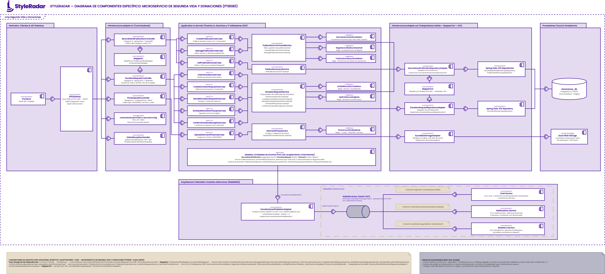
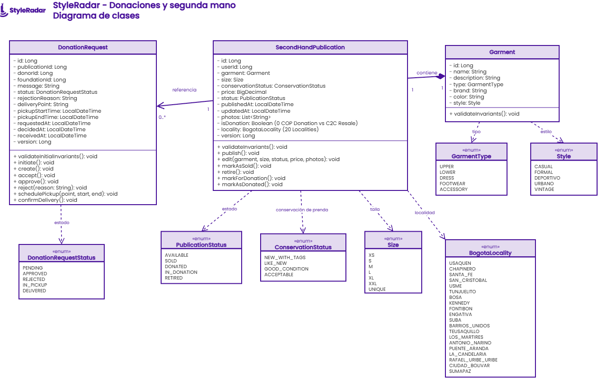
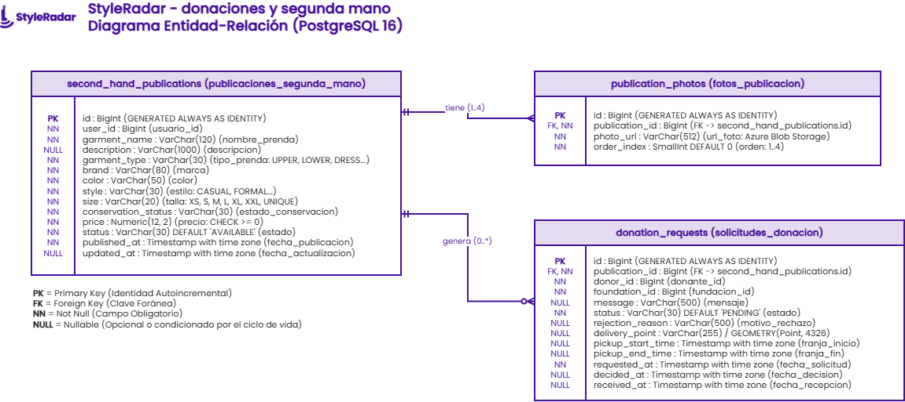
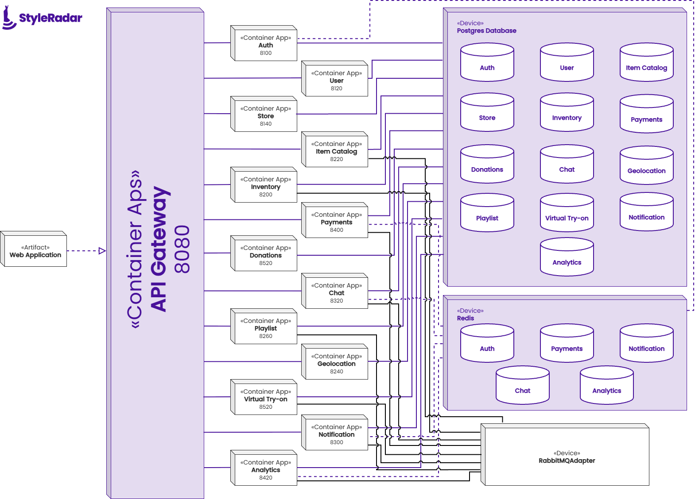
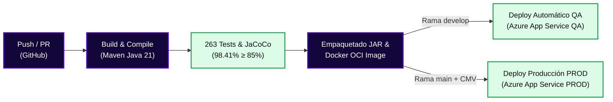

<!-- ==============================================================================
  STYLE RADAR · PLANTILLA MAESTRA DE README PARA MICROSERVICIOS
  Asignatura: DOSW (Diseño y Operación de Soluciones Web) · 2026
  Estándar obligatorio unificado para los microservicios del proyecto StyleRadar.
  Microservicio: PT8080-Donations-Service (ms-segunda-vida-donaciones)
  Squad Asignado: Portal8080 (PT8080)
============================================================================== -->

<div align="center">

  <a href="https://github.com/StyleRadar1">
    
  </a>

  <h1>STYLE<font color="#5600EF">RADAR</font> &nbsp;·&nbsp; <code>ms-segunda-vida-donaciones</code></h1>

  <p align="center">
    
    
    
    
  </p>

  <p align="center">
    <strong><font color="#5600EF">Descubre tu estilo. En tu ciudad.</font></strong><br />
    <em>Plataforma de moda local con inventario multi-sede geolocalizado en tiempo real, economía circular textil, vitrina benéfica y donaciones a fundaciones para Bogotá D.C.</em>
  </p>
  <p align="center">
    <a href="#4-endpoints-y-enlace-a-swagger"></a>
    <a href="#4-endpoints-y-enlace-a-swagger"></a>
    <a href="#4-endpoints-y-enlace-a-swagger"></a>
    <a href="https://github.com/StyleRadar1/PT8080-Donations-Service/actions"></a>
    <a href="https://github.com/StyleRadar1/PT8080-Donations-Service/actions"></a>
    <a href="#9-pruebas-y-cobertura"></a>
    <a href="#9-pruebas-y-cobertura"></a>
  </p>

  <p align="center">
    <a href="#6-tecnologías-y-dependencias">
      
    </a>
    <a href="#6-tecnologías-y-dependencias">
      
    </a>
    <a href="#6-tecnologías-y-dependencias">
      
    </a>
    <a href="#6-tecnologías-y-dependencias">
      
    </a>
    <a href="#6-tecnologías-y-dependencias">
      
    </a>
  </p>

</div>

---

##  ÍNDICE DE CONTENIDOS

1. [Nombre del servicio y su bounded context](#1-nombre-del-servicio-y-su-bounded-context)
2. [Equipo y responsables](#2-equipo-y-responsables)
3. [Arquitectura hexagonal con sus diagramas](#3-arquitectura-hexagonal-con-sus-diagramas)
   - [3.1 Diagrama de Componentes Hexagonal](#31-diagrama-de-componentes-hexagonal)
   - [3.2 Diagrama de Clases del Dominio y Puertos](#32-diagrama-de-clases-del-dominio-y-puertos)
   - [3.3 Diagrama Entidad-Relación de Base de Datos](#33-diagrama-entidad-relación-de-base-de-datos)
   - [3.4 Estructura Oficial de Paquetes](#34-estructura-oficial-de-paquetes)
   - [3.5 Diagrama de Componentes General del Ecosistema](#35-diagrama-de-componentes-general-del-ecosistema)
   - [3.6 Diagrama de Despliegue General](#36-diagrama-de-despliegue-general)
4. [Endpoints y enlace a Swagger](#4-endpoints-y-enlace-a-swagger)
5. [Eventos que publica y consume (RabbitMQ)](#5-eventos-que-publica-y-consume)
6. [Tecnologías y dependencias](#6-tecnologías-y-dependencias)
7. [Cómo ejecutar local y con Docker](#7-cómo-ejecutar-local-y-con-docker)
8. [Variables de entorno](#8-variables-de-entorno)
9. [Pruebas y cobertura](#9-pruebas-y-cobertura)
10. [CI/CD con el badge del pipeline](#10-cicd-con-el-badge-del-pipeline)
11. [Ramas y cómo contribuir](#11-ramas-y-cómo-contribuir)
12. [Enlace a la épica en Jira y requerimientos](#12-enlace-a-la-épica-en-jira)

---

<a id="1-nombre-del-servicio-y-su-bounded-context"></a>

## 1. NOMBRE DEL SERVICIO Y SU BOUNDED CONTEXT

* **Identificador de Servicio:** `PT8080-Donations-Service` (`ms-segunda-vida-donaciones`)
* **Paquete Arquitectónico:** Paquete 5: Probador virtual + Donaciones + API Gateway
* **Puerto de Escucha Oficial:** `8520` (context-path: `/api/v1`)
* **Base de Datos Asignada:** `PostgreSQL 16` (`styleradar_donations_qa` en QA / `styleradar_donations_prod` en PROD), aisladas en Azure Flexible Server bajo el patrón *Database-per-Service*.
* **Almacenamiento de Fotografías:** `Azure Blob Storage` (Cuenta `srdonacionesjmunar`, contenedor público `donaciones-fotos` en `rg-styleradar`).
* **Broker de Mensajería:** `RabbitMQ 3.12` mediante el Topic Exchange compartido `styleradar.exchange` con *Publisher Confirms* y *Correlation ID*.
* **Bounded Context:** `Segunda Vida y Donaciones` (Economía Circular Textil C2C y Sostenibilidad Social en Bogotá D.C.)

### Responsabilidades del Dominio

Este microservicio encapsula exclusivamente la lógica de negocio de economía circular textil para **Bogotá D.C.** dividida en dos ejes:
1. **Compraventa C2C de prendas de segunda mano (`esDonacion = false`, precio > 0 COP):** Publicación con fotografías en Azure Blob Storage, filtros por las 20 localidades de Bogotá, integración con `ms-chat` para acordar venta, y transición a `SOLD` mediante evento RabbitMQ `segunda-mano.prenda.vendida` con `compradorId` obligatorio.
2. **Vitrina Benéfica y Donaciones (`esDonacion = true`, precio 0 COP):** Publicación en Vitrina Abierta con reclamo directo por fundaciones aliadas, control de concurrencia optimista (`@Version`), prevención de auto-donación, coordinación de franjas horarias de entrega en Bogotá y confirmación física con evento `styleradar.donaciones.estado.cambiado`.

| Qué HACE este Microservicio (Alcance) | Qué NO HACE este Microservicio (Límites) |
| :--- | :--- |
| • Gestiona el catálogo circular C2C: publicación con fotos en Azure Blob Storage, tipo, marca, color, estilo, talla, estado de conservación (`ConservationStatus`), precio en COP, edición, venta y retiro voluntario (`SR-RF-33` a `39`). | • NO autentica usuarios ni emite identidades productivas (delegado a `ms-auth` en `:8081`; valida tokens JWT Bearer de forma stateless). |
| • Gestiona la Vitrina Abierta y solicitudes de donación: reclamo concurrente por fundaciones (`@Version`), selección de fundación, aprobación/rechazo, franjas de entrega en Bogotá y confirmación física (`SR-RF-42`, `44` a `49`). | • NO procesa pasarelas de pago monetarias de tiendas comerciales (delegado a `ms-pagos` en `:8090`). |
| • Carga y sirve fotografías de prendas binarias directamente a **Azure Blob Storage** (`donaciones-fotos`) generando URLs públicas de CDN permanentes con fallback resiliente a almacenamiento local. | • NO envía correos ni notificaciones push directas al usuario final (delegado a `ms-notificaciones` en `:8300` vía eventos RabbitMQ). |
| • Aplica control de acceso basado en roles (`USER`, `STORE`, `FOUNDATION`, `ADMIN`) y validación estricta de propiedad (`ResourceOwnershipValidator`) contra ataques IDOR/BOLA (`SR-RNF-04`). | • NO gestiona salas de chat en tiempo real entre compradores y vendedores (delegado a `ms-chat` en `:8200`). |
| • Emite eventos AMQP trazables con `version = 1` y UUID de correlación hacia el bus `styleradar.exchange` con confirmación del broker. | • NO accede directamente a bases de datos de otros microservicios bajo el principio *Database-per-Service*. |

---

<a id="2-equipo-y-responsables"></a>

## 2. EQUIPO Y RESPONSABLES

Desarrollado y mantenido por el **Squad Portal 8080 (`PT8080`)** para la asignatura DOSW 2026:

<div align="center">

| Rol | Nombre Completo |
| :---: | :---: |
| **Líder de Equipo (Scrum Master)** | Daniel Valero Quiroga |
| **Desarrollador Backend (`ms-segunda-vida-donaciones`)** | Juan David Munar |
| **Desarrollador Backend** | Jose Alejandro Martinez Arias |
| **Desarrollador Frontend** | Kevin Ángel |

</div>

---

<a id="3-arquitectura-hexagonal-con-sus-diagramas"></a>

## 3. ARQUITECTURA HEXAGONAL CON SUS DIAGRAMAS

El microservicio implementa **Arquitectura Hexagonal Estricta (Puertos y Adaptadores)** combinada con principios tácticos de **Domain-Driven Design (DDD)**. El núcleo de dominio es 100% puro en Java 21, desacoplado de frameworks web, motores de persistencia o brokers de mensajería. Todos los casos de uso cumplen la convención oficial: **Interfaz de Puerto de Entrada (`domain.port.in.*UseCase`) + Implementación de Aplicación (`application.usecase.*UseCaseImpl`)**.

---

<a id="31-diagrama-de-componentes-hexagonal"></a>

### 3.1 Diagrama de Componentes Hexagonal (`ms-segunda-vida-donaciones`)

Diseñado siguiendo el formato y paleta visual oficial de **StyleRadar** (`#48119A`, `#E4DBF0`), notación **Lollipop (`-(o-`)** para interfaces provistas/requeridas, y representación de bus asíncrono RabbitMQ en tubería 3D:

<div align="center">
  
  <p><sub><b>Figura 3.1:</b> Diagrama de Componentes Hexagonal de <code>ms-segunda-vida-donaciones</code> (PT8080 · Puerto 8520). Detalla adaptadores de entrada REST, puertos de entrada/salida, lógica de dominio con validadores de invariantes, adaptadores JPA, Azure Blob Storage Adapter, y bus asíncrono RabbitMQ con microservicios suscriptores (<code>ms-chat</code>, <code>ms-notificaciones</code>, <code>ms-auditoria-analitica</code>).</sub></p>
  <p>
    📁 <b>Archivo editable Draw.io:</b> <a href="docs/diagramas/drawio/diagrama_componentes_segunda_vida_donaciones.drawio"><code>docs/diagramas/drawio/diagrama_componentes_segunda_vida_donaciones.drawio</code></a>
  </p>
</div>

#### Capas y Flujos Arquitectónicos Representados:
1. **Clientes HTTP & API Gateway:** Peticiones authenticated con JWT Bearer redirigidas a través de `APIGateway` (`:8080`) hacia los controladores REST en `:8520`.
2. **Adaptadores de Entrada (Driving Adapters):**
   - `SecondHandPublicationController`: Catálogo unificado C2C y vitrina benéfica en Bogotá D.C.
   - `DonationRequestController`: Reclamo de vitrina, radicación y coordinación logística de donaciones.
   - `PhotoUploadController`: Endpoint de subida binaria `multipart/form-data` para fotografías de prendas.
   - `AuthController` & `HealthController`: Endpoints demo para Swagger UI y diagnóstico de salud.
   - `GlobalExceptionHandler` & `SecurityConfig`: Manejo centralizado de errores RFC 7807 y filtro JWT.
3. **Casos de Uso & Dominio (Application & Core):**
   - Puertos de Entrada: `CreatePublicationUseCase`, `GetPublicationsUseCase`, `ManagePublicationUseCase`, `CreateDonationRequestUseCase`, `ClaimDonationUseCase`, `DecideDonationRequestUseCase`, `ScheduleDonationPickupUseCase`, `ConfirmDonationReceiptUseCase`, `UploadGarmentPhotoUseCase`, `GetPartnerFoundationsUseCase`.
   - Validadores de Invariantes: `LocalidadBogota` (20 localidades de Bogotá D.C.), `GarmentPriceValidator` (0 COP donación / >0 COP venta), `GarmentImagePolicyValidator` (formatos JPEG/PNG/WEBP, máx 5MB con *magic bytes*), `DonationInvariantsValidator` (anti-auto-donación).
4. **Adaptadores de Salida (Driven Adapters):**
   - `PublicationPersistenceAdapter` & `DonationRequestPersistenceAdapter`: Persistencia relacional con Spring Data JPA y `PublicationSpecifications`.
   - `TiendasFoundationCatalogAdapter`: Cliente HTTP `RestClient` hacia `ms-tiendas` para listar fundaciones aliadas activas, resolver `representanteId` y validar `activa == true` (`SR-RF-44`).
   - `AzureBlobStorageAdapter`: Subida binaria de imágenes al contenedor `donaciones-fotos` en Azure Blob Storage vía SDK oficial `com.azure:azure-storage-blob` con fallback local resiliente en perfiles `local/dev/test`.
   - `DonationEventPublisherAdapter` / `RabbitMQEventPublisherAdapter`: Publicación AMQP transaccional *after-commit* con *Publisher Confirms*.
5. **Proveedores Cloud & Mensajería Asíncrona:**
   - Base de Datos: PostgreSQL 16 (`styleradar_donations_*` en Azure Flexible Server).
   - Cloud Storage: Azure Blob Storage (`srdonacionesjmunar` en `rg-styleradar`).
   - Broker AMQP: Tubería RabbitMQ sobre el exchange compartido `styleradar.exchange`, enrutando hacia `ms-chat`, `ms-notificaciones` y `ms-auditoria-analitica`.

---

<a id="32-diagrama-de-clases-del-dominio-y-puertos"></a>

### 3.2 Diagrama de Clases del Modelo de Dominio y Puertos

Diseñado 100% en inglés técnico alineado estrictamente con el código fuente en Java 21:

<div align="center">
  
  <p><sub><b>Figura 3.2:</b> Diagrama de Clases del dominio de <code>ms-segunda-vida-donaciones</code>. Modela entidades agregadas (<code>SecondHandPublication</code>, <code>DonationRequest</code>), value objects inmutables (<code>Garment</code>), puertos de entrada/salida, casos de uso y enums de dominio (<code>BogotaLocality</code>, <code>ConservationStatus</code>, <code>GarmentType</code>, <code>PublicationStatus</code>, <code>DonationRequestStatus</code>).</sub></p>
  <p>
    📁 <b>Archivo editable Draw.io:</b> <a href="docs/diagramas/drawio/diagrama_clases_sprint3.drawio"><code>docs/diagramas/drawio/diagrama_clases_sprint3.drawio</code></a>
  </p>
</div>

#### Componentes del Modelo de Dominio:
* **Entidad Raíz de Agregado `SecondHandPublication`:**
  - Atributos: `id: Long`, `userId: Long`, `garment: Garment`, `size: Size`, `conservationStatus: ConservationStatus`, `price: BigDecimal`, `isDonation: Boolean`, `locality: BogotaLocality`, `version: Long (@Version)`, `status: PublicationStatus`, `publishedAt: LocalDateTime`, `updatedAt: LocalDateTime`, `photos: List<String>`.
  - Invariantes y Métodos de Negocio: `validateInvariants()`, `markAsSold(buyerId)`, `markForDonation()`, `retire()`, `markAsDonated()`, `edit(...)`.
* **Value Object Inmutable `Garment`:**
  - Encapsula: `type: GarmentType`, `brand: String`, `color: String`, `style: Style`, `description: String`.
* **Entidad Raíz de Agregado `DonationRequest`:**
  - Atributos: `id: Long`, `publicationId: Long`, `donorId: Long`, `foundationId: Long`, `message: String`, `status: DonationRequestStatus`, `rejectionReason: String`, `deliveryPoint: String`, `slotStart: LocalDateTime`, `slotEnd: LocalDateTime`, `version: Long (@Version)`, `requestDate: LocalDateTime`, `decisionDate: LocalDateTime`, `receptionDate: LocalDateTime`.
  - Métodos de Negocio: `approve()`, `reject(reason)`, `schedulePickup(point, start, end)`, `confirmReceipt()`.
* **Enumeraciones de Dominio:**
  - `LocalidadBogota`: Las 20 localidades oficiales del Distrito Capital (`USAQUEN`, `CHAPINERO`, `SANTA_FE`, `SAN_CRISTOBAL`, `USME`, `TUNJUELITO`, `BOSA`, `KENNEDY`, `FONTIBON`, `ENGATIVA`, `SUBA`, `BARRIOS_UNIDOS`, `TEUSAQUILLO`, `LOS_MARTIRES`, `ANTONIO_NARINO`, `PUENTE_ARANDA`, `LA_CANDELARIA`, `RAFAEL_URIBE_URIBE`, `CIUDAD_BOLIVAR`, `SUMAPAZ`).
  - `ConservationStatus`: `NEW_WITH_TAGS`, `LIKE_NEW`, `GOOD_CONDITION`, `ACCEPTABLE`.
  - `GarmentType` *(9 categorías oficiales)*: `CAMISAS` (`Camisas`), `CAMISETAS` (`Camisetas`), `SUETERES` (`Suéteres`), `CHAQUETAS` (`Chaquetas`), `PANTALONES` (`Pantalones`), `FALDAS` (`Faldas`), `VESTIDOS` (`Vestidos`), `CALZADO` (`Calzado`), `ACCESORIOS` (`Accesorios`). Soporta alias retrocompatibles (`UPPER`, `LOWER`, `DRESS`, `FULL_BODY`, `FOOTWEAR`, `ACCESSORY`).
  - `Size` *(18 tallas estandarizadas)*: `XS`, `S`, `M`, `L`, `XL`, `XXL`, `28`, `30`, `32`, `34`, `36`, `37`, `38`, `39`, `40`, `41`, `42`, `Unica` (`TALLA_28`..`TALLA_42`, `UNICA`; alias `ONE_SIZE`).
  - `PublicationStatus`: `AVAILABLE`, `SOLD`, `DONATED`, `IN_DONATION`, `RETIRED`.
  - `DonationRequestStatus`: `PENDING`, `APPROVED`, `REJECTED`, `IN_PICKUP`, `DELIVERED`.

---

<a id="33-diagrama-entidad-relación-de-base-de-datos"></a>

### 3.3 Diagrama Entidad-Relación de Base de Datos (PostgreSQL 16)

<div align="center">
  
  <p><sub><b>Figura 3.3:</b> Modelo físico relacional en PostgreSQL 16 desplegado en Azure Flexible Server con bloqueo optimista (<code>version</code>), discriminador de donación (<code>es_donacion</code>) y restricción territorial en Bogotá (<code>localidad</code>).</sub></p>
  <p>
    📁 <b>Archivo editable Draw.io:</b> <a href="docs/diagramas/drawio/diagrama_er_sprint3.drawio"><code>docs/diagramas/drawio/diagrama_er_sprint3.drawio</code></a>
  </p>
</div>

#### Tablas del Microservicio:
1. **`publicaciones_segunda_mano`:** Almacena prendas unificadas de C2C y donación.
   - Columnas: `id BIGINT PK`, `usuario_id BIGINT NOT NULL`, `nombre_prenda VARCHAR(120) NOT NULL`, `descripcion VARCHAR(500)`, `tipo_prenda VARCHAR(30) NOT NULL`, `marca VARCHAR(60)`, `color VARCHAR(30) NOT NULL`, `estilo VARCHAR(30)`, `talla VARCHAR(20) NOT NULL`, `estado_conservacion VARCHAR(30) NOT NULL`, `precio NUMERIC(12,2) NOT NULL`, `es_donacion BOOLEAN NOT NULL`, `localidad VARCHAR(50) NOT NULL`, `estado VARCHAR(30) NOT NULL`, `version BIGINT NOT NULL DEFAULT 0`, `fecha_publicacion TIMESTAMP NOT NULL`, `fecha_actualizacion TIMESTAMP NOT NULL`.
2. **`fotos_publicacion`:** Galería fotográfica de 1 a 4 fotos alojadas en Azure Blob Storage.
   - Columnas: `id BIGINT PK`, `publicacion_id BIGINT NOT NULL FK`, `url_foto VARCHAR(512) NOT NULL`, `orden INT NOT NULL`. Relación `ON DELETE CASCADE`.
3. **`solicitudes_donacion`:** Registro trazable del ciclo logístico benéfico hacia fundaciones aliadas.
   - Columnas: `id BIGINT PK`, `publicacion_id BIGINT NOT NULL FK`, `donante_id BIGINT NOT NULL`, `fundacion_id BIGINT NOT NULL`, `mensaje VARCHAR(500)`, `estado VARCHAR(30) NOT NULL`, `motivo_rechazo VARCHAR(500)`, `punto_entrega VARCHAR(255)`, `franja_inicio TIMESTAMP`, `franja_fin TIMESTAMP`, `version BIGINT NOT NULL DEFAULT 0`, `fecha_solicitud TIMESTAMP NOT NULL`, `fecha_decision TIMESTAMP`, `fecha_recepcion TIMESTAMP`.

---

<a id="34-estructura-oficial-de-paquetes"></a>

### 3.4 Estructura Oficial de Paquetes en `src/main/java/`

```text
src/main/java/edu/dosw/styleradar/donaciones/
├── DonationsServiceApplication.java             <-- Punto de entrada Spring Boot 3.3.4
├── domain/                                      <-- NÚCLEO DE DOMINIO PURO (Java estándar, 0 dependencias)
│   ├── model/                                   <-- SecondHandPublication, Garment, DonationRequest, SearchCriteria, Enums
│   ├── event/                                   <-- Eventos de dominio puros (PublicationCreatedEvent, etc.)
│   ├── exception/                               <-- DomainException, DomainConflictException, ResourceNotFoundException
│   └── port/
│       ├── in/                                  <-- 10 Interfaces *UseCase y Commands inmutables
│       └── out/                                 <-- PublicationRepositoryPort, DonationRequestRepositoryPort, PhotoStoragePort, DonationEventPublisherPort, FoundationCatalogPort
├── application/                                 <-- CAPA DE APLICACIÓN (Orquestación de Casos de Uso)
│   ├── usecase/                                 <-- 10 Clases *UseCaseImpl (@Service / @Transactional) + TransactionEventHelper
│   └── dto/                                     <-- Request DTOs, Response DTOs y Mappers de aplicación
└── infrastructure/                              <-- CAPA DE INFRAESTRUCTURA (Tecnologías y Frameworks)
    ├── adapter/
    │   ├── in/
    │   │   ├── rest/                            <-- SecondHandPublicationController, DonationRequestController, PhotoUploadController, AuthController, HealthController
    │   │   └── messaging/                       <-- NotificationConsumerSimulator (Consumidor de prueba E2E)
    │   └── out/
    │       ├── external/                        <-- TiendasFoundationCatalogAdapter + TiendasFoundationResponseDTO
    │       ├── persistence/                     <-- PublicationPersistenceAdapter, DonationRequestPersistenceAdapter, JPA Repositories
    │       ├── storage/                         <-- AzureBlobStorageAdapter (Azure Blob Storage SDK con fallback local)
    │       └── messaging/                       <-- DonationEventPublisherAdapter, RabbitMQEventPublisherAdapter
    ├── security/                                <-- SecurityConfig (CORS + RBAC), JwtAuthenticationFilter, JwtTokenProvider (ms-auth), ResourceOwnershipValidator
    └── config/                                  <-- OpenApiConfig, RabbitMQConfig, TiendasClientConfig, TiendasProperties
```

---

<a id="35-diagrama-de-componentes-general-del-ecosistema"></a>

### 3.5 Diagrama de Componentes General del Ecosistema (`StyleRadar`)

Vista global de integración del ecosistema completo de **12 microservicios**, **API Gateway**, caché **Redis**, buses **RabbitMQ**, bases de datos aisladas y sistemas externos (`Google OAuth`, `MercadoPago API`, `Azure Blob Storage`, `FASHN AI API`):

<div align="center">
  
  <p><sub><b>Figura 3.4:</b> Diagrama de Componentes General de StyleRadar. Muestra la entrada desde <code>StyleRadar Client (Web App)</code> a través del <code>API Gateway</code> en notación <i>Lollipop</i> hacia los 12 microservicios, incluyendo <code>ms-segunda-vida</code> y sus dependencias con <code>segunda_vida_db</code>, <code>Azure Blob Storage</code>, <code>RabbitMQ</code> y <code>ms-tiendas</code> / <code>ms-chat</code> / <code>ms-notificaciones</code>.</sub></p>
  <p>
    📁 <b>Archivo editable Draw.io:</b> <a href="docs/diagramas/drawio/componentesGeneralSR.drawio"><code>docs/diagramas/drawio/componentesGeneralSR.drawio</code></a>
  </p>
</div>

**Descripción arquitectónica del Diagrama de Componentes General:**

1. **Plano de Entrada y Enrutamiento (`API Gateway`):** `StyleRadar Client (Web App)` centraliza todas las peticiones hacia un único `API Gateway`, el cual expone e interconecta los puertos/interfaces *Lollipop* de los 12 microservicios activos del ecosistema (`ms-auth`, `ms-usuarios`, `ms-tiendas`, `ms-notificaciones`, `ms-inventario`, `ms-itemcatalogo`, `ms-segunda-vida`, `ms-chat`, `ms-playlist`, `ms-pagos`, `ms-geolocalizacion` y `ms-probador-virtual`).
2. **Aislamiento de Persistencia (*Database-per-Service*):** Cada microservicio opera sobre su propio motor o esquema dedicado (`usuarios_db`, `tiendas_db`, `notificaciones_db`, `inventario_db`, `catalogo_db`, `segunda_vida_db`, `chat_db`, `playlist_db`, `pagos_db`, `geo_db` y `probador_db`), evitando acoplamiento directo en base de datos.
3. **Ubicación e Integraciones de `ms-segunda-vida`:**
   * Persiste publicaciones y solicitudes de donación en **`segunda_vida_db`**.
   * Consume **`Azure Blob Storage`** para el almacenamiento de fotografías de prendas cargadas desde `POST /api/v1/second-hand/photos`.
   * Interactúa de forma síncrona/lógica en la malla del backend con **`ms-tiendas`** (validación de fundaciones aliadas y representantes), **`ms-chat`** (acuerdos C2C) y **`ms-notificaciones`**.
   * Emite eventos asíncronos mediante los buses **`RabbitMQ`** (`RabbitMQ Notificaciones` y `RabbitMQ Pagos`) junto con caché compartida **`Redis`** para el ecosistema.
4. **Sistemas Externos Conectados:** Además de `Azure Blob Storage` para almacenamiento multimedia, el ecosistema integra **`Google OAuth`** (en `ms-auth`), **`MercadoPago API`** (en `ms-pagos`) y **`FASHN AI API`** (en `ms-probador-virtual`).

---

<a id="36-diagrama-de-despliegue-general"></a>

### 3.6 Diagrama de Despliegue General (`Container Apps` & Infraestructura)

Distribución física y topología de despliegue de los microservicios en **Container Apps**, asignación de puertos por servicio (`API Gateway :8080`, `Donations :8520`, `Store :8140`, etc.), instancias de **PostgreSQL** (*Database-per-Service*), caché **Redis** y nodo **RabbitMQAdapter**:

<div align="center">
  
  <p><sub><b>Figura 3.5:</b> Diagrama de Despliegue General de StyleRadar. Detalla el artefacto <code>Web Application</code> comunicándose con <code>&lt;&lt;Container Apps&gt;&gt; API Gateway (8080)</code>, el contenedor <code>Donations (8520)</code>, el dispositivo <code>Postgres Database</code> con sus esquemas aislados, <code>Redis</code> y <code>RabbitMQAdapter</code>.</sub></p>
  <p>
    📁 <b>Archivo editable Draw.io:</b> <a href="docs/diagramas/drawio/DiagramaDespliegueSR.drawio"><code>docs/diagramas/drawio/DiagramaDespliegueSR.drawio</code></a>
  </p>
</div>

**Descripción arquitectónica del Diagrama de Despliegue General:**

1. **Cliente y Puerta de Enlace (`API Gateway :8080`):** El artefacto `«Artifact» Web Application` interactúa únicamente con el contenedor `«Container Apps» API Gateway (8080)`, que actúa como punto único de entrada y enrutador interno hacia todos los contenedores del entorno.
2. **Nodos de Microservicios (`«Container App»`):** El plano de ejecución contiene los 12 contenedores activos con su asignación oficial de puertos internos: `Auth (8100)`, `User (8120)`, `Store (8140)`, `Inventory (8200)`, `Item Catalog (8220)`, `Geolocation (8240)`, `Playlist (8260)`, `Notification (8300)`, `Chat (8320)`, `Payments (8400)` y **`Donations (8520)`** (correspondiente a este microservicio `ms-segunda-vida-donaciones`), además de `Virtual Try-on (8520)`.
3. **Capa de Infraestructura de Datos (`«Device» Postgres Database`):** Agrupa las bases de datos dedicadas por microservicio (`Auth`, `User`, `Store`, `Inventory`, `Item Catalog`, `Payments`, `Chat`, `Playlist`, `Geolocation`, `Virtual Try-on` y **`Donations`**), garantizando aislamiento transaccional en PostgreSQL.
4. **Mensajería y Caché Distribuida (`RabbitMQAdapter` y `Redis`):**
   * **`«Device» Redis`:** Provee caché en memoria y gestión de sesiones/tokens para `Auth`, `Payments`, `Notification` y `Chat`.
   * **`«Device» RabbitMQAdapter`:** Actúa como bus central de mensajería asíncrona AMQP entre los contenedores productores y consumidores (`Donations`, `Notification`, `Chat` y `Payments`, entre otros).

---

<a id="4-endpoints-y-enlace-a-swagger"></a>

## 4. ENDPOINTS Y ENLACE A SWAGGER

El microservicio se encuentra desplegado y activo en **Microsoft Azure** dentro del Resource Group dedicado **`rg-styleradar`** (`Canada Central` / `East US 2`).

### 4.1 Matriz Oficial de Enlaces por Entorno (PROD, QA, LOCAL)

| Entorno | Estado | Propósito | URL Base del Servicio | Swagger OpenAPI UI | Health Check (`/health`) |
| :--- | :---: | :--- | :--- | :--- | :--- |
| **Producción (`PROD`)** | 🟢 **Active** | Entorno productivo en Azure Cloud con perfil endurecido | `https://styleradar-donaciones-prod-jmunar.azurewebsites.net` | [Swagger UI PROD](https://styleradar-donaciones-prod-jmunar.azurewebsites.net/api/v1/swagger-ui/index.html) | [`/api/v1/health`](https://styleradar-donaciones-prod-jmunar.azurewebsites.net/api/v1/health) |
| **Calidad (`QA`)** | 🟢 **Active** | Entorno de pruebas integradas y staging en Azure Cloud | `https://styleradar-donaciones-qa-jmunar.azurewebsites.net` | [Swagger UI QA](https://styleradar-donaciones-qa-jmunar.azurewebsites.net/api/v1/swagger-ui/index.html) | [`/api/v1/health`](https://styleradar-donaciones-qa-jmunar.azurewebsites.net/api/v1/health) |
| **Desarrollo Local (`DEV`)** | 🟢 **Active** | Entorno local de desarrollo (H2 o Docker Compose) | `http://localhost:8520` | [Swagger UI Local](http://localhost:8520/api/v1/swagger-ui.html) | [`/api/v1/health`](http://localhost:8520/api/v1/health) |

* **Especificación OpenAPI (JSON Contrato):** [`/api/v1/v3/api-docs`](https://styleradar-donaciones-qa-jmunar.azurewebsites.net/api/v1/v3/api-docs)
* **Colección Postman & Newman (Suite completa de todos los endpoints y códigos HTTP):** [`docs/postman/`](docs/postman/) (`StyleRadar-Donations-Service.postman_collection.json`, entornos `Local`/`QA` y simulador `mock-tiendas.js`)

### 4.2 Tabla Canónica de Endpoints REST Expuestos

Todos los endpoints responden bajo el estándar **RFC 7807 (`application/problem+json`)** para códigos de error con esquemas y ejemplos detallados en Swagger UI:

| Tag Swagger | Método | Endpoint Canónico | RF Asociado | Descripción | Rol Requerido | Códigos HTTP |
| :--- | :---: | :--- | :---: | :--- | :--- | :---: |
| **Diagnóstico** | `GET` | `/api/v1/health` | Diagnóstico | Estado UP, versión, puerto y hash de commit | Público | `200` |
| **Autenticación Demo** | `POST` | `/api/v1/auth/login` | Seguridad | Iniciar sesión por email y password en Swagger | local/dev/test | `200`, `400`, `500` |
| **Autenticación Demo** | `GET` | `/api/v1/auth/quick-token` | Seguridad | Generar token JWT rápido por rol (`USER`, `FOUNDATION`, `ADMIN`) | local/dev/test | `200`, `400`, `500` |
| **Autenticación Demo** | `GET` | `/api/v1/auth/demo-users` | Seguridad | Catálogo de identidades demo precargadas | local/dev/test | `200`, `500` |
| **Carga de Fotos** | `POST` | `/api/v1/second-hand/photos` | Azure Storage | Subir imagen (JPEG/PNG/WEBP, máx 5MB) a Azure Blob Storage | `USER`, `STORE`, `FOUNDATION`, `ADMIN` | `201`, `400`, `401`, `403`, `500` |
| **Economía Circular** | `POST` | `/api/v1/second-hand/publications` | `SR-RF-33` | Publicar prenda para reventa C2C (>0 COP) o donación (0 COP), incluyendo atributos, conservación (`ConservationStatus`) y precio | `USER`, `STORE`, `ADMIN` | `201`, `400`, `401`, `403`, `500` |
| **Economía Circular** | `GET` | `/api/v1/second-hand/publications` | `SR-RF-36` | Explorar y buscar prendas (`?search=` / `?searchTerm=`, categoría, color, talla, localidad, precio, `AVAILABLE` por defecto) | Público | `200`, `400`, `500` |
| **Economía Circular** | `GET` | `/api/v1/second-hand/publications/{id}` | `SR-RF-36` | Consultar detalle de publicación por ID | Público | `200`, `404`, `500` |
| **Economía Circular** | `GET` | `/api/v1/second-hand/publications/users/{userId}` | `SR-P5-N04` | Consultar y gestionar listado de publicaciones propias del usuario | Propietario, `ADMIN` | `200`, `401`, `403`, `500` |
| **Economía Circular** | `PUT` | `/api/v1/second-hand/publications/{id}` | `SR-RF-37` | Editar prenda (precio, fotos, talla, descripción obligatoria) en estado `AVAILABLE` | Propietario, `ADMIN` | `200`, `400`, `401`, `403`, `404`, `409`, `500` |
| **Economía Circular** | `PATCH` | `/api/v1/second-hand/publications/{id}/sale` | `SR-RF-38` | Marcar como vendida (`SOLD`), exigiendo `compradorId` para `ms-chat` | Propietario, `ADMIN` | `200`, `400`, `401`, `403`, `404`, `409`, `500` |
| **Economía Circular** | `DELETE` | `/api/v1/second-hand/publications/{id}` | `SR-RF-39` | Retirar publicación activa de la vitrina (bloquea `SOLD`, `IN_DONATION`, `DONATED`) | Propietario, `ADMIN` | `204`, `401`, `403`, `404`, `409`, `500` |
| **Economía Circular** | `PATCH` | `/api/v1/second-hand/publications/{id}/donation` | `SR-RF-42` | Convertir publicación existente al canal benéfico (`IN_DONATION`, precio `0 COP`) | Propietario, `ADMIN` | `200`, `401`, `403`, `404`, `409`, `500` |
| **Vitrina Benéfica** | `GET` | `/api/v1/donations/foundations` | `SR-RF-45` | Listar fundaciones aliadas activas desde `ms-tiendas` (filtro opcional `?category=`) | `USER`, `STORE`, `FOUNDATION`, `ADMIN` | `200`, `401`, `503` |
| **Vitrina Benéfica** | `GET` | `/api/v1/donations/foundations/representative` | `SR-RF-45` | Obtener la fundación asociada al representante autenticado (`sub` ↔ `representanteId`) | `FOUNDATION`, `ADMIN` | `200`, `401`, `403`, `404`, `503` |
| **Vitrina Benéfica** | `GET` | `/api/v1/donations/foundations/{foundationId}` | `SR-RF-45` | Consultar detalle institucional de una fundación activa en `ms-tiendas` | `USER`, `STORE`, `FOUNDATION`, `ADMIN` | `200`, `400`, `401`, `404`, `503` |
| **Vitrina Benéfica** | `POST` | `/api/v1/donations/claims` | `SR-P5-N05` | Reclamar prenda disponible desde la Vitrina Abierta por una fundación con bloqueo optimista (`@Version`) | `FOUNDATION`, `ADMIN` | `201`, `400`, `401`, `403`, `404`, `409`, `503` |
| **Vitrina Benéfica** | `POST` | `/api/v1/donations` | `SR-RF-45` | Crear solicitud de donación validando fundación activa en `ms-tiendas` y propuesta de entrega (`deliveryMode`, `deliveryPoint`, `startTime`, `endTime`) | `USER`, `STORE`, `ADMIN` | `201`, `400`, `401`, `403`, `404`, `409`, `503` |
| **Vitrina Benéfica** | `GET` | `/api/v1/donations/{id}` | `SR-RF-46` | Consultar estado y cita logística de una solicitud (protegido contra BOLA/IDOR) | Donante, Fundación, `ADMIN` | `200`, `401`, `403`, `404`, `500` |
| **Vitrina Benéfica** | `GET` | `/api/v1/donations/donors/{donorId}` | `SR-RF-46` | Historial de solicitudes originadas por el donante | Donante propietario, `ADMIN` | `200`, `401`, `403`, `500` |
| **Vitrina Benéfica** | `GET` | `/api/v1/donations/foundations/{foundationId}/requests` | `SR-RF-46` | Bandeja de solicitudes recibidas por la fundación (`?status=` opcional) | Fundación receptora / Representante, `ADMIN` | `200`, `401`, `403`, `500` |
| **Vitrina Benéfica** | `PATCH` | `/api/v1/donations/{id}/decision` | `SR-RF-47` | Aceptar (`APPROVED`) o rechazar (`REJECTED`, revierte prenda a `AVAILABLE`) | Fundación receptora / Representante, `ADMIN` | `200`, `400`, `401`, `403`, `404`, `409`, `500` |
| **Vitrina Benéfica** | `PATCH` | `/api/v1/donations/{id}/pickup` | `SR-RF-45` / `SR-P5-N05` | Agendar franja horaria futura (`America/Bogota`) y punto de entrega tras aprobación o reclamo | Donante, Fundación / Representante, `ADMIN` | `200`, `400`, `401`, `403`, `404`, `409`, `500` |
| **Vitrina Benéfica** | `PATCH` | `/api/v1/donations/{id}/confirmation` | `SR-RF-49` | Confirmar recepción física (`DELIVERED`), marcar prenda `DONATED` y emitir comprobante `SR-DON-XXXX` | Fundación receptora / Representante, `ADMIN` | `200`, `400`, `401`, `403`, `404`, `409`, `500` |

---

<a id="5-eventos-que-publica-y-consume"></a>

## 5. EVENTOS QUE PUBLICA Y CONSUME (RABBITMQ)

La integración asíncrona se realiza a través de **RabbitMQ 3.12** utilizando Topic Exchanges compartidos en StyleRadar:

* **Exchange General:** `styleradar.exchange` (`topic`, durable)
* **Exchange para Chat (homologado):** `styleradar.exchange` (`topic`, durable)
* **Dead Letter Exchange (DLX):** `styleradar.dlx` con cola `styleradar.donaciones.dlq`
* **Garantías de Entrega:** *Publisher Confirms* (`correlated`), *Publisher Returns* y trazabilidad con `version = 1` y `correlationId` UUID.

### Matriz de Eventos AMQP Integrados

| Tipo | Exchange | Routing Key | Emisor ➔ Receptor | Payload y Propósito de Integración |
| :---: | :--- | :--- | :--- | :--- |
| **PUBLICA** | `styleradar.exchange` | `segunda-mano.prenda.vendida` *(chat)* / `styleradar.segundavida.prenda.vendida` *(notif.)* | `ms-segunda-vida-donaciones` ➔ `ms-chat` & `ms-notificaciones` | `{ "version": 1, "correlationId": "...", "publicacionId": 10, "vendedorId": 101, "compradorId": 102, "interesadosIds": [...], "timestamp": "..." }`<br>Permite a `ms-chat` conservar abierta la conversación del comprador y cerrar las demás, y a `ms-notificaciones` avisar a los interesados (`interesadosIds` opcional en `PATCH /sale` o provistos por Chat). |
| **PUBLICA** | `styleradar.exchange` | `styleradar.donaciones.solicitud.creada` | `ms-segunda-vida-donaciones` ➔ `ms-notificaciones` | `{ "eventId": "...", "eventType": "donacion.solicitud.creada", "solicitudId": 1, "donanteId": 101, "fundacionId": 501, "representanteId": 24, "fundacionUsuarioId": 24, ... }`<br>Notifica al representante de la fundación sobre nuevas postulaciones o reclamos en Vitrina Abierta. |
| **PUBLICA** | `styleradar.exchange` | `styleradar.donaciones.estado.cambiado` | `ms-segunda-vida-donaciones` ➔ `ms-notificaciones` | `{ "version": 1, "correlationId": "...", "solicitudId": 1, "donanteId": 101, "fundacionId": 501, "nuevoEstado": "APPROVED", ... }`<br>Dispara alertas push/email al donante y a la fundación ante cambios de estado en el ciclo benéfico. |
| **CONSUME** | `styleradar.exchange` | `styleradar.donaciones.estado.cambiado` | `styleradar.exchange` ➔ `NotificationConsumerSimulator` | Consumidor de prueba E2E aislable mediante `RABBITMQ_SIMULATOR_ENABLED=true` para verificar la emisión local sin depender de servicios externos. |

---

<a id="6-tecnologías-y-dependencias"></a>

## 6. TECNOLOGÍAS Y DEPENDENCIAS

El stack tecnológico de `PT8080-Donations-Service` cumple con el estándar unificado de DOSW 2026:

| Capa / Componente | Tecnología | Versión | Justificación Técnica |
| :--- | :--- | :--- | :--- |
| **Lenguaje Core** | Java LTS (Eclipse Temurin) | `21` | Virtual Threads, Records inmutables y Pattern Matching. |
| **Framework Base** | Spring Boot | `3.3.4` | Soporte nativo para WebMVC, Data JPA, Security, AMQP y Actuator. |
| **Cloud Storage** | Azure Blob Storage SDK | `12.28.0` | `com.azure:azure-storage-blob` para almacenamiento de fotos en nube con fallback local. |
| **Seguridad y Tokens** | Spring Security + JJWT | `6.3.x` / `0.13.0` | Validación stateless de JWT con firma HMAC-SHA256 (`HS256`) y claim `exp`. |
| **Base de Datos** | PostgreSQL | `16` | Integridad ACID, bloqueo optimista (`@Version`) y aislamiento *Database-per-Service*. |
| **Control de Esquema** | Flyway Core | `10.10.0` | Migraciones reproducibles (`V1__init_schema.sql` .. `V5__migrate_garment_type_and_size_enums.sql`). |
| **Broker de Mensajería** | RabbitMQ (Spring AMQP) | `3.12` | Topic Exchanges durables con confirmaciones de publicación (*Publisher Confirms*). |
| **Mapeo y Boilerplate** | MapStruct + Lombok | `1.5.5` / `1.18.38` | Reducción de código repetitivo compatible con JDK 21. |
| **Documentación API** | SpringDoc OpenAPI | `2.5.0` | Especificación OpenAPI 3.0 con Swagger UI, esquemas RFC 7807 y ejemplos interactivos. |
| **Testing Automatizado** | JUnit 5 + Mockito + H2 + Testcontainers | `5.10.3` | **262 pruebas pasando en local** *(263 totales: 0 fallos, 0 errores, 1 prueba PostgreSQL condicional para CI omitida en local)* + **108 aserciones Newman/Postman**. |
| **Métricas de Cobertura** | JaCoCo Maven Plugin | `0.8.12` | Verificación estricta de cobertura mínima (≥ 85%) alcanzando **98.41% líneas / 98.36% instrucciones / 89.82% ramas**. |

---

<a id="7-cómo-ejecutar-local-y-con-docker"></a>

## 7. CÓMO EJECUTAR LOCAL Y CON DOCKER

### Prerrequisitos de Entorno

* **Java Development Kit (JDK):** Versión 21 LTS instalada (`java -version`).
* **Apache Maven:** Versión 3.9+ instalada (`mvn -version`).
* **Docker Engine & Docker Compose (Opcional):** Versión 24+ en ejecución (`docker --version`).

### Opción 1: Ejecución Instantánea Local con Perfil H2 (`local` por defecto, sin dependencias externas)

No requiere levantar Docker ni bases de datos externas; `spring.profiles.default: local` activa automáticamente el perfil `local` con H2 y el secreto JWT de desarrollo:

```powershell
mvn spring-boot:run
```

* **Swagger UI:** [http://localhost:8520/api/v1/swagger-ui.html](http://localhost:8520/api/v1/swagger-ui.html)
* **Health Check:** [http://localhost:8520/api/v1/health](http://localhost:8520/api/v1/health)

### Opción 2: Ejecución Contenerizada con Docker Compose (PostgreSQL 16 + RabbitMQ)

```bash
# 1. Clonar el repositorio
git clone https://github.com/StyleRadar1/PT8080-Donations-Service.git
cd PT8080-Donations-Service

# 2. Levantar la suite completa
docker compose up -d --build

# 3. Verificar estado saludable
docker compose ps
```

---

<a id="8-variables-de-entorno"></a>

## 8. VARIABLES DE ENTORNO

Todas las configuraciones se gestionan de forma desacoplada conforme a los principios de **Twelve-Factor App**:

| Variable | Descripción | Valor por Defecto (`dev`/`local`) | Requerido en Prod |
| :--- | :--- | :--- | :---: |
| `SERVER_PORT` / `PORT` | Puerto HTTP de escucha | `8520` | Sí |
| `SPRING_PROFILES_ACTIVE` | Perfil activo (`local`, `dev`, `qa`, `prod`, `test`) | `dev` | Sí |
| `DB_HOST` | Hostname de PostgreSQL | `localhost` | Sí |
| `DB_PORT` | Puerto de PostgreSQL | `5434` (`5432` en Azure) | Sí |
| `DB_NAME` | Nombre de la base de datos | `styleradar_donations` | Sí |
| `DB_USER` | Usuario de base de datos | `styleradar_user` | Sí |
| `DB_PASSWORD` | Contraseña de base de datos | `<configured_in_env>` | Sí |
| `DB_SSLMODE` | Modo SSL JDBC para Azure | `disable` (`require` en Cloud) | Sí |
| `AZURE_STORAGE_CONNECTION_STRING` | Connection String de Azure Blob Storage | *(vacío activa fallback local)* | Opcional |
| `AZURE_STORAGE_CONTAINER_NAME` | Contenedor público de blobs | `donaciones-fotos` | Sí |
| `AZURE_STORAGE_BLOB_ENDPOINT` | URL base del storage account | `https://srdonacionesjmunar.blob.core.windows.net` | Sí |
| `RABBITMQ_HOST` | Hostname del broker RabbitMQ | `localhost` | Sí |
| `RABBITMQ_PORT` | Puerto AMQP (`5672` local / `5671` TLS nube) | `5672` | Sí |
| `RABBITMQ_USERNAME` | Usuario de conexión RabbitMQ | `guest` | Sí |
| `RABBITMQ_PASSWORD` | Contraseña de conexión RabbitMQ | `guest` | Sí |
| `RABBITMQ_EXCHANGE` | Exchange compartido de eventos | `styleradar.exchange` | Sí |
| `RABBITMQ_CHAT_EXCHANGE` | Exchange para eventos hacia chat | `styleradar.exchange` | Sí |
| `RABBITMQ_ROUTING_KEY_SEGUNDA_VIDA` | Routing key de venta hacia `ms-chat` | `segunda-mano.prenda.vendida` | Sí |
| `RABBITMQ_ROUTING_KEY_NOTIFICACIONES_SEGUNDA_VIDA` | Routing key de venta hacia `ms-notificaciones` | `styleradar.segundavida.prenda.vendida` | Sí |
| `JWT_SECRET_BASE64` | Clave Base64 HMAC-SHA256 compartida con `ms-auth` (≥ 256 bits) | Clave local dev/test | Sí |
| `TIENDAS_SERVICE_URL` | URL base de `ms-tiendas` para fundaciones (`SR-RF-44`) | `http://localhost:8140` (`qa`/`prod` Azure) | Sí |
| `TIENDAS_VALIDATION_ENABLED` | Activa/desactiva validación remota de fundaciones en `ms-tiendas` | `true` (`false` en test) | Opcional |
| `TIENDAS_SERVICE_TOKEN` | Token Bearer de servicio/admin para consultar `/api/v1/admin/foundations` en `ms-tiendas` | Vacío *(configurable)* | Opcional |
| `TIENDAS_FORWARD_BEARER_TOKEN` | Reenvía el token `Authorization: Bearer` del usuario entrante (deshabilitado por defecto para no enviar rol donante) | `false` | Opcional |
| `TIENDAS_SERVICE_ROLES_HEADER` | Nombre de la cabecera de rol de servicio esperada por `ms-tiendas` | `X-User-Roles` | Opcional |
| `TIENDAS_SERVICE_ROLES_VALUE` | Valor de la cabecera de rol para consultar el catálogo en `ms-tiendas` | `ROLE_ADMIN_STYLERADAR` | Opcional |
| `CORS_ALLOWED_ORIGINS` | Orígenes permitidos para CORS del Frontend | `*` | Opcional |

---

<a id="9-pruebas-y-cobertura"></a>

## 9. PRUEBAS Y COBERTURA (≥ 85%)

El proyecto exige una cobertura de código mínima del **85%** verificada automáticamente mediante **JaCoCo** durante la fase `verify` de Maven.

### Resumen de Métricas de Pruebas y Cobertura

| Métrica | Valor Alcanzado | Umbral Exigido | Estado |
| :--- | :---: | :---: | :---: |
| **Pruebas Automatizadas Ejecutadas** | **262 pasando** *(263 totales: 0 fallos, 0 errores, 1 prueba PostgreSQL condicional CI omitida)* | Suite completa | ✅ **0 fallos, 0 errores** |
| **Cobertura de Instrucciones (JaCoCo)** | **98.36%** | `≥ 85.00%` | ✅ **Aprobado (+13.36%)** |
| **Cobertura de Líneas (JaCoCo)** | **98.41%** | `≥ 85.00%` | ✅ **Aprobado (+13.41%)** |
| **Cobertura de Ramas (JaCoCo)** | **89.82%** | `≥ 85.00%` | ✅ **Aprobado (+4.82%)** |
| **Cobertura de Métodos (JaCoCo)** | **96.88%** | `≥ 85.00%` | ✅ **Aprobado (+11.88%)** |
| **Auditoría SonarQube** | **Quality Gate Passed (Rating A)** | 0 Bugs, 0 Vuln, 0 Smells | ✅ **Calificación A** |

### Pirámide de Pruebas Implementada

| Nivel de Prueba | Clases de Prueba Representativas | Alcance Verificado |
| :--- | :--- | :--- |
| **Dominio Puro (Unitarias)** | `SecondHandPublicationTest`, `DonationRequestTest`, `LocalidadBogotaTest` | Entidades, máquinas de estados, invariantes de Bogotá y precio. |
| **Casos de Uso (Unitarias Mockito + E2E)** | `DonationCompleteFlowIntegrationTest`, `ManagePublicationUseCaseTest`, `CreateDonationRequestUseCaseTest`, `ClaimDonationUseCaseTest`, `GetPartnerFoundationsUseCaseTest`, `UploadGarmentPhotoUseCaseImplTest` | Los 10 casos de uso (`*UseCaseImpl`), los 7 escenarios del flujo benéfico completo, concurrencia optimista y subida de imágenes. |
| **Controladores REST (`MockMvc`)** | `SecondHandPublicationControllerTest`, `DonationRequestControllerTest`, `PhotoUploadControllerTest`, `AuthControllerTest`, `HealthControllerTest` | Contratos HTTP, códigos 200/201/204 y RFC 7807 (`ProblemDetail`) para 400/401/403/404/409/500/503. |
| **Persistencia, Storage, HTTP y Mensajería** | `SecondHandPublicationPersistenceAdapterTest`, `DonationRequestPersistenceAdapterTest`, `TiendasFoundationCatalogAdapterTest`, `AzureBlobStorageAdapterTest`, `DonationEventPublisherAdapterTest` | Mapeo JPA, cliente HTTP hacia `ms-tiendas`, Azure Blob Storage con fallback local, y RabbitMQ TLS (`AMQPS 5671`). |
| **Seguridad e Integración RBAC** | `SecurityRbacIntegrationTest`, `AuthQaSecurityIsolationTest`, `JwtTokenProviderTest`, `ResourceOwnershipValidatorTest`, `DemoUserServiceTest` | JWT oficiales `ms-auth` (`sub` + `roles`), aislamiento en QA/Prod, roles (`USER`, `STORE`, `FOUNDATION`, `ADMIN`), mitigación BOLA/IDOR, CORS y `representanteId`. |

### Evidencias del Proyecto ([`docs/evidencias/`](docs/evidencias/))

📁 **Todas las evidencias de ejecución, pruebas, cobertura, calidad y despliegue se encuentran centralizadas en la carpeta [`docs/evidencias/`](docs/evidencias/)** (compilación Maven, reporte JaCoCo, auditoría SonarQube, Swagger UI, Health Check en Azure, contenedores Docker, RabbitMQ TLS y tablero Jira del squad).

---

<a id="10-cicd-con-el-badge-del-pipeline"></a>

## 10. CI/CD CON EL BADGE DEL PIPELINE

El ciclo de integración y despliegue continuo está automatizado en **GitHub Actions** mediante dos flujos separados (`.github/workflows/ci-qa.yml` para QA y `.github/workflows/cd-prod.yml` para Producción):

### Matriz de Pipelines por Rama Protegida

| Pipeline | Rama / Entorno | Trigger | Quality Gate Requerido | Estado |
| :--- | :---: | :---: | :--- | :---: |
| **CI - Develop** | `develop`<br>*(Staging QA)* | Push / PR | 263 Tests + JaCoCo ≥ 85% + Docker Build | [](https://github.com/StyleRadar1/PT8080-Donations-Service/actions) |
| **CI - Master** | `master` / `main`<br>*(Producción)* | Push / PR | 263 Tests + JaCoCo ≥ 85% + Docker Build | [](https://github.com/StyleRadar1/PT8080-Donations-Service/actions) |
| **CD - Despliegue QA** | Azure QA (`rg-styleradar`) | Push / Merge a `develop` | Deploy Web App + Smoke Test `/health` | [](https://styleradar-donaciones-qa-jmunar.azurewebsites.net/api/v1/swagger-ui/index.html) |
| **CD - Despliegue PROD** | Azure PROD (`rg-styleradar`) | Push / Merge a `master` (CMV) | Aprobación CMV + Smoke Test `/health` | [](https://styleradar-donaciones-prod-jmunar.azurewebsites.net/api/v1/swagger-ui/index.html) |



---

<a id="11-ramas-y-cómo-contribuir"></a>

## 11. RAMAS Y CÓMO CONTRIBUIR

El equipo adopta el modelo **GitFlow adaptado para microservicios**. Las ramas `master` y `develop` están protegidas y reciben cambios exclusivamente mediante Pull Requests:

```text
master / main                           <-- Producción (Azure PROD · Requiere CMV)
└── develop                             <-- Integración continua (Azure QA)
    ├── feature/nombre-ejemplo          <-- Agregar nuevas funcionalidades
    └── fix/nombre-ejemplo              <-- Arreglar bugs solamente
```

### Convención de Commits (*Conventional Commits*)

```text
<tipo>(<alcance>): <descripción imperativa en español> [#PT8080-XX]
```

### Checklist Obligatorio para Pull Requests

- [x] La rama parte de la versión más reciente de `develop`.
- [x] El código compila limpiamente sin advertencias críticas con `mvn clean compile`.
- [x] Todas las pruebas automatizadas pasan en verde (`mvn -B clean verify` con 262 pasando en local, 0 fallos, 0 errores, 1 condicional PostgreSQL CI omitida; y suite Postman/Newman con 108 aserciones passing).
- [x] La cobertura en JaCoCo supera el 85% obligatorio (alcanzado **98.41% líneas / 98.36% instrucciones / 89.82% ramas**).
- [x] Diagramas de arquitectura actualizados en [`docs/diagramas/drawio`](docs/diagramas/drawio) y [`docs/diagramas/png`](docs/diagramas/png).
- [x] Evidencias de pruebas, cobertura JaCoCo, SonarQube, Swagger y despliegue almacenadas en [`docs/evidencias/`](docs/evidencias/).
- [x] Colección Postman y pruebas automatizadas de todos los endpoints disponibles en [`docs/postman/`](docs/postman/).
- [x] No se introducen credenciales ni secretos en el código (uso de variables de entorno).
- [x] El PR cuenta con la revisión y aprobación del líder técnico del squad.

---

<a id="12-enlace-a-la-épica-en-jira"></a>

## 12. ENLACE A LA ÉPICA EN JIRA

* **Repositorio Oficial en GitHub:** [https://github.com/StyleRadar1/PT8080-Donations-Service](https://github.com/StyleRadar1/PT8080-Donations-Service)
* **Épica Oficial del Microservicio (Jira):** [https://mail-team-nyjtgqcj.atlassian.net/browse/PT8080-2](https://mail-team-nyjtgqcj.atlassian.net/browse/PT8080-2)
* **Tablero Scrum del Squad Portal 8080 (Jira):** [https://mail-team-nyjtgqcj.atlassian.net/jira/software/projects/PT8080/boards/74](https://mail-team-nyjtgqcj.atlassian.net/jira/software/projects/PT8080/boards/74)
* **Contenedor OCI Oficial (Docker Hub):** [https://hub.docker.com/r/judamuch09/pt8080-donations-service-ms-segunda-vida-donaciones](https://hub.docker.com/r/judamuch09/pt8080-donations-service-ms-segunda-vida-donaciones)

### Matriz de los 12 Requerimientos Funcionales Reestructurados (Actualización 17/11/2026)

> **Consolidación oficial Paquete 5:** `SR-RF-33` absorbe a `SR-RF-34` (estado de conservación) y `SR-RF-35` (precio), y `SR-RF-45` absorbe a `SR-RF-44` (selección de fundación) y `SR-RF-48` (propuesta de entrega), incorporando además los requerimientos `SR-P5-N04` y `SR-P5-N05`.

| Código RF | Nombre del Requerimiento | Implementación en `ms-segunda-vida-donaciones` | Estado |
| :---: | :--- | :--- | :---: |
| `SR-RF-33` | Publicar prenda para venta de segunda mano o donación | `POST /api/v1/second-hand/publications` y `POST /api/v1/second-hand/photos`: categorías (9), tallas (18), color, localidad Bogotá, `ConservationStatus`, precio (>0 venta / 0 donación) y fotos en Azure Blob Storage. *(Absorbe `SR-RF-34` y `SR-RF-35`)*. | ✅ Completado |
| `SR-RF-36` | Explorar y buscar prendas del catálogo general de Segunda Vida | `GET /api/v1/second-hand/publications` y `/{id}` (`GetPublicationsUseCaseImpl` + `PublicationSpecifications`): estado `AVAILABLE` por defecto, filtros por `?search=` / `?searchTerm=`, categoría, color, talla, conservación, precio, marca, estilo, `esDonacion` y localidad. | ✅ Completado |
| `SR-P5-N04` | Consultar y gestionar publicaciones propias | `GET /api/v1/second-hand/publications/users/{userId}` con validación JWT y control de propiedad (`ResourceOwnershipValidator`). | ✅ Completado |
| `SR-RF-37` | Editar publicación de segunda mano | `PUT /api/v1/second-hand/publications/{id}` (`ManagePublicationUseCaseImpl.edit`) restringido a estado editable (bloquea `SOLD`, `RETIRED`, `IN_DONATION`, `DONATED`) y descripción `@NotBlank`. | ✅ Completado |
| `SR-RF-38` | Marcar prenda de segunda mano como vendida | `PATCH /api/v1/second-hand/publications/{id}/sale` (`ManagePublicationUseCaseImpl.markAsSold`), con `compradorId` obligatorio y eventos RabbitMQ hacia `ms-chat` y `ms-notificaciones`. | ✅ Completado |
| `SR-RF-39` | Retirar publicación de segunda mano | `DELETE /api/v1/second-hand/publications/{id}` (`ManagePublicationUseCaseImpl.retire`), bloqueando `SOLD`, `IN_DONATION` y `DONATED`. | ✅ Completado |
| `SR-RF-42` | Convertir una publicación existente de venta en donación | `PATCH /api/v1/second-hand/publications/{id}/donation` (`ManagePublicationUseCaseImpl.markForDonation`) fijando `esDonacion=true`, `price=0` y `status=IN_DONATION`. | ✅ Completado |
| `SR-RF-45` | Crear solicitud de donación con fundación y propuesta de entrega | `POST /api/v1/donations` (`CreateDonationRequestUseCaseImpl`) + `GET /api/v1/donations/foundations*` y `PATCH /api/v1/donations/{id}/pickup`: valida fundación activa en `ms-tiendas`, registra propuesta (`deliveryMode`, `deliveryPoint`, `startTime`, `endTime`) y publica evento con `representanteId`. *(Absorbe `SR-RF-44` y `SR-RF-48`)*. | ✅ Completado |
| `SR-P5-N05` | Reclamar prenda disponible desde la Vitrina Abierta | `POST /api/v1/donations/claims` (`ClaimDonationUseCaseImpl`) con bloqueo optimista (`@Version`, `409 Conflict` ante concurrencia), prevención de auto-donación y validación `ms-tiendas`. | ✅ Completado |
| `SR-RF-46` | Consultar solicitudes de donación | `GET /api/v1/donations/{id}` (con validación BOLA/IDOR), `/donors/{donorId}`, `/foundations/{foundationId}/requests` y `/foundations/representative`. | ✅ Completado |
| `SR-RF-47` | Aceptar o rechazar solicitud de donación | `PATCH /api/v1/donations/{id}/decision` (`DecideDonationRequestUseCaseImpl`) con motivo obligatorio al rechazar y retorno automático de la prenda a `AVAILABLE`. | ✅ Completado |
| `SR-RF-49` | Confirmar recepción de donación | `PATCH /api/v1/donations/{id}/confirmation` (`ConfirmDonationReceiptUseCaseImpl`) transicionando solicitud a `DELIVERED`, prenda a `DONATED` y emitiendo comprobante `SR-DON-XXXX`. | ✅ Completado |

> **Nota de flujo logístico (`SR-RF-45` → `SR-RF-48`):** El servicio adopta el flujo secuencial realista de donaciones (`POST /api/v1/donations` en estado `PENDING` → `PATCH /api/v1/donations/{id}/decision` para aceptar/rechazar → `PATCH /api/v1/donations/{id}/pickup` para agendar franja futura y punto de entrega → `PATCH /api/v1/donations/{id}/confirmation` para generar el comprobante `SR-DON-XXXX`). De este modo solo se coordina logística cuando la fundación ya aprobó la donación.
