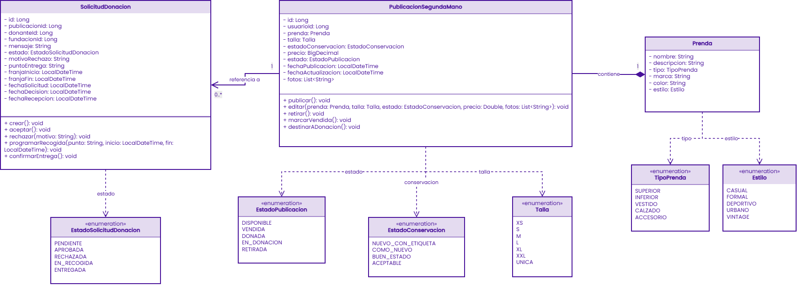
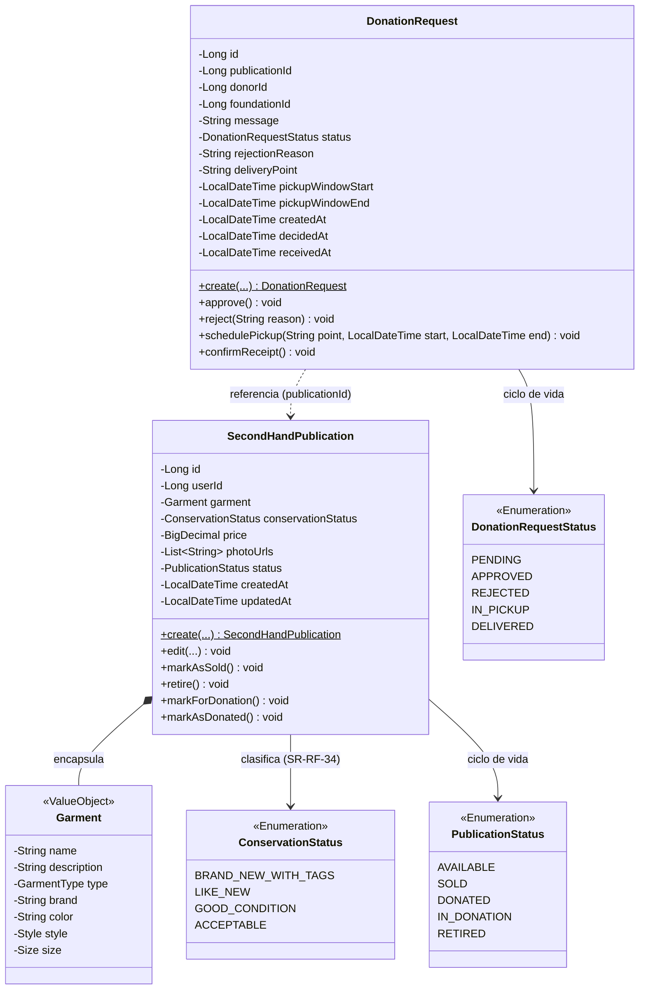
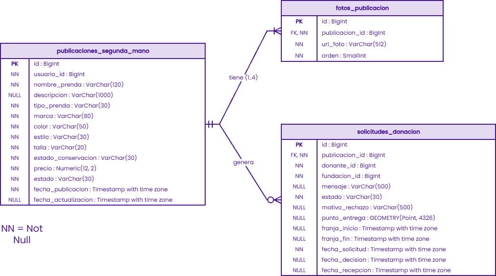
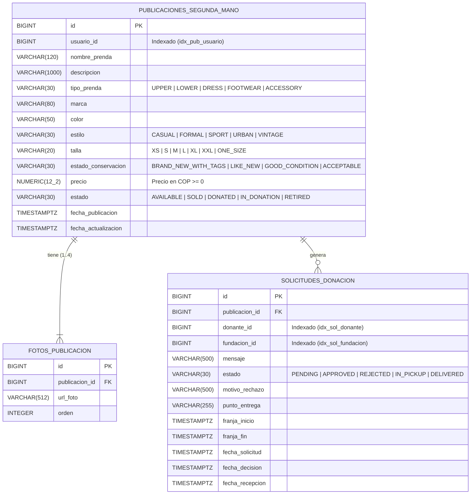

# Documento Técnico de Arquitectura · `ms-segunda-vida-donaciones`
## Plataforma StyleRadar · Squad Portal 8080 (`PT8080`) · Puerto `8520`

**Asignatura:** Desarrollo y Operación de Software (DOSW) · 2026  
**Entregable:** Sprint 2 · Documento de Arquitectura (Pág. 13)  
**Bounded Context:** Economía Circular (Mercado C2C de Segunda Mano y Canalización de Donaciones a Fundaciones)  

---

## 1. Visión Arquitectónica y Alcance del Microservicio

El microservicio **`ms-segunda-vida-donaciones`** implementa el contexto delimitado (*Bounded Context*) de **Economía Circular y Sostenibilidad Textil** dentro del ecosistema **StyleRadar**. Su diseño atiende a dos arquetipos centrales del proyecto:
* **Nora Rebelde (Comercio Circular C2C):** Publicación de prendas usadas con hasta 4 fotografías (`SR-RF-33`), clasificación de estado de conservación (`BRAND_NEW_WITH_TAGS`, `LIKE_NEW`, `GOOD_CONDITION`, `ACCEPTABLE` - `SR-RF-34`), fijación de precio en COP (`SR-RF-35`), búsqueda avanzada con filtros dinámicos (`SR-RF-36`), edición (`SR-RF-37`), venta (`SR-RF-38`) y retiro voluntario (`SR-RF-39`).
* **Tomás Esencial (Donación Social a Fundaciones):** Transición de prendas hacia estado en donación (`IN_DONATION` - `SR-RF-42`), selección de fundación aliada receptora (`SR-RF-44`), creación de solicitud de donación (`SR-RF-45`), consulta por donante/fundación (`SR-RF-46`), decisión justificada de aprobación/rechazo (`SR-RF-47`), coordinación de entrega/recogida (`SR-RF-48`) y confirmación final de recepción física (`DELIVERED` / `DONATED` - `SR-RF-49`).

---

## 2. Diagrama de Componentes Específico (Arquitectura Hexagonal)

El microservicio aplica **Arquitectura Hexagonal Estricta (Ports & Adapters)**, aislando completamente el modelo de dominio y las reglas de negocio de los detalles tecnológicos (Spring Web, Spring Data JPA, PostgreSQL y RabbitMQ). Todos los casos de uso cumplen la regla arquitectónica del curso: **Puerto de Entrada (`*UseCase` interfaz en `domain.port.in`) + Implementación (`*UseCaseImpl` clase en `application.usecase`)**.

  

### 2.1. Flujo Estructural de Componentes Codificados

```mermaid
flowchart TB
    subgraph Inbound_Adapters["Adaptadores Primarios / Entrada (infrastructure.adapter.in)"]
        SHC["SecondHandPublicationController<br>(/api/v1/segunda-mano)"]
        DRC["DonationRequestController<br>(/api/v1/donaciones)"]
        AC["AuthController<br>(/api/v1/auth)"]
        HC["HealthController<br>(/api/v1/health)"]
        SIM["NotificationConsumerSimulator<br>(RabbitMQ Consumer)"]
        SEC["JwtAuthenticationFilter &<br>ResourceOwnershipValidator"]
    end

    subgraph Input_Ports["Puertos de Entrada (domain.port.in)"]
        P1["CreatePublicationUseCase"]
        P2["GetPublicationsUseCase"]
        P3["ManagePublicationUseCase"]
        P4["CreateDonationRequestUseCase"]
        P5["DecideDonationRequestUseCase"]
        P6["ScheduleDonationPickupUseCase"]
        P7["ConfirmDonationReceiptUseCase"]
    end

    subgraph Application_Layer["Capa de Aplicación (application.usecase)"]
        U1["CreatePublicationUseCaseImpl"]
        U2["GetPublicationsUseCaseImpl"]
        U3["ManagePublicationUseCaseImpl"]
        U4["CreateDonationRequestUseCaseImpl"]
        U5["DecideDonationRequestUseCaseImpl"]
        U6["ScheduleDonationPickupUseCaseImpl"]
        U7["ConfirmDonationReceiptUseCaseImpl"]
    end

    subgraph Domain_Core["Núcleo de Dominio Puro (domain.model & domain.event)"]
        M1["SecondHandPublication"]
        M2["Garment"]
        M3["DonationRequest"]
        M4["PublicationSearchCriteria"]
        E1["ConservationStatus / GarmentType / Size / Style"]
        E2["PublicationStatus / DonationRequestStatus"]
        EV["DonationRequestCreatedEvent / DonationRequestDecidedEvent /<br>PickupScheduledEvent / DonationDeliveredEvent /<br>PublicationCreatedEvent / PublicationSoldEvent"]
    end

    subgraph Output_Ports["Puertos de Salida (domain.port.out)"]
        OP1["PublicationRepositoryPort"]
        OP2["DonationRequestRepositoryPort"]
        OP3["DonationEventPublisherPort /<br>DonacionEventPublisherPort"]
    end

    subgraph Outbound_Adapters["Adaptadores Secundarios / Salida (infrastructure.adapter.out)"]
        JPA1["PublicationPersistenceAdapter<br>(Spring Data JPA + PublicationSpecifications)"]
        JPA2["DonationRequestPersistenceAdapter<br>(Spring Data JPA)"]
        RMQ["DonationEventPublisherAdapter &<br>DonacionEventPublisherAdapter"]
    end

    subgraph External_Infra["Infraestructura Externa Desplegada (Azure rg-styleradar & CloudAMQP)"]
        PG[("Azure PostgreSQL Flexible Server<br>(QA & PROD Aisladas)")]
        BROKER[["RabbitMQ Topic Exchange<br>(donaciones.exchange)"]]
    end

    SHC & DRC --> SEC
    SHC --> P1 & P2 & P3
    DRC --> P4 & P5 & P6 & P7

    P1 -.-> U1
    P2 -.-> U2
    P3 -.-> U3
    P4 -.-> U4
    P5 -.-> U5
    P6 -.-> U6
    P7 -.-> U7

    U1 & U2 & U3 --> M1 & M2 & M4 & E1 & E2
    U4 & U5 & U6 & U7 --> M3 & E2 & EV

    U1 & U2 & U3 --> OP1
    U4 & U5 & U6 & U7 --> OP2
    U1 & U3 & U4 & U5 & U6 & U7 --> OP3

    OP1 -.-> JPA1
    OP2 -.-> JPA2
    OP3 -.-> RMQ

    JPA1 & JPA2 --> PG
    RMQ --> BROKER
    BROKER --> SIM
```

### 2.2. Responsabilidad por Paquete

| Paquete | Capa Hexagonal | Componentes Reales Codificados |
| :--- | :--- | :--- |
| `domain.model` | Dominio (Núcleo) | `SecondHandPublication`, `Garment`, `DonationRequest`, `PublicationSearchCriteria`, `ConservationStatus`, `GarmentType`, `PublicationStatus`, `DonationRequestStatus`, `Size`, `Style`. Marcas de tiempo estandarizadas en UTC (`ZoneOffset.UTC`). |
| `domain.event` | Dominio (Eventos) | `PublicationCreatedEvent`, `PublicationSoldEvent`, `DonationRequestCreatedEvent`, `DonationRequestDecidedEvent`, `PickupScheduledEvent`, `DonationDeliveredEvent`. |
| `domain.exception` | Dominio (Excepciones) | `DomainException`, `DomainConflictException`, `InvalidPublicationException`, `InvalidDonationRequestException`, `InvalidStateTransitionException`, `ResourceNotFoundException`. |
| `domain.port.in` | Puertos de Entrada | 7 interfaces `*UseCase` (`CreatePublicationUseCase`, `GetPublicationsUseCase`, `ManagePublicationUseCase`, `CreateDonationRequestUseCase`, `DecideDonationRequestUseCase`, `ScheduleDonationPickupUseCase`, `ConfirmDonationReceiptUseCase`) y objetos Command inmutables. |
| `domain.port.out` | Puertos de Salida | `PublicationRepositoryPort`, `DonationRequestRepositoryPort`, `DonationEventPublisherPort`, `DonacionEventPublisherPort`. |
| `application.usecase` | Aplicación | 7 clases `*UseCaseImpl` que implementan los puertos de entrada, validan invariantes de negocio, gestionan transacciones `@Transactional` y publican eventos. |
| `infrastructure.adapter.in.rest` | Adaptador Primario (Web) | `SecondHandPublicationController`, `DonationRequestController`, `AuthController`, `HealthController`, `GlobalExceptionHandler` (RFC 7807 `ProblemDetail`), `PublicationRestMapper`, `DonationRequestRestMapper`. |
| `infrastructure.adapter.in.messaging` | Adaptador Primario (AMQP) | `NotificationConsumerSimulator` (consumidor en cola aislada `q.donaciones.simulador-notificaciones`). |
| `infrastructure.adapter.out.persistence` | Adaptador Secundario (BD) | `PublicationPersistenceAdapter`, `DonationRequestPersistenceAdapter`, `PublicationSpecifications` (búsqueda dinámica C2C), entidades JPA (`SecondHandPublicationEntity`, `PublicationPhotoEntity`, `DonationRequestEntity`) y mappers. |
| `infrastructure.adapter.out.messaging` | Adaptador Secundario (Broker) | `DonationEventPublisherAdapter`, `DonacionEventPublisherAdapter`, `RabbitMQEventPublisherAdapter`, `DonationRequestCreatedIntegrationEvent`. |
| `infrastructure.security` | Seguridad Transversal | `SecurityConfig`, `JwtAuthenticationFilter`, `JwtTokenProvider` (HMAC-SHA256 + validación obligatoria de claim `exp` con `java.time.Instant`), `ResourceOwnershipValidator` (anti-IDOR/BOLA), `SecurityErrorHandler`, `DemoUserService`. |

---

## 3. Diagrama de Clases de Dominio

  

### 3.1. Entidades y Objetos de Valor del Dominio

---

## 4. Diagrama de Base de Datos (Modelo Relacional Desplegado en QA y PROD)

El esquema relacional está desplegado en **Azure Database for PostgreSQL Flexible Server (PostgreSQL 16)** en instancias independientes dentro del Resource Group **`rg-styleradar`** para **QA** (`styleradar-db-qa-jmunar` / `styleradar_donations_qa`) y **PROD** (`styleradar-db-prod-jmunar` / `styleradar_donations_prod`), gestionado automáticamente por **Flyway** (`V1__init_schema.sql` y `V2__align_domain_and_tables.sql`).

  

### 4.1. Esquema Entidad-Relación (`V2__align_domain_and_tables.sql`)

