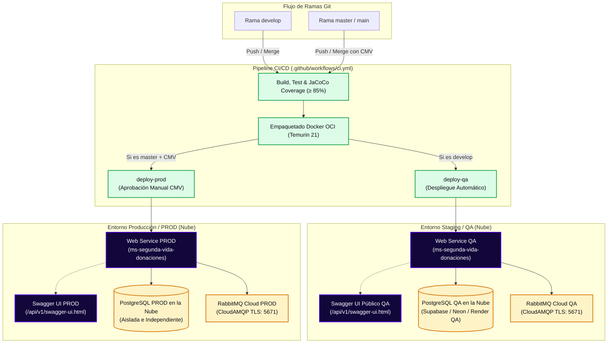

# Guía Técnica de Despliegue en la Nube y CI/CD (QA & PROD)
## Microservicio: `ms-segunda-vida-donaciones` (StyleRadar · Puerto 8520)

**Asignatura:** Desarrollo y Operación de Software (DOSW) · 2026  
**Entregable:** Sprint 2 · Fase 5 (Págs. 8, 10, 18 y 19)  
**Alcance:** Pipeline Automatizado de Despliegue, Bases de Datos Aisladas en la Nube y Swagger Público  

---

## 1. Arquitectura de Despliegue y Separación Estricta de Entornos

Conforme a las directrices de la **Página 8** del proyecto, **los ambientes de QA y PRODUCCIÓN jamás comparten bases de datos ni recursos de infraestructura**. Se configuran dos instancias PostgreSQL completamente aisladas y dos entornos de ejecución desacoplados:



---

## 2. Matriz de Despliegue en la Nube (Pág. 8)

Todos los recursos en la nube de **StyleRadar** se encuentran alojados en la suscripción de Azure dentro del Grupo de Recursos dedicado **`rg-styleradar`** (Región: **Canada Central**):

| Recurso / Componente | Entorno Staging / QA | Entorno Producción / PROD | Notas Técnicas |
| :--- | :--- | :--- | :--- |
| **Resource Group** | `rg-styleradar` | `rg-styleradar` | Grupo de recursos exclusivo de StyleRadar en Azure. |
| **Azure App Service** | `styleradar-donaciones-qa-jmunar` | `styleradar-donaciones-prod-jmunar` | Linux App Service Plan (Java 21). |
| **URL Base del Servicio** | [`https://styleradar-donaciones-qa-jmunar.azurewebsites.net`](https://styleradar-donaciones-qa-jmunar.azurewebsites.net) | [`https://styleradar-donaciones-prod-jmunar.azurewebsites.net`](https://styleradar-donaciones-prod-jmunar.azurewebsites.net) | HTTPS activo por defecto con certificados gestionados por Azure. |
| **Swagger UI Público** | [`https://styleradar-donaciones-qa-jmunar.azurewebsites.net/api/v1/swagger-ui/index.html`](https://styleradar-donaciones-qa-jmunar.azurewebsites.net/api/v1/swagger-ui/index.html) | [`https://styleradar-donaciones-prod-jmunar.azurewebsites.net/api/v1/swagger-ui/index.html`](https://styleradar-donaciones-prod-jmunar.azurewebsites.net/api/v1/swagger-ui/index.html) | Documentación interactiva OpenAPI 3 (Auth Demo disponible en QA; restringido en PROD). |
| **Health Check Endpoint** | [`https://styleradar-donaciones-qa-jmunar.azurewebsites.net/api/v1/health`](https://styleradar-donaciones-qa-jmunar.azurewebsites.net/api/v1/health) | [`https://styleradar-donaciones-prod-jmunar.azurewebsites.net/api/v1/health`](https://styleradar-donaciones-prod-jmunar.azurewebsites.net/api/v1/health) | Monitoreo y validación de versión y salud (retorna HTTP 200 OK con payload JSON). |
| **Azure PostgreSQL Flexible**| `styleradar-db-qa-jmunar.postgres.database.azure.com` | `styleradar-db-prod-jmunar.postgres.database.azure.com` | **Instancias 100% aisladas e independientes en Azure.** |
| **Base de Datos** | `styleradar_donations_qa` | `styleradar_donations_prod` | Esquemas migrados automáticamente mediante Flyway. |
| **Perfil Activo Spring** | `qa` (`SPRING_PROFILES_ACTIVE=qa`) | `prod` (`SPRING_PROFILES_ACTIVE=prod`) | Configuraciones desacopladas en `application-qa.yml` y `application-prod.yml`. |

### 2.1. Tabla Resumen Oficial del Curso (Pág. 8 del Enunciado)

| Servicio | URL QA | URL PROD | BD QA (Aislada) | BD PROD (Aislada) |
| :--- | :--- | :--- | :--- | :--- |
| **`ms-segunda-vida-donaciones`** | `https://styleradar-donaciones-qa-jmunar.azurewebsites.net` | `https://styleradar-donaciones-prod-jmunar.azurewebsites.net` | `styleradar-db-qa-jmunar.postgres.database.azure.com` (Azure PostgreSQL QA) | `styleradar-db-prod-jmunar.postgres.database.azure.com` (Azure PostgreSQL PROD) |

* **Regla de Oro:** La base de datos de producción (`styleradar_donations_prod`) reside en un clúster físico o lógico independiente de QA (`styleradar_donations_qa`), con credenciales, usuarios y políticas de firewall distintas.

---

## 3. Swagger Público y Endpoints de Salud (Pág. 10 y 19)

### 3.1. Swagger UI de QA
El microservicio expone su documentación interactiva OpenAPI 3 en:
👉 **`https://styleradar-donaciones-qa-jmunar.azurewebsites.net/api/v1/swagger-ui/index.html`**  
*(OpenAPI JSON: `https://styleradar-donaciones-qa-jmunar.azurewebsites.net/api/v1/v3/api-docs`)*

> 🔒 **Seguridad en Producción vs. QA:**  
> Por diseño de seguridad perimetral, los endpoints de demostración (`/api/v1/auth/**`) y el servicio de simulación `DemoUserService` están etiquetados con `@Profile({"local", "test", "dev", "qa"})`. En el ambiente **QA**, se encuentran activos para facilitar la evaluación y pruebas controladas. En el ambiente **PROD**, estos beans no se instancian, respondiendo `HTTP 404 Not Found` para evitar la emisión no autorizada de tokens con rol `ADMIN` o la divulgación de credenciales demo.

### 3.2. Endpoints de Diagnóstico (`/health`) y Validación de Versión
Para la validación del estado operativo por parte de load balancers, herramientas de monitoreo y el pipeline CI/CD:
* **Endpoint QA:** `GET https://styleradar-donaciones-qa-jmunar.azurewebsites.net/api/v1/health`
* **Endpoint PROD:** `GET https://styleradar-donaciones-prod-jmunar.azurewebsites.net/api/v1/health`

**Respuesta esperada (HTTP 200 OK):**
```json
{
  "status": "UP",
  "service": "ms-segunda-vida-donaciones",
  "version": "0.0.1-SNAPSHOT",
  "port": 8520,
  "timestamp": "2026-11-09T20:00:00.000000Z"
}
```

---

## 4. Configuración de Variables de Entorno por Ambiente

El microservicio utiliza perfiles Spring Boot desacoplados (`application-qa.yml` y `application-prod.yml`), inyectando su configuración por variables de entorno del contenedor:

| Variable de Entorno | Valor en QA | Valor en PROD | Descripción |
| :--- | :--- | :--- | :--- |
| `SPRING_PROFILES_ACTIVE` | `qa` | `prod` | Activa el perfil correspondiente de Spring Boot. |
| `PORT` | `8520` (o asignado por cloud) | `8520` (o asignado por cloud) | Puerto de enlace del servidor embebido. |
| `SPRING_DATASOURCE_URL` | `jdbc:postgresql://<HOST_QA>:5432/styleradar_donations_qa?sslmode=require` | `jdbc:postgresql://<HOST_PROD>:5432/styleradar_donations_prod?sslmode=require` | Conexión JDBC segura con SSL obligatorio. |
| `DB_USER` | `styleradar_qa_user` | `styleradar_prod_user` | Usuario de base de datos exclusivo del entorno. |
| `DB_PASSWORD` | `<SECRET_QA>` | `<SECRET_PROD>` | Contraseña cifrada en la nube. |
| `SECURITY_JWT_SECRET` | Clave segura HMAC-SHA256 (≥ 256 bits) | Clave robusta de producción (≥ 256 bits) | Clave secreta para validación de tokens JWT. |
| `RABBITMQ_HOST` | `<HOST_CLOUDAMQP_QA>` | `<HOST_CLOUDAMQP_PROD>` | Broker RabbitMQ en la nube. |
| `RABBITMQ_PORT` | `5671` | `5671` | Puerto con cifrado TLS/SSL. |
| `RABBITMQ_SSL_ENABLED`| `true` | `true` | Cifrado en tránsito de eventos asíncronos. |
| `RABBITMQ_USERNAME` | `<USER_RABBITMQ_QA>` | `<USER_RABBITMQ_PROD>` | Usuario de conexión a RabbitMQ. |
| `RABBITMQ_PASSWORD` | `<PASS_RABBITMQ_QA>` | `<PASS_RABBITMQ_PROD>` | Contraseña del broker. |
| `RABBITMQ_VHOST` | `/<vhost_qa>` | `/<vhost_prod>` | Virtual Host asignado en CloudAMQP. |

---

## 5. Configuración de Secretos y Reglas de Fallo en GitHub Actions

Para que el pipeline `.github/workflows/ci.yml` ejecute el despliegue automático, se requiere registrar las credenciales en GitHub Actions (**Settings ➔ Secrets and variables ➔ Actions**):

* `AZURE_WEBAPP_PUBLISH_PROFILE_QA`: Contenido XML del perfil de publicación de Azure Web App (`styleradar-donaciones-qa-jmunar`).
* `AZURE_WEBAPP_PUBLISH_PROFILE_PROD`: Contenido XML del perfil de publicación de Azure Web App (`styleradar-donaciones-prod-jmunar`).
* `DEPLOY_WEBHOOK_QA` / `DEPLOY_WEBHOOK_PROD`: (Opcional) Webhook de despliegue alternativo.

### Reglas Estrictas de Validación y Fallo en el Pipeline:
1. **Fallo por Credenciales Faltantes:** Si no se detecta `AZURE_WEBAPP_PUBLISH_PROFILE_QA` (en `deploy-qa`) o `AZURE_WEBAPP_PUBLISH_PROFILE_PROD` (en `deploy-prod`), el job falla de inmediato con código de salida `exit 1`.
2. **Validación de Versión y Estado Saludable en Smoke Test:** Tras invocar el despliegue, el pipeline sondea hasta 15 veces (intervalos de 10 segundos) el endpoint `/api/v1/health`:
   * Verifica que el estado HTTP sea `200 OK`.
   * Verifica que el payload JSON contenga `"status": "UP"`.
   * Verifica que el campo `"version"` coincida con la versión empaquetada (`0.0.1-SNAPSHOT`).
   * Si después de 15 intentos no responde adecuadamente o la versión difiere, el pipeline aborta con `exit 1` marcando el build como fallido.
3. **Calidad Automatizada vs. Auditoría SonarQube:** El pipeline de GitHub Actions valida de manera estricta la compuerta de cobertura de código mediante **JaCoCo (`≥ 85%`)**. El análisis estático de **SonarQube v26.9.0** se ejecuta de manera independiente (`mvn sonar:sonar`), certificando el Quality Gate en Calificación A (0 issues).

---

## 6. Procedimiento de Aprovisionamiento Paso a Paso

### Paso 1: Aprovisionar Base de Datos PostgreSQL QA (Neon / Supabase / Render)
1. Crear un proyecto llamado `styleradar-donations-qa`.
2. Obtener la cadena de conexión JDBC con `?sslmode=require`.
3. Al arrancar el microservicio, Flyway ejecutará automáticamente los scripts `V1__init_schema.sql` y `V2__initial_seed_data.sql`, creando las tablas `publicaciones_segunda_mano`, `solicitudes_donacion`, `fotos_publicacion` e insertando la data semilla.

### Paso 2: Aprovisionar Base de Datos PostgreSQL PROD
1. Crear un proyecto independiente llamado `styleradar-donations-prod`.
2. Asignar credenciales dedicadas de producción.
3. Verificar que las tablas se migren limpiamente con Flyway en el primer arranque.

### Paso 3: Aprovisionar Broker CloudAMQP (RabbitMQ)
1. Crear una instancia en [CloudAMQP](https://www.cloudamqp.com) (plan gratuito Lemur).
2. Obtener el hostname AMQP, virtual host y credenciales.
3. El microservicio creará automáticamente el Topic Exchange `donaciones.exchange` y la cola durable `q.notificaciones.donacion-solicitud-creada`.
