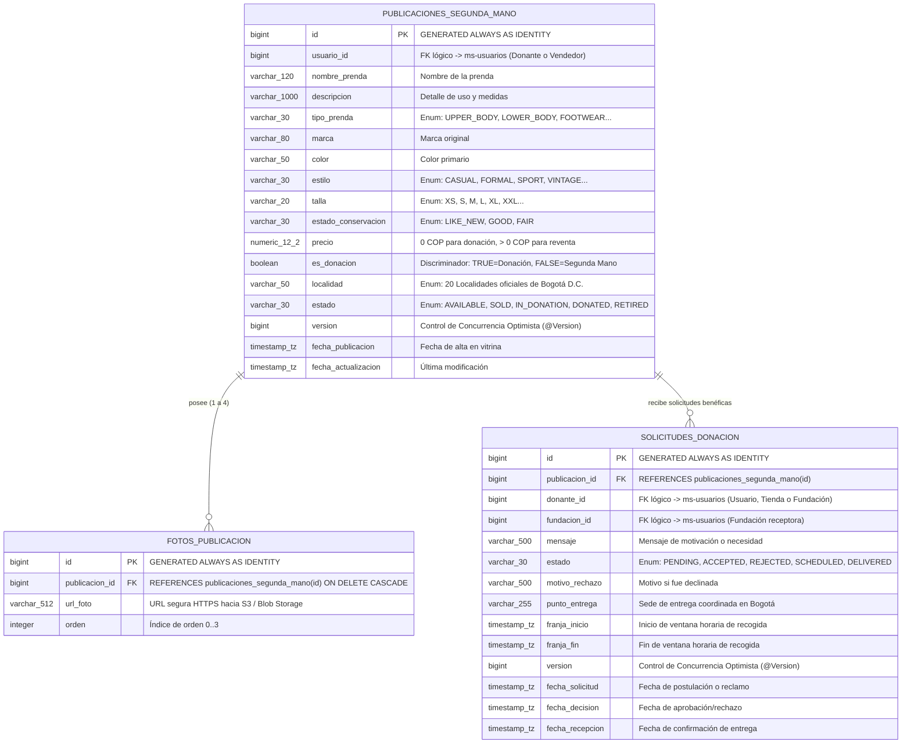
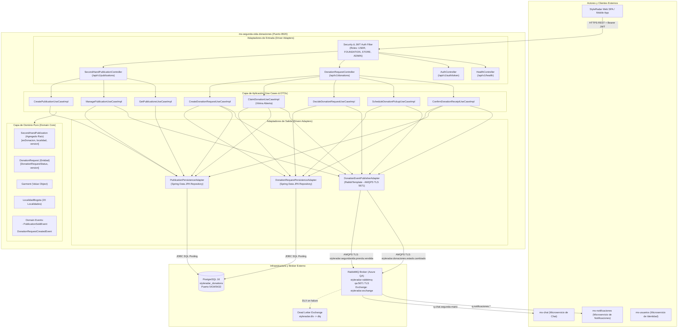

# Diagramas de Arquitectura y Diseño — Sprint 3
## Microservicio `ms-segunda-vida-donaciones` (Puerto 8520) — StyleRadar

Este documento compila y documenta los 3 diagramas arquitectónicos oficiales del microservicio, actualizados con la evolución de dominio de economía circular (Vitrina Abierta C2C y Donaciones benéficas, restricción a 20 localidades de Bogotá D.C., concurrencia optimista y mensajería RabbitMQ AMQPS TLS).

---

## 1. Diagrama de Clases del Dominio y Puertos Hexagonales

El modelo de dominio es 100% puro (Java POJOs sin dependencias de frameworks ni JPA). El agregado `SecondHandPublication` unifica las publicaciones de segunda mano (`esDonacion = false`) y las de donación benéfica (`esDonacion = true`).

```mermaid
classDiagram
    direction TB

    class SecondHandPublication {
        -Long id
        -Long userId
        -Garment garment
        -Size size
        -ConservationStatus conservationStatus
        -BigDecimal price
        -boolean esDonacion
        -LocalidadBogota localidad
        -PublicationStatus status
        -Long version
        -List~String~ photos
        -LocalDateTime publishedAt
        -LocalDateTime updatedAt
        +validateInvariants() void
        +publish() void
        +edit(...) void
        +markAsSold() void
        +retire() void
        +markForDonation() void
        +markAsDonated() void
    }

    class Garment {
        <<Value Object>>
        -String name
        -String description
        -GarmentType garmentType
        -String brand
        -String color
        -Style style
        +validateInvariants() void
    }

    class DonationRequest {
        -Long id
        -Long publicationId
        -Long donorId
        -Long foundationId
        -String message
        -DonationRequestStatus status
        -String rejectionReason
        -String deliveryPoint
        -LocalDateTime pickupStartTime
        -LocalDateTime pickupEndTime
        -Long version
        -LocalDateTime requestedAt
        -LocalDateTime decidedAt
        -LocalDateTime receivedAt
        +initiate() void
        +approve() void
        +reject(String reason) void
        +schedulePickup(String point, LocalDateTime start, LocalDateTime end) void
        +confirmReceipt() void
    }

    class LocalidadBogota {
        <<Enumeration>>
        USAQUEN
        CHAPINERO
        SANTA_FE
        SAN_CRISTOBAL
        USME
        TUNJUELITO
        BOSA
        KENNEDY
        FONTIBON
        ENGATIVA
        SUBA
        BARRIOS_UNIDOS
        TEUSAQUILLO
        LOS_MARTIRES
        ANTONIO_NARINO
        PUENTE_ARANDA
        LA_CANDELARIA
        RAFAEL_URIBE_URIBE
        CIUDAD_BOLIVAR
        SUMAPAZ
    }

    class PublicationStatus {
        <<Enumeration>>
        AVAILABLE
        SOLD
        IN_DONATION
        DONATED
        RETIRED
    }

    class DonationRequestStatus {
        <<Enumeration>>
        PENDING
        ACCEPTED
        REJECTED
        SCHEDULED
        DELIVERED
        CANCELLED
    }

    %% Puertos Hexagonales de Entrada
    class CreatePublicationUseCase {
        <<Interface / In Port>>
        +create(CreatePublicationCommand) SecondHandPublication
    }

    class ManagePublicationUseCase {
        <<Interface / In Port>>
        +edit(Long, EditPublicationCommand) SecondHandPublication
        +retire(Long, Long) void
        +markAsSold(Long, Long) void
        +markForDonation(Long, Long) void
    }

    class ClaimDonationUseCase {
        <<Interface / In Port>>
        +claimDonation(ClaimDonationCommand) DonationRequest
    }

    %% Puertos Hexagonales de Salida
    class PublicationRepositoryPort {
        <<Interface / Out Port>>
        +save(SecondHandPublication) SecondHandPublication
        +findById(Long) Optional~SecondHandPublication~
        +search(PublicationSearchCriteria) List~SecondHandPublication~
    }

    class DonationRequestRepositoryPort {
        <<Interface / Out Port>>
        +save(DonationRequest) DonationRequest
        +findById(Long) Optional~DonationRequest~
        +findByDonorId(Long) List~DonationRequest~
        +findByFoundationId(Long) List~DonationRequest~
        +existsActiveRequestForPublication(Long) boolean
    }

    class DonationEventPublisherPort {
        <<Interface / Out Port>>
        +publishEvent(Object) void
    }

    %% Relaciones
    SecondHandPublication *-- Garment : compone
    SecondHandPublication o-- LocalidadBogota : ubicada en
    SecondHandPublication o-- PublicationStatus : estado
    DonationRequest o-- DonationRequestStatus : estado
    SecondHandPublication "1" <-- "0..*" DonationRequest : referencia a
```

---

## 2. Diagrama Entidad-Relación (Base de Datos PostgreSQL `styleradar_donations`)

Modelo relacional en 3FN desplegado sobre PostgreSQL 16 con migraciones Flyway (`V1`, `V2`, `V3`). Incluye discriminador `es_donacion`, control de concurrencia optimista (`version`) y restricciones geográficas de Bogotá.

---

## 3. Diagrama de Componentes C4 (Nivel 3 — Arquitectura Hexagonal)

Muestra los adaptadores de entrada (REST API Controllers, filtros JWT/RBAC), los casos de uso de la capa de aplicación, el modelo de dominio puro, y los adaptadores de salida (JPA Persistence Adapter y RabbitMQ AMQPS TLS Event Publisher Adapter hacia el broker central `styleradar.exchange`).

