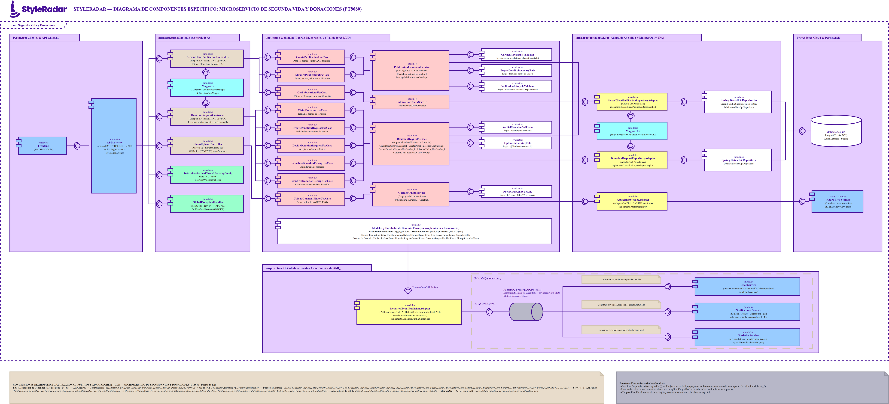
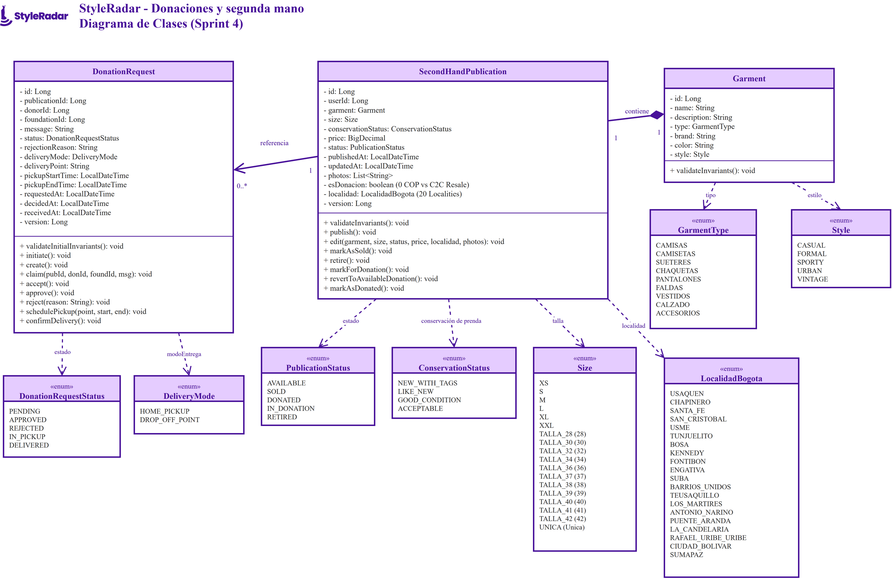
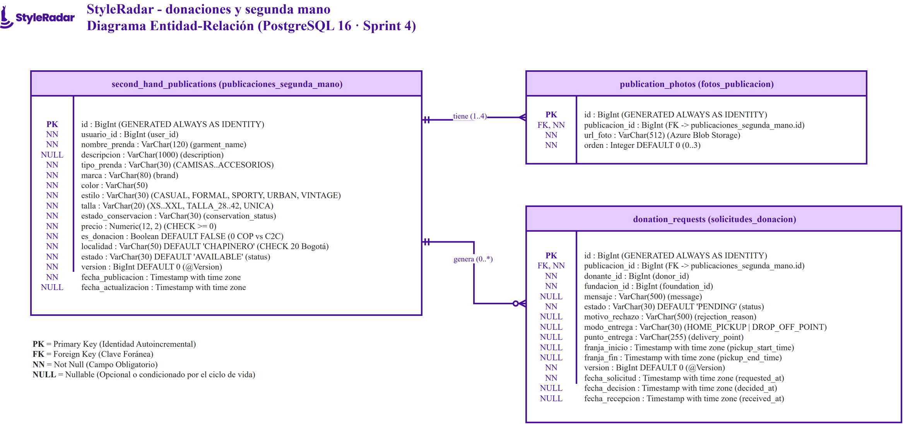
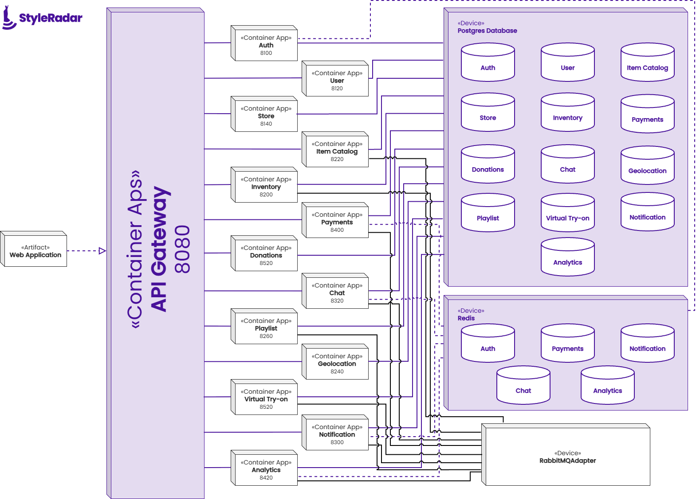

[← Anterior: 2. Equipo y Responsables](./02-equipo-responsables.md) &nbsp;|&nbsp; [Índice Principal](../../README.md) &nbsp;|&nbsp; [Siguiente: 4. Endpoints y Swagger →](./04-endpoints-swagger.md)

# 3. Arquitectura Hexagonal con sus Diagramas

El microservicio implementa **Arquitectura Hexagonal Estricta (Puertos y Adaptadores)** combinada con principios tácticos de **Domain-Driven Design (DDD)**. El núcleo de dominio es 100% puro en Java 21, desacoplado de frameworks web, motores de persistencia o brokers de mensajería. Todos los casos de uso cumplen la convención oficial: **Interfaz de Puerto de Entrada (`domain.port.in.*UseCase`) + Implementación de Aplicación (`application.usecase.*UseCaseImpl`)**.

---

## 3.1 Diagrama de Componentes Hexagonal (`ms-segunda-vida-donaciones`)

Diseñado siguiendo el formato y paleta visual oficial de **StyleRadar** (`#48119A`, `#E5CCFF`), notación **Lollipop (`-(o-`)** para interfaces provistas/requeridas, contenedores `«module»` y bus asíncrono RabbitMQ:

<div align="center">
  
  <p><sub><b>Figura 3.1:</b> Diagrama de Componentes Específico (Sprint 4) de <code>ms-segunda-vida-donaciones</code> (PT8080 · Puerto 8520). Detalla adaptadores de entrada REST, puertos de entrada/salida, módulos de dominio con validadores de invariantes, adaptadores JPA, Azure Blob Storage Adapter y bus asíncrono RabbitMQ.</sub></p>
  <p>
    📁 <b>Archivo editable Draw.io:</b> <a href="../diagramas/drawio/diagrama_componentes_especifico_sprint4.drawio"><code>docs/diagramas/drawio/diagrama_componentes_especifico_sprint4.drawio</code></a>
  </p>
</div>

### Capas y Flujos Arquitectónicos Representados:
1. **Clientes HTTP & API Gateway:** Peticiones autenticadas con JWT Bearer redirigidas a través de `APIGateway` (`:8080`) hacia los controladores REST en `:8520`.
2. **Adaptadores de Entrada (Driving Adapters):**
   - `SecondHandPublicationController`: Catálogo unificado C2C y vitrina benéfica en Bogotá D.C.
   - `DonationRequestController`: Reclamo de vitrina, radicación (con `DeliveryProposalDTO` y `donorId` resuelto desde JWT) y coordinación logística de donaciones.
   - `PhotoUploadController`: Endpoint de subida binaria `multipart/form-data` para fotografías de prendas.
   - `AuthController` & `HealthController`: Endpoints demo para Swagger UI (restringidos en `qa`/`prod`) y diagnóstico de salud.
   - `GlobalExceptionHandler` & `SecurityConfig`: Manejo centralizado de errores RFC 7807 y filtro JWT.
3. **Casos de Uso & Dominio (Application & Core):**
   - Puertos de Entrada: `CreatePublicationUseCase`, `GetPublicationsUseCase`, `ManagePublicationUseCase`, `CreateDonationRequestUseCase`, `ClaimDonationUseCase`, `DecideDonationRequestUseCase`, `ScheduleDonationPickupUseCase`, `ConfirmDonationReceiptUseCase`, `UploadGarmentPhotoUseCase`, `GetPartnerFoundationsUseCase`.
   - Validadores de Invariantes: `LocalidadBogota` (20 localidades de Bogotá D.C.), `GarmentPriceValidator` (0 COP donación / >0 COP venta), `GarmentImagePolicyValidator` (JPEG/PNG/WEBP, máx 5MB con *magic bytes*), `DonationInvariantsValidator` (anti-auto-donación).
4. **Adaptadores de Salida (Driven Adapters):**
   - `PublicationPersistenceAdapter` & `DonationRequestPersistenceAdapter`: Persistencia relacional con Spring Data JPA y `PublicationSpecifications`.
   - `TiendasFoundationCatalogAdapter`: Cliente HTTP `RestClient` hacia `ms-tiendas` para listar fundaciones aliadas activas, resolver `representanteId` y validar `activa == true`.
   - `AzureBlobStorageAdapter`: Subida binaria de imágenes al contenedor `donaciones-fotos` en Azure Blob Storage vía SDK oficial `com.azure:azure-storage-blob` con fallback local en perfiles `local/dev/test`.
   - `DonationEventPublisherAdapter` / `RabbitMQEventPublisherAdapter`: Publicación AMQP transaccional *after-commit* con *Publisher Confirms* y formato homologado con `ms-notificaciones`.
5. **Proveedores Cloud & Mensajería Asíncrona:**
   - Base de Datos: PostgreSQL 16 (`styleradar_donations_*` en Azure Flexible Server).
   - Cloud Storage: Azure Blob Storage (`srdonacionesjmunar` en `rg-styleradar`).
   - Broker AMQP: RabbitMQ TLS (`AMQPS :5671`) sobre `styleradar.exchange` hacia `ms-chat` y `ms-notificaciones`.

---

## 3.2 Diagrama de Clases del Dominio y Puertos

Diseñado en inglés técnico alineado con el código fuente en Java 21 (Sprint 4), incorporando `DeliveryMode`, `claim(...)`, `revertToAvailableDonation()`, las 9 categorías de `GarmentType`, las 18 tallas de `Size`, `Style` y las 20 localidades de `LocalidadBogota`:

<div align="center">
  
  <p><sub><b>Figura 3.2:</b> Diagrama de Clases del dominio de <code>ms-segunda-vida-donaciones</code> (Sprint 4).</sub></p>
  <p>
    📁 <b>Archivo editable Draw.io:</b> <a href="../diagramas/drawio/diagrama_clases_sprint4.drawio"><code>docs/diagramas/drawio/diagrama_clases_sprint4.drawio</code></a>
  </p>
</div>

### Componentes del Modelo de Dominio:
* **Entidad Raíz de Agregado `SecondHandPublication`:**
  - Atributos: `id: Long`, `userId: Long`, `garment: Garment`, `size: Size`, `conservationStatus: ConservationStatus`, `price: BigDecimal`, `esDonacion: boolean`, `localidad: LocalidadBogota`, `version: Long (@Version)`, `status: PublicationStatus`, `publishedAt: LocalDateTime`, `updatedAt: LocalDateTime`, `photos: List<String>`.
  - Métodos de Negocio: `validateInvariants()`, `publish()`, `edit(garment, size, status, price, localidad, photos)`, `markAsSold()`, `retire()`, `markForDonation()`, `revertToAvailableDonation()`, `markAsDonated()`.
* **Value Object `Garment`:**
  - Encapsula: `id: Long`, `name: String`, `description: String`, `type: GarmentType`, `brand: String`, `color: String`, `style: Style`.
* **Entidad Raíz de Agregado `DonationRequest`:**
  - Atributos: `id: Long`, `publicationId: Long`, `donorId: Long`, `foundationId: Long`, `message: String`, `status: DonationRequestStatus`, `rejectionReason: String`, `deliveryMode: DeliveryMode`, `deliveryPoint: String`, `pickupStartTime: LocalDateTime`, `pickupEndTime: LocalDateTime`, `version: Long (@Version)`, `requestedAt: LocalDateTime`, `decidedAt: LocalDateTime`, `receivedAt: LocalDateTime`.
  - Métodos de Negocio: `validateInitialInvariants()`, `initiate()`, `create()`, `claim(pubId, donId, foundId, msg)`, `accept()`, `approve()`, `reject(reason)`, `schedulePickup(point, start, end)`, `confirmDelivery()`.
* **Enumeraciones de Dominio:**
  - `LocalidadBogota` *(20 localidades)*: `USAQUEN`, `CHAPINERO`, `SANTA_FE`, `SAN_CRISTOBAL`, `USME`, `TUNJUELITO`, `BOSA`, `KENNEDY`, `FONTIBON`, `ENGATIVA`, `SUBA`, `BARRIOS_UNIDOS`, `TEUSAQUILLO`, `LOS_MARTIRES`, `ANTONIO_NARINO`, `PUENTE_ARANDA`, `LA_CANDELARIA`, `RAFAEL_URIBE_URIBE`, `CIUDAD_BOLIVAR`, `SUMAPAZ`.
  - `ConservationStatus`: `NEW_WITH_TAGS`, `LIKE_NEW`, `GOOD_CONDITION`, `ACCEPTABLE`.
  - `GarmentType` *(9 categorías oficiales)*: `CAMISAS`, `CAMISETAS`, `SUETERES`, `CHAQUETAS`, `PANTALONES`, `FALDAS`, `VESTIDOS`, `CALZADO`, `ACCESORIOS` (con alias retrocompatibles).
  - `Size` *(18 tallas estandarizadas)*: `XS`, `S`, `M`, `L`, `XL`, `XXL`, `TALLA_28` (`28`) .. `TALLA_42` (`42`), `UNICA` (`Unica`).
  - `Style`: `CASUAL`, `FORMAL`, `SPORTY`, `URBAN`, `VINTAGE`.
  - `DeliveryMode`: `HOME_PICKUP`, `DROP_OFF_POINT`.
  - `PublicationStatus`: `AVAILABLE`, `SOLD`, `DONATED`, `IN_DONATION`, `RETIRED`.
  - `DonationRequestStatus`: `PENDING`, `APPROVED`, `REJECTED`, `IN_PICKUP`, `DELIVERED`.

---

## 3.3 Diagrama Entidad-Relación de Base de Datos (PostgreSQL 16)

Refleja el esquema físico consolidado de las migraciones Flyway `V2__align_domain_and_tables.sql`, `V3__unify_vitrina_bogota.sql`, `V4__add_delivery_mode_to_donations.sql` y `V5__migrate_garment_type_and_size_enums.sql`:

<div align="center">
  
  <p><sub><b>Figura 3.3:</b> Modelo físico relacional en PostgreSQL 16 (Sprint 4) con bloqueo optimista (<code>version</code>), discriminador de donación (<code>es_donacion</code>), restricción territorial en Bogotá (<code>localidad</code>) y modalidad de entrega (<code>modo_entrega</code>).</sub></p>
  <p>
    📁 <b>Archivo editable Draw.io:</b> <a href="../diagramas/drawio/diagrama_er_sprint4.drawio"><code>docs/diagramas/drawio/diagrama_er_sprint4.drawio</code></a>
  </p>
</div>

### Tablas del Microservicio:
1. **`publicaciones_segunda_mano`:** Almacena prendas unificadas de C2C y donación (`es_donacion`, `localidad`, `version`, `tipo_prenda` y `talla` migrados en V5).
2. **`fotos_publicacion`:** Galería fotográfica de 1 a 4 fotos alojadas en Azure Blob Storage (`ON DELETE CASCADE`).
3. **`solicitudes_donacion`:** Registro trazable del ciclo logístico benéfico hacia fundaciones aliadas (`modo_entrega`, `punto_entrega`, `franja_inicio`, `franja_fin`, `version`).

---

## 3.4 Estructura Oficial de Paquetes en `src/main/java/`

```text
src/main/java/edu/dosw/styleradar/donaciones/
├── DonationsServiceApplication.java             <-- Punto de entrada Spring Boot 3.3.4
├── domain/                                      <-- NÚCLEO DE DOMINIO PURO (Java estándar, 0 dependencias)
│   ├── model/                                   <-- SecondHandPublication, Garment, DonationRequest, FoundationSummary, Enums
│   ├── event/                                   <-- Eventos de dominio puros (PublicationCreatedEvent, PublicationSoldEvent, etc.)
│   ├── exception/                               <-- DomainException, DomainConflictException, ResourceNotFoundException
│   └── port/
│       ├── in/                                  <-- 10 Interfaces *UseCase y Commands inmutables
│       └── out/                                 <-- PublicationRepositoryPort, DonationRequestRepositoryPort, PhotoStoragePort, DonationEventPublisherPort, FoundationCatalogPort
├── application/                                 <-- CAPA DE APLICACIÓN (Orquestación de Casos de Uso)
│   ├── usecase/                                 <-- 10 Clases *UseCaseImpl (@Service / @Transactional) + TransactionEventHelper
│   └── dto/                                     <-- Request DTOs (incl. DeliveryProposalDTO), Response DTOs y Mappers
└── infrastructure/                              <-- CAPA DE INFRAESTRUCTURA (Tecnologías y Frameworks)
    ├── adapter/
    │   ├── in/
    │   │   ├── rest/                            <-- SecondHandPublicationController, DonationRequestController, PhotoUploadController, AuthController, HealthController
    │   │   └── messaging/                       <-- NotificationConsumerSimulator (Consumidor de prueba E2E)
    │   └── out/
    │       ├── external/                        <-- TiendasFoundationCatalogAdapter + TiendasFoundationResponseDTO
    │       ├── persistence/                     <-- PublicationPersistenceAdapter, DonationRequestPersistenceAdapter, JPA Repositories
    │       ├── storage/                         <-- AzureBlobStorageAdapter (Azure Blob Storage SDK con fallback local)
    │       └── messaging/                       <-- DonationEventPublisherAdapter, IntegrationDateFormatter, IntegrationEvents
    ├── security/                                <-- SecurityConfig (CORS + RBAC), JwtAuthenticationFilter, JwtTokenProvider (ms-auth), ResourceOwnershipValidator
    └── config/                                  <-- OpenApiConfig, RabbitMQConfig, TiendasClientConfig, TiendasProperties
```

---

## 3.5 Diagrama de Componentes General del Ecosistema (`StyleRadar`)

Vista global de integración del ecosistema completo de **12 microservicios**, **API Gateway**, caché **Redis**, buses **RabbitMQ**, bases de datos aisladas y sistemas externos (`Google OAuth`, `MercadoPago API`, `Azure Blob Storage`, `FASHN AI API`):

<div align="center">
  
  <p><sub><b>Figura 3.4:</b> Diagrama de Componentes General de StyleRadar.</sub></p>
  <p>
    📁 <b>Archivo editable Draw.io:</b> <a href="../diagramas/drawio/componentesGeneralSR.drawio"><code>docs/diagramas/drawio/componentesGeneralSR.drawio</code></a>
  </p>
</div>

---

## 3.6 Diagrama de Despliegue General (`Container Apps` & Infraestructura)

Distribución física y topología de despliegue de los microservicios en **Container Apps**, asignación de puertos por servicio (`API Gateway :8080`, `Donations :8520`, `Store :8140`, etc.), instancias de **PostgreSQL** (*Database-per-Service*), caché **Redis** y nodo **RabbitMQAdapter**:

<div align="center">
  
  <p><sub><b>Figura 3.5:</b> Diagrama de Despliegue General de StyleRadar.</sub></p>
  <p>
    📁 <b>Archivo editable Draw.io:</b> <a href="../diagramas/drawio/DiagramaDespliegueSR.drawio"><code>docs/diagramas/drawio/DiagramaDespliegueSR.drawio</code></a>
  </p>
</div>

---

[← Anterior: 2. Equipo y Responsables](./02-equipo-responsables.md) &nbsp;|&nbsp; [Índice Principal](../../README.md) &nbsp;|&nbsp; [Siguiente: 4. Endpoints y Swagger →](./04-endpoints-swagger.md)
