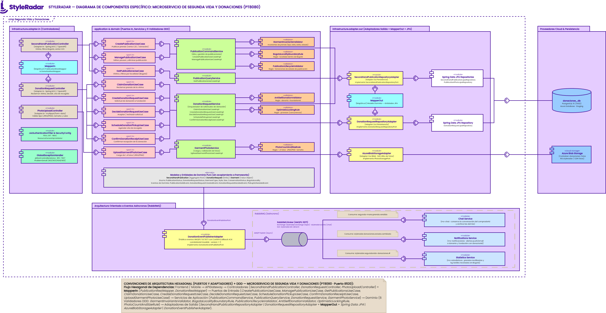
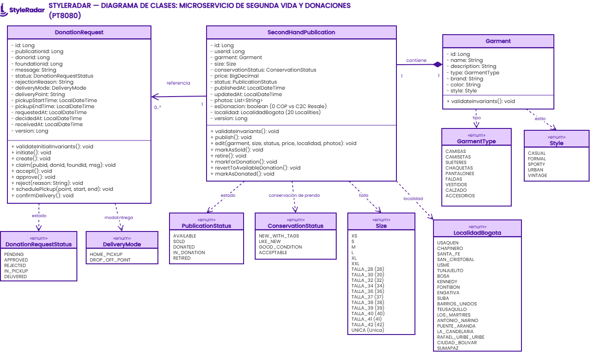

[← Anterior: 2. Equipo y Responsables](./02-equipo-responsables.md) &nbsp;|&nbsp; [Índice Principal](../../README.md) &nbsp;|&nbsp; [Siguiente: 4. Endpoints y Swagger →](./04-endpoints-swagger.md)

# 3. Arquitectura Hexagonal con sus Diagramas

El microservicio implementa **Arquitectura Hexagonal Estricta (Puertos y Adaptadores)** combinada con principios tácticos de **Domain-Driven Design (DDD)**. El núcleo de dominio es 100% puro en Java 21, desacoplado de frameworks web, motores de persistencia o brokers de mensajería. Todos los casos de uso cumplen la convención oficial: **Interfaz de Puerto de Entrada (`domain.port.in.*UseCase`) + Implementación de Aplicación (`application.usecase.*UseCaseImpl`)**.

---

## 3.1 Diagrama de Componentes Hexagonal (`ms-segunda-vida-donaciones`)

Diseñado siguiendo el formato y paleta visual oficial de **StyleRadar** (`#48119A`, `#E5CCFF`), notación **Lollipop (`-(o-`)** para interfaces provistas/requeridas, contenedores UML `«module»` diferenciados por rol y bus asíncrono RabbitMQ:

<div align="center">
  
  <p><sub><b>Figura 3.1:</b> Diagrama de Componentes Específico (Sprint 4) de <code>ms-segunda-vida-donaciones</code> (PT8080 · Puerto 8520). Detalla adaptadores de entrada REST, puertos de entrada/salida, servicios de aplicación, validadores de dominio, adaptadores JPA, Azure Blob Storage Adapter y bus asíncrono RabbitMQ.</sub></p>
  <p>
    📁 <b>Archivo editable Draw.io:</b> <a href="../diagramas/drawio/Diagrama_Componentes_Especifico_Sprint4.drawio"><code>docs/diagramas/drawio/Diagrama_Componentes_Especifico_Sprint4.drawio</code></a>
  </p>
</div>

### Capas y Flujos Arquitectónicos Representados:
1. **Adaptadores de Entrada (`infrastructure.adapter.in`):**
   - `SecondHandPublicationController`: Catálogo unificado C2C y vitrina benéfica en Bogotá D.C.
   - `DonationRequestController`: Reclamo de vitrina, radicación (con `DeliveryProposalDTO` y `donorId` resuelto desde JWT) y coordinación logística de donaciones.
   - `PhotoUploadController`: Endpoint de subida binaria `multipart/form-data` para fotografías de prendas.
   - `MapperIn` (`PublicationRestMapper` & `DonationRestMapper`): Conversión MapStruct entre DTOs REST y comandos de entrada.
   - `JwtAuthenticationFilter & SecurityConfig` + `CorrelationIdFilter` + `GlobalExceptionHandler`: Filtro JWT, propagación/generación de `X-Correlation-Id` y `X-Request-Id` en MDC, control RBAC (`ResourceOwnershipValidator`) y manejo centralizado de errores RFC 7807 (`ProblemDetail` con mensajes sanitizados y `correlationId`).
2. **Casos de Uso & Dominio (`application & domain`):**
   - Puertos de Entrada (`«port in»`): `CreatePublicationUseCase`, `ManagePublicationUseCase`, `GetPublicationsUseCase`, `ClaimDonationUseCase`, `CreateDonationRequestUseCase`, `DecideDonationRequestUseCase`, `ScheduleDonationPickupUseCase`, `ConfirmDonationReceiptUseCase`, `UploadGarmentPhotoUseCase`.
   - Servicios de Aplicación: `PublicationCommandService`, `PublicationQueryService`, `DonationRequestService`, `GarmentPhotoService`.
   - Validadores y Modelos de Dominio (`«validator»` / `«domain»`): `GarmentInvariantsValidator`, `BogotaLocalityBoundaryRule`, `PublicationLifecycleValidator`, `AntiSelfDonationValidator`, `OptimisticLockingRule`, `PhotoCountAndSizeRule` y entidades puras (`SecondHandPublication`, `DonationRequest`, `Garment`).
3. **Adaptadores de Salida (`infrastructure.adapter.out`):**
   - `SecondHandPublicationRepositoryAdapter` & `DonationRequestRepositoryAdapter` + `MapperOut` + `Spring Data JPA Repositories`: Persistencia relacional con PostgreSQL 16.
   - `AzureBlobStorageAdapter`: Subida binaria de imágenes al contenedor `donaciones-fotos` en Azure Blob Storage vía SDK oficial con fallback local en perfiles `local/dev/test`.
4. **Proveedores Cloud & Persistencia:**
   - Base de Datos: `donaciones_db` en PostgreSQL 16 (`:5432`, Azure Database).
   - Cloud Storage: `Azure Blob Storage` (contenedor `donaciones-fotos`, RG `styleradar`).
5. **Arquitectura Orientada a Eventos Asíncronos (RabbitMQ):**
   - `DonationEventPublisherAdapter` publica sobre `styleradar.exchange` (AMQPS TLS `5671`, *Publisher Confirms*) hacia `Chat Service` (`ms-chat`), `Notifications Service` (`ms-notificaciones`) y `Statistics Service` (`ms-estadisticas`).

---

## 3.2 Diagrama de Clases del Dominio y Puertos

Diseñado en inglés técnico alineado con el código fuente en Java 21 (Sprint 4), incorporando `DeliveryMode`, `claim(...)`, `revertToAvailableDonation()`, las 9 categorías de `GarmentType`, las 18 tallas de `Size`, `Style` y las 20 localidades de `LocalidadBogota`:

<div align="center">
  
  <p><sub><b>Figura 3.2:</b> Diagrama de Clases del dominio de <code>ms-segunda-vida-donaciones</code> (Sprint 4).</sub></p>
  <p>
    📁 <b>Archivo editable Draw.io:</b> <a href="../diagramas/drawio/Diagrama_Clases_Sprint4.drawio"><code>docs/diagramas/drawio/Diagrama_Clases_Sprint4.drawio</code></a>
  </p>
</div>

### Componentes del Modelo de Dominio:
* **Entidad Raíz de Agregado `SecondHandPublication`:**
  - Atributos: `id: Long`, `userId: Long`, `garment: Garment`, `size: Size`, `conservationStatus: ConservationStatus`, `price: BigDecimal`, `esDonacion: boolean`, `localidad: LocalidadBogota`, `version: Long (@Version)`, `status: PublicationStatus`, `publishedAt: LocalDateTime`, `updatedAt: LocalDateTime`, `photos: List<String>`.
  - Métodos de Negocio: `validateInvariants()`, `publish()`, `edit(garment, size, status, price, localidad, photos)`, `markAsSold()`, `retire()`, `markForDonation()`, `revertToAvailableDonation()`, `markAsDonated()`.
* **Value Object `Garment`:**
  - Encapsula: `id: Long`, `name: String`, `description: String`, `type: GarmentType`, `brand: String`, `color: String`, `style: Style`.
* **Entidad Raíz de Agregado `DonationRequest`:**
  - Atributos: `id: Long`, `publicationId: Long`, `donorId: Long`, `foundationId: Long`, `message: String`, `status: DonationRequestStatus`, `rejectionReason: String`, `deliveryMode: DeliveryMode`, `deliveryPoint: String`, `pickupStartTime: LocalDateTime`, `pickupEndTime: LocalDateTime`, `version: Long (@Version)`, `requestedAt: LocalDateTime`, `decidedAt: LocalDateTime`, `receivedAt: LocalDateTime`.
  - Métodos de Negocio: `validateInitialInvariants()`, `initiate()`, `create()`, `claim(pubId, donId, foundId, msg)`, `accept()`, `approve()`, `reject(reason)`, `schedulePickup(point, start, end)`, `confirmDelivery()`.
* **Enumeraciones de Dominio:**
  - `LocalidadBogota` *(20 localidades)*: `USAQUEN`, `CHAPINERO`, `SANTA_FE`, `SAN_CRISTOBAL`, `USME`, `TUNJUELITO`, `BOSA`, `KENNEDY`, `FONTIBON`, `ENGATIVA`, `SUBA`, `BARRIOS_UNIDOS`, `TEUSAQUILLO`, `LOS_MARTIRES`, `ANTONIO_NARINO`, `PUENTE_ARANDA`, `LA_CANDELARIA`, `RAFAEL_URIBE_URIBE`, `CIUDAD_BOLIVAR`, `SUMAPAZ`.
  - `ConservationStatus`: `NEW_WITH_TAGS`, `LIKE_NEW`, `GOOD_CONDITION`, `ACCEPTABLE`.
  - `GarmentType` *(9 categorías oficiales)*: `CAMISAS`, `CAMISETAS`, `SUETERES`, `CHAQUETAS`, `PANTALONES`, `FALDAS`, `VESTIDOS`, `CALZADO`, `ACCESORIOS` (con alias retrocompatibles).
  - `Size` *(18 tallas estandarizadas)*: `XS`, `S`, `M`, `L`, `XL`, `XXL`, `TALLA_28` (`28`) .. `TALLA_42` (`42`), `UNICA` (`Unica`).
  - `Style`: `CASUAL`, `FORMAL`, `SPORTY`, `URBAN`, `VINTAGE`.
  - `DeliveryMode`: `HOME_PICKUP`, `DROP_OFF_POINT`.
  - `PublicationStatus`: `AVAILABLE`, `SOLD`, `DONATED`, `IN_DONATION`, `RETIRED`.
  - `DonationRequestStatus`: `PENDING`, `APPROVED`, `REJECTED`, `IN_PICKUP`, `DELIVERED`.

---

## 3.3 Diagrama Entidad-Relación de Base de Datos (PostgreSQL 16)

Refleja el esquema físico consolidado de las migraciones Flyway `V1`–`V5` (catálogo, vitrina y solicitudes) y `V6`–`V8` (`eventos_outbox_donacion` para Outbox transaccional de notificaciones y estadísticas):

<div align="center">
  
  <p><sub><b>Figura 3.3:</b> Modelo físico relacional en PostgreSQL 16 (Sprint 4) con bloqueo optimista (<code>version</code>), discriminador de donación (<code>es_donacion</code>), restricción territorial en Bogotá (<code>localidad</code>) y modalidad de entrega (<code>modo_entrega</code>).</sub></p>
  <p>
    📁 <b>Archivo editable Draw.io:</b> <a href="../diagramas/drawio/Diagrama_BD_ER_Sprint4.drawio"><code>docs/diagramas/drawio/Diagrama_BD_ER_Sprint4.drawio</code></a>
  </p>
</div>

### Tablas del Microservicio:
1. **`publicaciones_segunda_mano`:** Almacena prendas unificadas de C2C y donación (`es_donacion`, `localidad`, `version`, `tipo_prenda` y `talla` migrados en V5).
2. **`fotos_publicacion`:** Galería fotográfica de 1 a 4 fotos alojadas en Azure Blob Storage (`ON DELETE CASCADE`).
3. **`solicitudes_donacion`:** Registro trazable del ciclo logístico benéfico hacia fundaciones aliadas (`modo_entrega`, `punto_entrega`, `franja_inicio`, `franja_fin`, `version`).
4. **`eventos_outbox_donacion`:** Cola transaccional Outbox (`V6`–`V8`) para despacho resiliente e idempotente de eventos hacia `ms-notificaciones` y `ms-estadisticas` (`PROCESSING` + *lease* y reintentos sin duplicados).

---

## 3.4 Estructura Oficial de Paquetes en `src/main/java/`

```text
src/main/java/edu/dosw/styleradar/donaciones/
├── DonationsServiceApplication.java             <-- Punto de entrada Spring Boot 3.3.4
├── domain/                                      <-- NÚCLEO DE DOMINIO PURO (Java estándar, 0 dependencias)
│   ├── model/                                   <-- SecondHandPublication, Garment, DonationRequest, FoundationSummary, Enums
│   ├── event/                                   <-- Eventos de dominio puros (PublicationCreatedEvent, PublicationSoldEvent, etc.)
│   ├── exception/                               <-- DomainException, DomainConflictException, ResourceNotFoundException
│   └── port/
│       ├── in/                                  <-- 10 Interfaces *UseCase y Commands inmutables
│       └── out/                                 <-- PublicationRepositoryPort, DonationRequestRepositoryPort, PhotoStoragePort, DonationEventPublisherPort, FoundationCatalogPort
├── application/                                 <-- CAPA DE APLICACIÓN (Orquestación de Casos de Uso)
│   ├── usecase/                                 <-- 10 Clases *UseCaseImpl (@Service / @Transactional) + TransactionEventHelper
│   └── dto/                                     <-- Request DTOs (incl. DeliveryProposalDTO), Response DTOs y Mappers
└── infrastructure/                              <-- CAPA DE INFRAESTRUCTURA (Tecnologías y Frameworks)
    ├── adapter/
    │   ├── in/
    │   │   ├── rest/                            <-- SecondHandPublicationController, DonationRequestController, PhotoUploadController, AuthController, HealthController + filter.CorrelationIdFilter
    │   │   └── messaging/                       <-- NotificationConsumerSimulator (Consumidor de prueba E2E)
    │   └── out/
    │       ├── external/                        <-- TiendasFoundationCatalogAdapter + TiendasFoundationResponseDTO
    │       ├── persistence/                     <-- PublicationPersistenceAdapter, DonationRequestPersistenceAdapter, JPA Repositories
    │       ├── storage/                         <-- AzureBlobStorageAdapter (Azure Blob Storage SDK con fallback local)
    │       └── messaging/                       <-- DonationEventPublisherAdapter, IntegrationDateFormatter, IntegrationEvents
    ├── security/                                <-- SecurityConfig (CORS + RBAC), JwtAuthenticationFilter, JwtTokenProvider (ms-auth), ResourceOwnershipValidator
    └── config/                                  <-- OpenApiConfig, RabbitMQConfig, TiendasClientConfig, TiendasProperties
```

---

[← Anterior: 2. Equipo y Responsables](./02-equipo-responsables.md) &nbsp;|&nbsp; [Índice Principal](../../README.md) &nbsp;|&nbsp; [Siguiente: 4. Endpoints y Swagger →](./04-endpoints-swagger.md)
