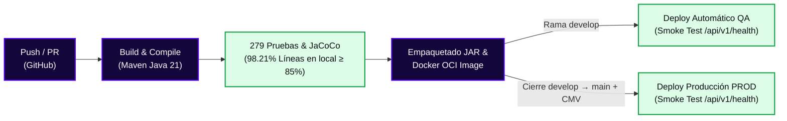

[← Anterior: 9. Pruebas y Cobertura](./09-pruebas-cobertura.md) &nbsp;|&nbsp; [Índice Principal](../../README.md) &nbsp;|&nbsp; [Siguiente: 11. Ramas y Cómo Contribuir →](./11-ramas-contribuir.md)

# 10. CI/CD con el Badge del Pipeline

El ciclo de integración y despliegue continuo está automatizado en **GitHub Actions** siguiendo el flujo **`develop → main`** mediante dos workflows (`.github/workflows/ci-qa.yml` para QA en `develop` y `.github/workflows/cd-prod.yml` para Producción en `main`).

## Matriz de Pipelines por Rama Protegida

| Pipeline | Rama / Entorno | Trigger | Quality Gate Requerido | Ejecución y Estado |
| :--- | :---: | :---: | :--- | :---: |
| **CI - Develop** | `develop` *(Staging QA)* | Push / PR hacia `develop` | **279 pruebas totales en suite** *(278 aprobadas en local sin Docker; último baseline en CI: 277)* + JaCoCo Líneas `≥ 85%` (`98.21%` en local) + Docker Build |  |
| **CI - Main** | `main` *(Producción)* | Push / PR (`develop → main`) | **279 pruebas totales en suite** *(último baseline en CI `main`: 277)* + JaCoCo Líneas `≥ 85%` (`98.21%` en local) + Docker Build |  |
| **CD - Despliegue QA** | Azure QA (`rg-styleradar`) | Push / Merge a `develop` | Deploy Web App + Smoke Test `/api/v1/health` |  |
| **CD - Despliegue PROD** | Azure PROD (`rg-styleradar`) | Push / Merge `develop → main` (CMV) | Aprobación CMV + Smoke Test `/api/v1/health` |  |

> **Nota de flujo:** La rama productiva oficial del equipo es `main` (cierre **`develop → main`**). El workflow `.github/workflows/cd-prod.yml` valida el endpoint `/api/v1/health` tras cada despliegue.

---

[← Anterior: 9. Pruebas y Cobertura](./09-pruebas-cobertura.md) &nbsp;|&nbsp; [Índice Principal](../../README.md) &nbsp;|&nbsp; [Siguiente: 11. Ramas y Cómo Contribuir →](./11-ramas-contribuir.md)
