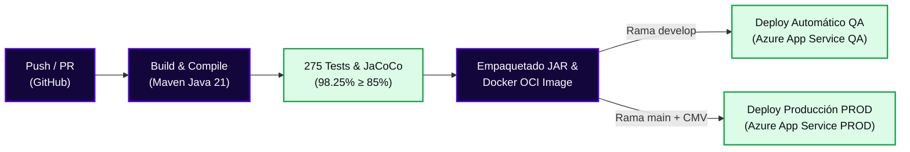

[← Anterior: 9. Pruebas y Cobertura](./09-pruebas-cobertura.md) &nbsp;|&nbsp; [Índice Principal](../../README.md) &nbsp;|&nbsp; [Siguiente: 11. Ramas y Cómo Contribuir →](./11-ramas-contribuir.md)

# 10. CI/CD con el Badge del Pipeline

El ciclo de integración y despliegue continuo está automatizado en **GitHub Actions** mediante dos flujos separados (`.github/workflows/ci-qa.yml` para QA y `.github/workflows/cd-prod.yml` para Producción):

## Matriz de Pipelines por Rama Protegida

| Pipeline | Rama / Entorno | Trigger | Quality Gate Requerido | Estado |
| :--- | :---: | :---: | :--- | :---: |
| **CI - Develop** | `develop` *(Staging QA)* | Push / PR | 275 Tests + JaCoCo ≥ 85% + Docker Build |  |
| **CI - Master** | `master` / `main` *(Producción)* | Push / PR | 275 Tests + JaCoCo ≥ 85% + Docker Build |  |
| **CD - Despliegue QA** | Azure QA (`rg-styleradar`) | Push / Merge a `develop` | Deploy Web App + Smoke Test `/health` |  |
| **CD - Despliegue PROD** | Azure PROD (`rg-styleradar`) | Push / Merge a `master` (CMV) | Aprobación CMV + Smoke Test `/health` |  |

---

[← Anterior: 9. Pruebas y Cobertura](./09-pruebas-cobertura.md) &nbsp;|&nbsp; [Índice Principal](../../README.md) &nbsp;|&nbsp; [Siguiente: 11. Ramas y Cómo Contribuir →](./11-ramas-contribuir.md)
