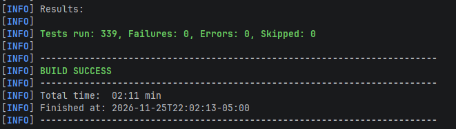
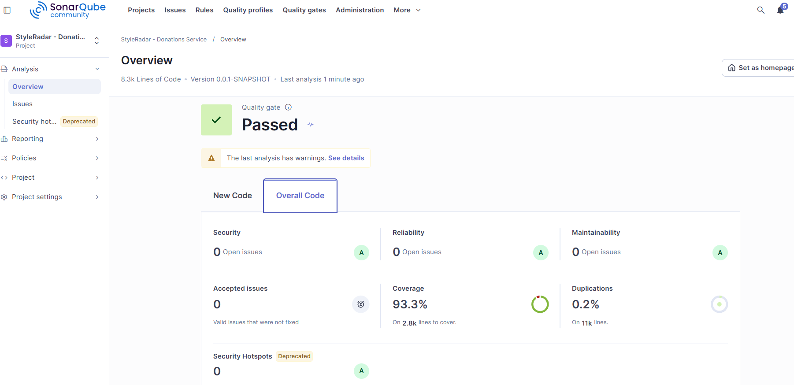

[← Anterior: 7. Variables de Entorno](./07-variables-de-entorno.md) &nbsp;|&nbsp; [Índice Principal](../../README.md) &nbsp;|&nbsp; [Siguiente: 9. CI/CD Pipelines →](./09-cicd-pipeline.md)

# 8. Pruebas y Cobertura (≥ 85% Líneas / ≥ 80% Ramas)

El proyecto exige una cobertura mínima de **líneas del `85.00%`** y de **ramas del `80.00%`** verificadas automáticamente mediante **JaCoCo** durante la fase `verify` (`./mvnw -B clean verify "-Dapi.version=1.44"`).

## Resumen de Métricas de Pruebas y Cobertura (Local vs. CI)

| Métrica | Valor Alcanzado | Origen / Entorno | Umbral Exigido | Respaldo / Enlace de Ejecución |
| :--- | :---: | :--- | :---: | :--- |
| **Suite en GitHub Actions CI (`ci.yml` · PR #25)** | **340 pruebas aprobadas** *(0 fallos, 0 errores, 0 omitidas)* | **Verificado en CI** (`ubuntu-latest` + Docker, run `#45`, commit `b1b21c7`) | `≥ 85.00%` líneas / `≥ 80.00%` ramas + SonarCloud + Docker | [Run CI #45 (`45775635039`)](https://github.com/StyleRadar1/PT8080-Donations-Service/actions/runs/45775635039) · [Run CD QA #47 (`45756632270`)](https://github.com/StyleRadar1/PT8080-Donations-Service/actions/runs/45756632270) |
| **Suite en CD PROD (`main`)** | **277 pruebas aprobadas** *(baseline productivo previo)* | **Verificado en CI `main`** (`ubuntu-latest` + Docker) | `≥ 85.00%` + despliegue PROD | [Run CD PROD `main` (#45525360439)](https://github.com/StyleRadar1/PT8080-Donations-Service/actions/runs/45525360439) |
| **Suite Completa Local (`./mvnw -B clean verify`)** | **340 pruebas aprobadas** *(0 fallos, 0 errores, 0 omitidas)* | **Medición Local** con Docker Testcontainers (PostgreSQL 16) | Suite completa sin fallos | [`339_test_run.png`](../evidencias/339_test_run.png) *(baseline 339)* · [`docs/evidencias/`](../evidencias/) |
| **Cobertura de Líneas (JaCoCo `LINE`)** | **97.47%** (`2769 / 2841`) | **Medición Local** (`target/site/jacoco/jacoco.xml`, 95 clases; gate `>= 85%` también validado en CI) | `≥ 85.00%` *(gate obligatorio)* | [`jacoco-final.png`](../evidencias/jacoco-final.png) · [Run CI #45 (`45775635039`)](https://github.com/StyleRadar1/PT8080-Donations-Service/actions/runs/45775635039) |
| **Cobertura de Instrucciones (JaCoCo `INSTRUCTION`)** | **97.50%** (`12171 / 12483`) | **Medición Local** (`target/site/jacoco/jacoco.xml`, 95 clases) | Referencia (`≥ 85.00%`) | `target/site/jacoco/jacoco.xml` |
| **Cobertura de Ramas (JaCoCo `BRANCH`)** | **88.09%** (`917 / 1041`) | **Medición Local** (`target/site/jacoco/jacoco.xml`, 95 clases; gate `>= 80%` también validado en CI) | `≥ 80.00%` *(gate obligatorio)* | [`jacoco-final.png`](../evidencias/jacoco-final.png) · [Run CI #45 (`45775635039`)](https://github.com/StyleRadar1/PT8080-Donations-Service/actions/runs/45775635039) |
| **Cobertura de Métodos (JaCoCo `METHOD`)** | **95.84%** (`461 / 481`) | **Medición Local** (`target/site/jacoco/jacoco.xml`, 95 clases) | Referencia | `target/site/jacoco/jacoco.xml` |
| **Auditoría SonarQube / SonarCloud** | **CI PR #25: `OK` (0 Issues)** · **Local: Quality Gate Passed (Rating A)** | **CI (`#45`):** `0` Bugs, `0` Vulnerabilidades, `0` Code Smells. **Local:** `0` Issues, `93.3%` cov, `0.2%` dup. | Quality Gate Aprobado | [SonarCloud PR #25](https://sonarcloud.io/summary/new_code?id=StyleRadar1_PT8080-Donations-Service&pullRequest=25) · [`sonarqube-final.png`](../evidencias/sonarqube-final.png) |

---

## Pirámide de Pruebas Implementada

| Nivel de Prueba | Clases de Prueba Representativas | Alcance Verificado |
| :--- | :--- | :--- |
| **Dominio Puro (Unitarias)** | `SecondHandPublicationTest`, `DonationRequestTest`, `LocalidadBogotaTest`, `EnumsAndEventsTest` | Entidades, máquinas de estados, enums (`GarmentType`, `Size`, `Style`, `DeliveryMode`), invariantes de Bogotá y precio. |
| **Casos de Uso (Unitarias Mockito + E2E)** | `DonationCompleteFlowIntegrationTest`, `FoundationDeletedOutboxIntegrationTest`, `DonationDeliveryOutboxIntegrationTest`, `ManagePublicationUseCaseTest`, `CreateDonationRequestUseCaseTest`, `ClaimDonationUseCaseTest`, `GetPartnerFoundationsUseCaseTest`, `ConfirmDonationReceiptUseCaseTest`, `UploadGarmentPhotoUseCaseImplTest` | Los 10 casos de uso (`*UseCaseImpl`), los 7 escenarios del flujo benéfico completo, Outbox transaccional en cancelaciones y entregas (Notificaciones + Estadísticas independientes), concurrencia optimista y subida de imágenes. |
| **Controladores REST (`MockMvc`)** | `SecondHandPublicationControllerTest`, `DonationRequestControllerTest`, `PhotoUploadControllerTest`, `AuthControllerTest`, `HealthControllerTest`, `GlobalExceptionHandlerTest`, `CorrelationIdFilterTest` | Contratos HTTP (`GET /api/v1/donations` por rol incl. `ADMIN`, `deliveryProposal` + `donorId` resuelto por JWT), códigos 200/201/204, RFC 7807 sanitizado (`400`/`404`/`405`/`415`) y cabeceras `X-Correlation-Id` / `X-Request-Id`. |
| **Persistencia, Storage, HTTP y Mensajería** | `SecondHandPublicationPersistenceAdapterTest`, `DonationRequestPersistenceAdapterTest`, `TiendasFoundationCatalogAdapterTest`, `AzureBlobStorageAdapterTest`, `DonationEventPublisherAdapterTest`, `DonationRequestCreatedIntegrationEventTest`, `RabbitMQTlsCertificateTest` | Mapeo JPA, cliente HTTP hacia `ms-tiendas` (separación catálogo público vs canales autenticados + propagación MDC `X-Correlation-Id`), Azure Blob Storage con fallback local y RabbitMQ TLS (`AMQPS 5671`). |
| **Seguridad e Integración RBAC** | `SecurityRbacIntegrationTest`, `AuthQaSecurityIsolationTest`, `JwtTokenProviderTest`, `ResourceOwnershipValidatorTest`, `DemoUserServiceTest` | JWT reales HMAC-SHA256 en `GET /api/v1/donations` (`USER`, `STORE`, `FOUNDATION`, `ADMIN`, `401` sin token, intentos de suplantación y `404`/`503` desde `ms-tiendas`), aislamiento en QA/Prod y mitigación BOLA/IDOR. |

---

## Evidencias del Proyecto ([`docs/evidencias/`](../evidencias/))

📁 **Todas las evidencias de ejecución, pruebas, cobertura, calidad y despliegue se encuentran centralizadas en [`docs/evidencias/`](../evidencias/):**

* **Ejecución Completa de Pruebas (`339` tests, `0` fallos):**

  

* **Reporte de Cobertura JaCoCo Final:**

  

* **Auditoría SonarQube Final (`Quality Gate Passed · 0 Issues`):**

  

---

[← Anterior: 7. Variables de Entorno](./07-variables-de-entorno.md) &nbsp;|&nbsp; [Índice Principal](../../README.md) &nbsp;|&nbsp; [Siguiente: 9. CI/CD Pipelines →](./09-cicd-pipeline.md)
