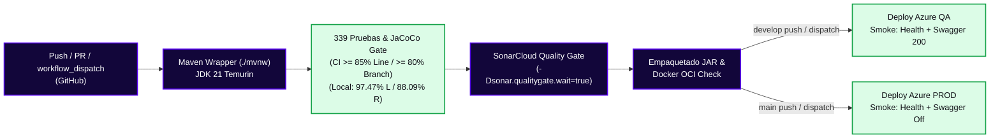

[← Anterior: 8. Pruebas y Cobertura](./08-pruebas-y-cobertura.md) &nbsp;|&nbsp; [Índice Principal](../../README.md) &nbsp;|&nbsp; [Siguiente: 10. Ramas y Cómo Contribuir →](./10-ramas-y-como-contribuir.md)

# 9. CI/CD con el Badge del Pipeline

El ciclo de integración y despliegue continuo está automatizado en **GitHub Actions** mediante tres workflows independientes: `.github/workflows/ci.yml` (revisión de PRs y ramas), `.github/workflows/ci-qa.yml` (despliegue QA en `develop`) y `.github/workflows/cd-prod.yml` (despliegue PROD en `main`).

  
  
  
  

## Matriz de Pipelines por Rama Protegida

| Pipeline | Rama / Entorno | Trigger | Alcance Verificado (CI vs. Local) | Ejecución y Estado |
| :--- | :---: | :--- | :--- | :---: |
| **CI - PR #25 (`ci.yml`)** | `feat/estandarizacion-final-cadche` → `develop` | `push` / `pull_request` / `workflow_dispatch` | **CI (`#45`, `b1b21c7`):** `340` pruebas aprobadas (`0` fallos, `0` omitidas), JaCoCo (`LINE >= 85%`, `BRANCH >= 80%`), **SonarCloud Quality Gate `OK` (`0 Issues`)** y Docker Build OCI. **Local (`jacoco.xml`):** `97.47%` líneas y `88.09%` ramas (`95` clases). |  |
| **CD - Develop (`ci-qa.yml`)** | `develop` *(Staging QA)* | `push` a `develop` o `workflow_dispatch` | **CI (`#47`, `a96994a`):** Build + suite + JaCoCo + despliegue Azure QA + Smoke Test (`/api/v1/health`, `/api/v1/v3/api-docs` y `/api/v1/swagger-ui/index.html`). |  |
| **CD - Main (`cd-prod.yml`)** | `main` *(Producción)* | `push` a `main`/`master` o `workflow_dispatch` | **CI:** `277` pruebas aprobadas en baseline `main` + despliegue Azure PROD + Smoke Test (`/api/v1/health` UP + verificación de Swagger deshabilitado en `401`/`403`/`404`). |  |
| **CD - Salud en Vivo QA / PROD** | Azure App Service (`rg-styleradar`) | Post-despliegue automático | **QA:** `/api/v1/health` + Swagger habilitados. **PROD:** `/api/v1/health` activo; Swagger restringido (`springdoc.*.enabled=false`, HTTP `401`/`403`/`404`). |   |

> **Nota sobre SonarQube/SonarCloud en CI:** Los tres workflows exigen `SONAR_TOKEN` configurado en GitHub Repository Secrets (org `styleradar1`, projectKey `StyleRadar1_PT8080-Donations-Service` en `https://sonarcloud.io`), fallando explícitamente en ramas oficiales (`develop`, `main`, `master`) y PRs internos si el secreto falta, sin omisiones silenciosas. En el run `#45` de `ci.yml`, SonarCloud se ejecutó en CI aprobando el Quality Gate con `0` bugs, `0` vulnerabilidades y `0` code smells.

### Detalle de los Workflows Configurados

| Workflow | Trigger | Validaciones Automatizadas |
| :--- | :--- | :--- |
| **CI PR (`ci.yml`)** | `push` y `pull_request` hacia `main`, `master`, `develop` + `workflow_dispatch` | `./mvnw -B clean verify`, JaCoCo (`LINE >= 85%` y `BRANCH >= 80%`), Quality Gate SonarCloud obligatorio (`SONAR_TOKEN` requerido) y validación de build Docker (`docker/build-push-action`). |
| **CD QA (`ci-qa.yml`)** | `push` a `develop` y `workflow_dispatch` en `develop` | Verificación Maven Wrapper, Quality Gate Sonar obligatorio, empaquetado JAR, despliegue Azure QA (`push` y `workflow_dispatch`) y Smoke Test validando `status=UP`, `commitSha`, `/api/v1/v3/api-docs` (`200`) y `/api/v1/swagger-ui/index.html` (`200`). |
| **CD PROD (`cd-prod.yml`)** | `push` a `main`/`master` y `workflow_dispatch` | Verificación Maven Wrapper, Quality Gate Sonar obligatorio, aprobación productiva, despliegue Azure PROD y Smoke Test validando `status=UP`, `commitSha` y Swagger deshabilitado (`401`/`403`/`404` por `OWASP A05`). |

### Evidencia del Pipeline en GitHub Actions

  
  
<b>Figura 9.1:</b> Ejecución exitosa en GitHub Actions del pipeline CI/CD sobre <code>develop</code> (Run <code>#47</code> / <code>45756632270</code>, <code>6m 39s</code>, Build + Tests + Cobertura + Despliegue verificado en Azure QA). El último run de PR con SonarCloud Gate aprobado (<code>ci.yml</code> <code>#45</code>) corresponde a <a href="https://github.com/StyleRadar1/PT8080-Donations-Service/actions/runs/45775635039"><code>45775635039</code></a>.

---

[← Anterior: 8. Pruebas y Cobertura](./08-pruebas-y-cobertura.md) &nbsp;|&nbsp; [Índice Principal](../../README.md) &nbsp;|&nbsp; [Siguiente: 10. Ramas y Cómo Contribuir →](./10-ramas-y-como-contribuir.md)
