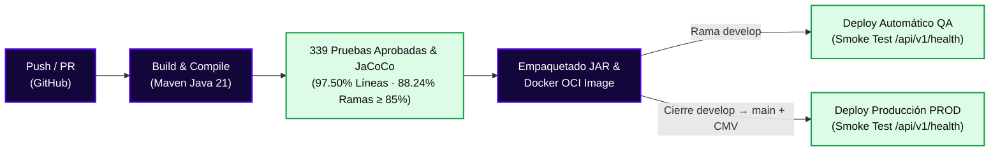
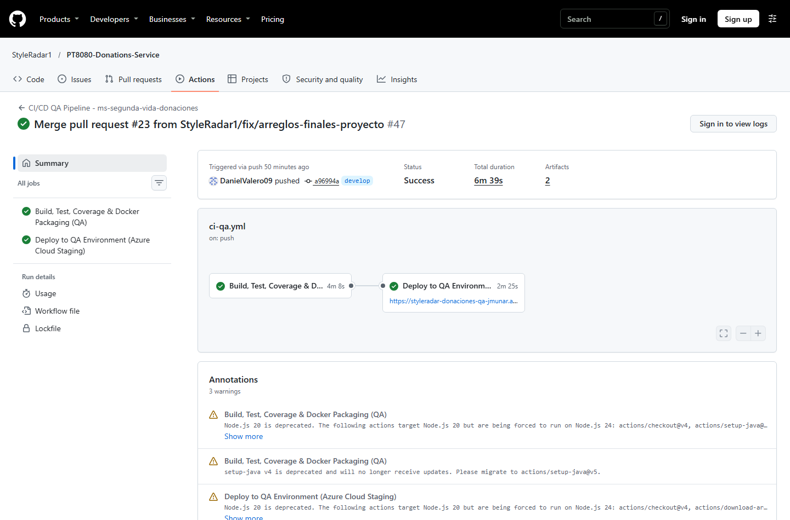

[← Anterior: 8. Pruebas y Cobertura](./08-pruebas-y-cobertura.md) &nbsp;|&nbsp; [Índice Principal](../../README.md) &nbsp;|&nbsp; [Siguiente: 10. Ramas y Cómo Contribuir →](./10-ramas-y-como-contribuir.md)

# 9. CI/CD con el Badge del Pipeline

El ciclo de integración y despliegue continuo está automatizado en **GitHub Actions** siguiendo el flujo **`develop → main`** mediante dos workflows (`.github/workflows/ci-qa.yml` para QA en `develop` y `.github/workflows/cd-prod.yml` para Producción en `main`).

## Matriz de Pipelines por Rama Protegida

| Pipeline | Rama / Entorno | Trigger | Quality Gate Requerido | Ejecución y Estado |
| :--- | :---: | :---: | :--- | :---: |
| **CI - PR #22 (`fix/auditoria-integral`)** | `fix/auditoria-integral` → `develop` | Merge PR #22 (`5f896e9`) | **Build, pruebas con Docker y JaCoCo aprobados en CI** (rama actual: **339 pruebas aprobadas**, `97.50%` Líneas / `88.24%` Ramas JaCoCo) |  |
| **CI - Develop** | `develop` *(Staging QA)* | Push / PR hacia `develop` | **339 pruebas aprobadas** *(0 fallos, 0 omitidas con Docker)* + JaCoCo `97.50%` Líneas / `88.24%` Ramas (`≥ 85%`) + Deploy QA `4a2cbec` verificado |  |
| **CI - Main** | `main` *(Producción)* | Push / PR (`develop → main`) | **339 pruebas aprobadas** *(baseline `main` en CI con Docker: 277)* + JaCoCo `97.50%` Líneas / `88.24%` Ramas (`≥ 85%`) + Docker Build |  |
| **CD - Despliegue QA** | Azure QA (`rg-styleradar`) | Push / Merge a `develop` | Deploy Web App + Smoke Test `/api/v1/health` |  |
| **CD - Despliegue PROD** | Azure PROD (`rg-styleradar`) | Push / Merge `develop → main` (CMV) | Aprobación CMV + Smoke Test `/api/v1/health` |  |

> **Nota de flujo:** La rama productiva oficial del equipo es `main` (cierre **`develop → main`**). El workflow `.github/workflows/cd-prod.yml` valida el endpoint `/api/v1/health` tras cada despliegue.

### Pipelines Homologados y Compuertas Automáticas

| Workflow | Trigger | Validaciones Automatizadas |
| :--- | :--- | :--- |
| **CI PR (`ci.yml`)** | `push` y `pull_request` hacia `main`, `master`, `develop` | `./mvnw -B clean verify`, JaCoCo (`LINE >= 85%` y `BRANCH >= 80%`), Quality Gate SonarQube/SonarCloud (`-Dsonar.qualitygate.wait=true`) y validación de build Docker. |
| **CD QA (`ci-qa.yml`)** | `push` a `develop` / `workflow_dispatch` | Verificación Maven Wrapper, Quality Gate Sonar, empaquetado JAR, despliegue a Azure QA y Smoke Test en vivo validando `status=UP`, `commitSha`, `/api/v1/v3/api-docs` (`200`) y `/api/v1/swagger-ui/index.html` (`200`). |
| **CD PROD (`cd-prod.yml`)** | `push` a `main`/`master` / `workflow_dispatch` | Verificación Maven Wrapper, Quality Gate Sonar, aprobación productiva, despliegue Azure PROD y Smoke Test validando `status=UP`, `commitSha`, `/api/v1/v3/api-docs` (`200`) y `/api/v1/swagger-ui/index.html` (`200`). |

### Evidencia del Pipeline en GitHub Actions

  
  
<b>Figura 9.1:</b> Ejecución exitosa en GitHub Actions del pipeline CI/CD sobre <code>develop</code> (<code>6m 39s</code>, Build + Tests + Cobertura + Despliegue verificado en Azure QA).

---

[← Anterior: 8. Pruebas y Cobertura](./08-pruebas-y-cobertura.md) &nbsp;|&nbsp; [Índice Principal](../../README.md) &nbsp;|&nbsp; [Siguiente: 10. Ramas y Cómo Contribuir →](./10-ramas-y-como-contribuir.md)
