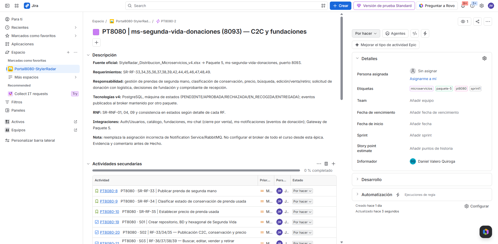

[← Anterior: 11. Seguridad y OWASP Top 10](./11-seguridad-y-owasp.md) &nbsp;|&nbsp; [Índice Principal](../../README.md)

---

## 12. EQUIPO, RESPONSABLES Y ENLACE A LA ÉPICA EN JIRA

### Equipo y Responsables del Microservicio

Desarrollado y mantenido por el **Squad Portal 8080 (`PT8080`)** para la asignatura DOSW 2026:

  

| Rol | Nombre Completo | Usuario GitHub |
| :---: | :---: | :---: |
| **Líder de Equipo (Scrum Master)** | Daniel Valero Quiroga | [@DanielValeroQ](https://github.com/DanielValeroQ) |
| **Desarrollador Backend (`ms-segunda-vida-donaciones`)** | Juan David Munar | [@JuanDavidMunar](https://github.com/JuanDavidMunar) |
| **Desarrollador Backend** | Jose Alejandro Martinez Arias | [@JoseMartinez883](https://github.com/JoseMartinez883) |
| **Desarrollador Frontend** | Kevin Ángel | [@StyleRadar1](https://github.com/StyleRadar1) |

---

### Enlaces de Gestión, Repositorios y Evidencias

* **Repositorio Oficial en GitHub:** [https://github.com/StyleRadar1/PT8080-Donations-Service](https://github.com/StyleRadar1/PT8080-Donations-Service)
* **Épica Oficial del Microservicio (Jira):** [https://mail-team-nyjtgqcj.atlassian.net/browse/PT8080-2](https://mail-team-nyjtgqcj.atlassian.net/browse/PT8080-2)
* **Tablero Scrum del Squad Portal 8080 (Jira):** [https://mail-team-nyjtgqcj.atlassian.net/jira/software/projects/PT8080/boards/74](https://mail-team-nyjtgqcj.atlassian.net/jira/software/projects/PT8080/boards/74)
* **Contenedor OCI Oficial (Docker Hub):** [https://hub.docker.com/r/judamuch09/pt8080-donations-service-ms-segunda-vida-donaciones](https://hub.docker.com/r/judamuch09/pt8080-donations-service-ms-segunda-vida-donaciones)

  
  
<b>Figura 12.1:</b> Épica oficial <code>PT8080-2</code> en Atlassian Jira para <code>ms-segunda-vida-donaciones</code> (puerto <code>8520</code>).

---

## Matriz de los 12 Requerimientos Funcionales (v4 Oficial)

> **Consolidación oficial Paquete 5 (v4):** `SR-RF-33` absorbe a `SR-RF-34` (estado de conservación) y `SR-RF-35` (precio), y `SR-RF-45` absorbe a `SR-RF-44` (selección de fundación) y `SR-RF-48` (propuesta de entrega). Los códigos provisionales previos `SR-P5-N04` y `SR-P5-N05` quedan unificados como **`SR-RF-110`** y **`SR-RF-111`** en la matriz v4.

| Código RF | Nombre del Requerimiento | Implementación en `ms-segunda-vida-donaciones` | Estado |
| :---: | :--- | :--- | :---: |
| `SR-RF-33` | Publicar prenda para venta de segunda mano o donación | `POST /api/v1/second-hand/publications` y `POST /api/v1/second-hand/photos`: categorías (9 + alias `UPPER`..`ACCESSORY`), tallas (18), marca, color, estilo, localidad Bogotá, `ConservationStatus`, precio (>0 venta / 0 donación), descripción `@NotBlank` y hasta 4 fotos (≤ 5 MB) en Azure Blob Storage. *(Absorbe `SR-RF-34` y `SR-RF-35`)*. | ✅ Completado |
| `SR-RF-36` | Explorar y buscar prendas del catálogo general de Segunda Vida | `GET /api/v1/second-hand/publications` y `/{id}` (`GetPublicationsUseCaseImpl` + `PublicationSpecifications`): estado `AVAILABLE` por defecto, filtros por `?search=` / `?searchTerm=`, categoría, color, talla, conservación, rango `minPrice`/`maxPrice` validado, marca, estilo, `esDonacion` y localidad. | ✅ Completado |
| `SR-RF-110` | Consultar y gestionar el listado de publicaciones propias | `GET /api/v1/second-hand/publications/users/{userId}` con validación JWT y control de propiedad (`ResourceOwnershipValidator`, retorna todos los estados propios). *(Antes provisional `SR-P5-N04`)*. | ✅ Completado |
| `SR-RF-37` | Editar publicación de segunda mano | `PUT /api/v1/second-hand/publications/{id}` (`ManagePublicationUseCaseImpl.edit`) restringido a propietario/ADMIN en estado `AVAILABLE` (bloquea `SOLD`, `RETIRED`, `IN_DONATION`, `DONATED`), descripción `@NotBlank` y preservación de `localidad` cuando se omite. | ✅ Completado |
| `SR-RF-38` | Marcar prenda de segunda mano como vendida | `PATCH /api/v1/second-hand/publications/{id}/sale?userId={userId}&compradorId={compradorId}` (`ManagePublicationUseCaseImpl.markAsSold`), con ambos parámetros de consulta obligatorios (`userId` y `compradorId`), rechazo HTTP `400` si el cliente envía `interesadosIds` arbitrarios y eventos RabbitMQ homologados hacia `ms-chat` y `ms-notificaciones`. | ✅ Completado |
| `SR-RF-39` | Retirar publicación de segunda mano | `DELETE /api/v1/second-hand/publications/{id}` (`ManagePublicationUseCaseImpl.retire`), retorno `204 No Content`, bloqueando `SOLD`, `IN_DONATION` y `DONATED`. | ✅ Completado |
| `SR-RF-42` | Convertir una publicación existente de venta en donación | `PATCH /api/v1/second-hand/publications/{id}/donation` (`ManagePublicationUseCaseImpl.markForDonation`) fijando atómicamente `esDonacion=true`, `price=0` y `status=IN_DONATION`. | ✅ Completado |
| `SR-RF-45` | Crear solicitud de donación con fundación y propuesta de entrega | `POST /api/v1/donations` (`CreateDonationRequestUseCaseImpl`) + `GET /api/v1/donations/foundations*`: obtiene `donorId` exclusivamente desde el token JWT, acepta objeto `deliveryProposal` (`deliveryMode`/`mode`, `deliveryPoint`/`point`, `startTime`, `endTime`) o campos planos, valida fundación activa en `ms-tiendas` y publica evento con `representanteId` (`fundacionUsuarioId`). *(Absorbe `SR-RF-44` y `SR-RF-48`)*. | ✅ Completado |
| `SR-RF-111` | Reclamar prenda disponible desde la Vitrina Abierta por una fundación | `POST /api/v1/donations/claims` (`ClaimDonationUseCaseImpl`) con bloqueo optimista (`@Version`, `409 Conflict` ante concurrencia), prevención de auto-donación y validación `ms-tiendas`. *(Antes provisional `SR-P5-N05`)*. | ✅ Completado |
| `SR-RF-46` | Consultar solicitudes de donación | `GET /api/v1/donations`, `/{id}` (con validación BOLA/IDOR), `/donors/{donorId}`, `/foundations/{foundationId}/requests` y `/foundations/representative`. | ✅ Completado |
| `SR-RF-47` | Aceptar o rechazar solicitud de donación | `PATCH /api/v1/donations/{id}/decision` (`DecideDonationRequestUseCaseImpl`) con motivo obligatorio al rechazar y retorno automático de la prenda a `AVAILABLE`. | ✅ Completado |
| `SR-RF-49` | Confirmar recepción de donación | `PATCH /api/v1/donations/{id}/confirmation` (`ConfirmDonationReceiptUseCaseImpl`) transicionando solicitud a `DELIVERED`, prenda a `DONATED` y emitiendo comprobante `SR-DON-XXXX`. | ✅ Completado |

> **Nota de flujo logístico (`SR-RF-45` / `SR-RF-111`):** El servicio conserva `PATCH /api/v1/donations/{id}/pickup` como transición técnica logística auxiliar (`APPROVED` → `IN_PICKUP`) para agendar franja futura y punto de entrega con evento `CITA_PROGRAMADA` antes de `PATCH /api/v1/donations/{id}/confirmation` (`SR-RF-49`).

---

## Matriz de Requerimientos No Funcionales Aplicables (`SR-RNF` v1)

| Código RNF | Requerimiento | Controles implementados en `ms-segunda-vida-donaciones` |
| :---: | :--- | :--- |
| `SR-RNF-01` | Autenticación segura | JWT HMAC-SHA256 stateless (`JwtAuthenticationFilter` + `JwtTokenProvider`) y RBAC por rol (`USER`, `STORE`, `FOUNDATION`, `ADMIN`) con respuestas `401`/`403` RFC 7807 (`code`, `type` v8, `errors[]`). |
| `SR-RNF-02` | Protección de datos personales | Validación BOLA/IDOR (`ResourceOwnershipValidator`), credenciales por variables de entorno, PostgreSQL `sslmode=require`, AMQPS TLS `5671` con `verify-hostname=true` y `show-details: never` en PROD. |
| `SR-RNF-03` | Disponibilidad mínima (≥ 95%) | Despliegue en Azure App Service (`qa`/`prod`), endpoint `/api/v1/health` y pools HikariCP con validación de conexión. |
| `SR-RNF-04` | Tiempo máximo de búsquedas (≤ 3 s) | Índices PostgreSQL (`idx_pub_estado`, `idx_pub_tipo`, `idx_pub_es_donacion`, `idx_pub_localidad`, `idx_pub_donacion_vitrina`) y consultas dinámicas JPA `Specification`. |
| `SR-RNF-08` | Capacidad de ≥ 500 usuarios simultáneos | Arquitectura stateless sin sesión en memoria, `maximum-pool-size: 30` en PROD y bloqueo optimista (`@Version`) ante contención. |
| `SR-RNF-09` | Consistencia del inventario publicado | Transacciones ACID (`@Transactional`), catálogo público filtrado por defecto a `AVAILABLE` y transición atómica de estados (`SOLD`, `RETIRED`, `IN_DONATION`, `DONATED`). |
| `SR-RNF-15` | Resiliencia e idempotencia en mensajería | *Publisher Confirms* (`correlated`), *Publisher Returns* (`mandatory=true`), Outbox Transaccional (`eventos_outbox_donacion`) y `eventoId`/`eventId` único idempotente. |

---

[← Anterior: 11. Seguridad y OWASP Top 10](./11-seguridad-y-owasp.md) &nbsp;|&nbsp; [Índice Principal](../../README.md)
